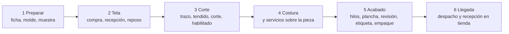
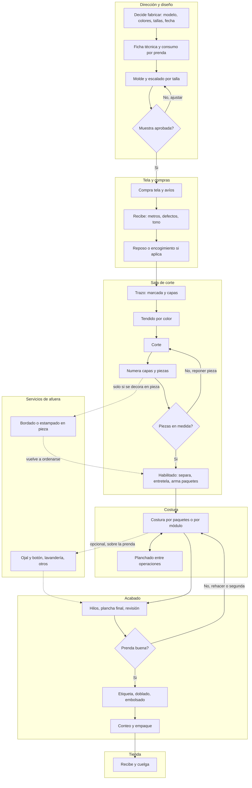

# 01 · El mapa del proceso: de «hay que fabricar» a «está colgada en la tienda»

**Frente 1 · 2026-10-16 · solo lectura.** Nada de esto diseña pantallas ni tablas; cada hallazgo termina en una línea de implicación.
**Niveles de evidencia:** **A** medido por mí en la base o el repo · **B** fuente primaria citable (tesis, documento oficial, artículo con revisión, texto de curso) · **C** fuente secundaria (blog, ficha comercial, gremio) · **D** lo dijo Felipe y está escrito en el repo · **E** inferencia mía (dicha como tal). Todas las fuentes se consultaron el 2026-10-16.

## Resumen (para leer en dos minutos)

1. **Todo lo que se sabe del oficio sale de plantas más grandes que el Taller.** Las únicas fuentes peruanas que describen el paso a paso son tesis de ingeniería sobre una planta de abrigos en Arequipa (~1.300 prendas al mes), un exportador de polos de 995 personas y una fábrica de camisas de 13 operarios en Chiclayo (la más parecida al Taller). Ninguna es un taller de 5 personas.
2. **La espina Corte · Costura · Acabado aguanta.** Las tres plantas y el catálogo oficial del Ministerio de Educación la usan. Lo que se ve distinto es *lo de adentro*: el habilitado, la revisión de calidad y el planchado no caben limpios en una sola caja.
3. **«Habilitado» significa al menos tres cosas** (cierre de la sala de corte, puestos de preparación dentro de la línea de costura, y preparación final antes del despacho) y además es un **puesto de trabajo** (el habilitador). Esto afecta a la lista de fases y al vocabulario de pantalla.
4. **En el taller de 13 personas una sola persona traza, tiende y corta** (con una habilitadora que ayuda a tender): confirma «misma persona» para el trazo y el tendido, pero el habilitado tiene su propio puesto.
5. **La calidad se revisa en varios momentos** (muestreo en corte, en línea en costura, 100 % en acabado), con un puesto que decide «se rehace o se descarta». «Solo avanzan las buenas» necesita saber *quién* dice que una prenda es buena.
6. **El planchado también ocurre en medio de la costura** en tejido plano (camisas, abrigos). **Las prendas de marca CAYLA parecen todas de tejido plano** (A para los números; E para la clasificación, porque la base no distingue plano de punto y me baso en el nombre del tejido): ese rasgo importa para CAYLA y no para un polo de punto.
7. **Un servicio que se compra en tejido plano es el ojal y botón**, y ADR-0400 no lo nombra entre sus fases opcionales (Bordado, Estampado, Lavandería). En la fábrica de camisas de 13 personas sale el 100 % de la producción a ese servicio, con un día de ida y vuelta.
8. **Tercerizar «de capacidad» (en los picos) es el modo dominante** en una encuesta de 2007 a empresas de Lima, y lo que se manda es **la prenda completa**, no una fase: esto matiza la decisión de «una fase entera, un solo quién».
9. **Del 95 % «trabaja por bultos» no hay fuente.** Sí hay un 80 % (fábricas de EE. UU., 1993) y una encuesta limeña de 2007 donde los sistemas modulares no están lejos de la producción en serie.
10. **Lo que de verdad falta es lo que solo el Taller sabe**: quién hace qué, qué se anota hoy, cuánto se corta de más, cuántas pruebas se hacen. Está en las preguntas del final.

## 1 · Un hecho local que condiciona todo el mapa (A)

Base de producción (`cayla-dynamic`, schema `retail`, solo `SELECT`, 2026-10-16), modelos con al menos una variante activa y sin marca de prueba:

| Grupo | Modelos | Colores por modelo (mediana · máx.) | Tallas por modelo (mediana · máx.) | Variantes por modelo (mediana · máx.) | Modelos de una sola talla |
|---|---|---|---|---|---|
| Marca CAYLA | 25 | 3 · 16 | 3 · 4 | 6 · 21 | 9 |
| Otras marcas | 223 | 3 · 17 | 1 · 5 | 5 · 33 | 147 |
| Sin marca | 89 | 2 · 25 | 1 · 4 | 2 · 25 | 81 |

Los 25 modelos de marca CAYLA son camisas y blusas (popelina, oxford, satín, aterciopelada, mezcla de algodón), pantalones y shorts de lino u oxford, chalecos, blazers, faldas y vestidos. **No hay una categoría de polos ni de prendas de punto** (A). Por el nombre del tejido, todo parece **tejido plano**, pero la base no tiene un campo «plano o punto»: esa lectura es inferencia mía (E). (Aparecen además un anillo y una bolsa, que no son confección.) Confianza: alta en los números, media en la clasificación. Implicación: el mapa de abajo usa como referencia plantas de tejido plano (camisas, abrigos); los datos de punto (reposo de 12 a 48 horas, relajado de tubular) están marcados «punto».

## 2 · El mapa en tres niveles

Leyenda: línea continua = camino normal; línea punteada = paso opcional. Los nombres de las cajas están en lenguaje de tienda; los nombres de oficio van en las tablas.

### Nivel 1 · seis cajas

### Nivel 2 · doce cajas

### Nivel 3 · carriles (quién hace qué y dónde se rompe)

## 3 · Tabla etapa × entrada, salida, quién, papel, control, error clásico, dato

Las letras entre corchetes son el nivel de evidencia; el detalle de cada fuente está en «Hallazgos» y en «Fuentes». «Quién» se lee para tres tamaños: **~5 personas · ~10-13 · ~30 o más**; donde no hay fuente el tamaño pequeño es inferencia mía **[E]**.

| Etapa | Entrada | Salida | Quién (5 · 10-13 · 30+) | Papel o registro | Control | Error clásico | Dato que nace |
|---|---|---|---|---|---|---|---|
| 1 Decidir y abrir | Señal de reposición o novedad (otro frente) | Pedido con modelo, colores, tallas, fecha | 5-13: dueña o encargada [E] · 30+: oficina de planeamiento [B PUCP 2014] | Pedido; orden de corte y orden de habilitado, que salen de planeamiento [B] | Confirmar capacidad y tela antes de aceptar [E] | Aceptar sin medir la capacidad y entregar tarde [B, 5 pymes, PUCP 2013] | Qué, cuánto, para cuándo, quién decidió |
| 2 Ficha técnica y consumo | Diseño, tela elegida | Ficha con medidas, avíos y consumo de tela por prenda | 5: la misma dueña [E] · 13+: diseñadora y patronista [B UCSM] | Ficha técnica, hoja de costos con consumo en metros [B UCSM]; hoja de especificaciones con tolerancia de ±¼ de pulgada [B PUCP 2014] | La diseñadora aprueba los moldes [B UCSM] | Ficha incompleta: el operario decide «a ojo» [B USAT] | Consumo teórico por prenda; medidas y tolerancias |
| 3 Molde y escalado | Ficha | Moldes por talla (plotter o cartón) | Patronista (en CAYLA, con Audaces según R-26 [D]) | Moldes con piquetes [B UCSM] | Aprobación de moldes por la diseñadora [B UCSM] | Confusión de moldes sobre la mesa: genera merma [B USAT] | Tallas del modelo; versión del molde |
| 4 Muestra y aprobación | Ficha, moldes, tela | Muestra aprobada o ajustes | Taller propio arma; dueña aprueba [E] | Prenda física. Etapas que nombra la literatura: prototipo, ajuste, juego de tallas, vendedor, producción (PP), primera de línea (TOP) [B e-PG; C WaveLPM] | Medidas contra ficha; la PP con tela y avíos de producción [C] | Cortar el lote sin PP aprobada y parar a mitad [C] | Veredicto con quién y cuándo; qué se corrigió [C] |
| 5 Compra de tela y avíos | Pedido y consumo | Pedido al proveedor (metros) | Encargada o dueña; almacén recibe [B USAT] | Pedido; en la fábrica de camisas, entrega en 3 días desde Lima y compra urgente local más cara [B USAT] | Comparar lo requerido con consumo más merma [E] | Quedarse corto y comprar urgente a mayor costo [B USAT] | Metros, ancho, color, lote de tinte, proveedor |
| 6 Recepción y reposo de la tela | Rollos | Tela revisada y registrada | Encargado de almacén verifica y registra metros [B USAT] | Registro de ingreso; requisición de tela a corte [C OCS] | Metros y defectos (sistema de 4 puntos [C]); banda de tono [C]; reposo y encogimiento: «no está estandarizado» [B PUCP 2014] | Tono distinto entre rollos: 16 % de las fallas de corte medidas [B PUCP 2014]; mancha o hueco | Metros recibidos, defectos, tono, % de encogimiento |
| 7 Trazo (marcada) | Moldes, ancho útil, cantidades por talla y color | Marcada, número de capas y consumo teórico | 13: el mismo cortador [B USAT] · planta: operario que calcula capas [B UCSM] · 30+: planeamiento entrega el tizado [B PUCP 2014] | Marcada impresa o a mano; plan de marcadas [C OCS] | Consumo real contra planeado [C OCS] | Tizar sin aprovechar espacios y confundir moldes: 4,7 % de la tela perdida en un año [B USAT] | Longitud de marcada, capas, consumo teórico |
| 8 Tendido | Tela revisada, marcada | Tendido por color, capas alineadas | 13: cortador con la habilitadora [B USAT] · planta: 2 operarios [B UCSM] | Reporte de tendido [C OCS] | Cara y bordes de la tela; el área de corte marca el número de paños como factor crítico [B PUCP 2014] | Errores de tendido y demasiados paños: piezas disparejas [B PUCP 2014] | Capas, metros usados, empalmes, defectos marcados |
| 9 Corte | Tendido y marcada | Piezas por talla y color | 1 cortador [B USAT, UCSM] | Orden de corte [B PUCP 2014] | Muestreo por norma ISO 2859 (AQL 1,5 %) y medidas ±¼ pulgada [B PUCP 2014] | Asimetría y medidas: 66 % de 347 fallas en 4 meses [B PUCP 2014] | Piezas cortadas, falladas y motivo |
| 10 Habilitado | Piezas cortadas | Paquetes numerados y completos; entretela fusionada si aplica | 13: habilitadora, puesto propio [B USAT] · 5: quien corta [E] · 30+: área de habilitado [B PUCP 2014] | Orden de habilitado [B PUCP 2014]; etiqueta con talla, color y cantidad [C OCS]; etiquetado por número de pieza y lote [B UCSM] | Verificar piquetes y medidas [B UCSM]; conteo | Mezclar lotes o tonos; piezas que faltan y se reponen | Paquete (número, cantidad por talla y color); piezas de reposición pedidas |
| 11 Bordado o estampado en pieza | Piezas numeradas | Piezas decoradas que vuelven a corte para ordenarse | Servicio de afuera | Nota o guía de envío (formato sin dato) | Revisión de talla y diseño al volver [C OCS] | Mezcla de piezas sin numeración [C OCS] | Piezas salidas y vueltas por talla y color |
| 12 Costura | Paquetes | Prendas armadas | 13: 10 costureras [B USAT] · modular: equipo de 5 a 17 [B JTATM] · planta: línea por operaciones | Instructivo de confección [B USAT]; etiqueta de paquete; cupón de destajo (sin dato en Perú) | Inspección en línea y muestreo [B PUCP 2014, e-PG] | Pliegue, hilo sucio, puntada saltada: reproceso de unos 10 min por camisa [B USAT] | Prendas cosidas; reprocesos con motivo |
| 13 Servicios sobre la prenda | Prendas cosidas | Prendas con ojal y botón, lavadas, decoradas | Servicio de afuera | Sin dato | Conteo al volver | Demora; el servicio no deja control permanente de calidad [B UNMSM 2007] | Salida y vuelta; días afuera |
| 14 Acabado y revisión | Prendas cosidas y vueltas | Prendas buenas, segundas, por rehacer | 13: una persona [B USAT] · 30+: varias áreas [B UCSM] | Hoja de auditoría [B PUCP 2014]; control de medidas, 22 min por abrigo [B UCSM] | 100 % visual en acabado [B PUCP 2014]; detector de metales solo en exportación | Defecto que se ve tarde y se rehace; cuello de botella en botones manuales [B UCSM] | Buenas, segundas y descartes con motivo |
| 15 Empaque y conteo | Prendas buenas | Prendas etiquetadas, dobladas, embolsadas | Acabado [B MINEDU] | Conteo de empacadas contra faltantes [C OCS] | Conteo y revisión al azar [B e-PG] | Etiqueta equivocada; conteo que no cuadra | Unidades empacadas por talla y color |
| 16 Despacho y recepción en tienda | Prendas empacadas | Prendas en la tienda | El Taller envía; la tienda recibe | Guía de traslado (otro frente) | Conteo en recepción | Diferencia entre enviado y recibido | Enviadas, recibidas, fecha de llegada |

### Tiempo típico y su variabilidad (lo poco que hay medido)

| Dato | Valor | Evidencia |
|---|---|---|
| Un abrigo forrado (tejido plano, planta mediana), minutos estándar por prenda | Corte 71 · costura 125 · acabado 139 = 334 (21 % · 37 % · 42 %); suplementos de 21 % en corte y 23 % en costura y acabado | B · tesis UCSM 2021, p. 63 |
| De ese corte de 71 min por abrigo | Tender: 3,2 (dos operarios); cortar: 3,0 más 2,6 y 1,8 de forro y entretela; fusionar y igualar: 37; habilitar y empaquetar piezas: 11 | B · UCSM, tabla 9 |
| Revisión de medidas en acabado | 22 min por abrigo, dentro de los 139 | B · UCSM |
| Lote de camisas (tamaño del lote no declarado), minutos por lote | Tizado 20 · tendido 45 · corte 35 (la sala de corte son ~100) · costura 720 · **ida y vuelta de ojal y botón 1.440 (un día)** · planchado 355 · doblado 51 · embolsado 20; total 2.773 | B · tesis USAT 2023, anexo 1 |
| Variación observada en 10 días de toma de tiempos | Tizado 19,5 a 23,4 · tendido 40,4 a 45,4 · planchado 352 a 362 | B · USAT, anexo 1 |
| Reposo de tela de punto antes de cortar | De «unas horas» a «de un día para otro» (OCS); de 12 a 48 horas (fabricantes de máquinas, con interés comercial) | C · solo punto |
| Etapa de preparación antes del primer corte | 4 a 8 semanas en un contexto de exportación | C · blog de un proveedor de software |
| Días de calendario por etapa en un taller pequeño de Lima | **No hay dato público; preguntar al Taller** | — |

## 4 · Dónde una orden se parte y dónde se junta

**Se parte:**
- En el **tendido**: una orden se corta en varios tendidos, porque los colores casi siempre usan rollos distintos [C WaveLPM] y el tono no debe mezclarse dentro de un tendido [C OCS]. Cada tendido produce sus paquetes.
- En el **trazo**: las tallas se reparten en marcadas de una talla, de dos o de varias; se prefiere juntar tallas pequeñas con grandes para aprovechar la tela [B Zhezhova 2019].
- En el **servicio sobre la pieza**: las piezas numeradas salen a bordar o estampar y vuelven a corte para ordenarse antes de pasar a costura [C OCS].
- En la **capacidad**: en los picos una parte de la costura sale a otro taller. La encuesta limeña de 2007 la llama subcontratación de capacidad y dice que es el modo más usado; lo que se contrata es sobre todo la prenda completa [B UNMSM 2007, p. 90].
- En el **ojal y botón**: sale todo el lote y vuelve entero, con un día de ida y vuelta [B USAT].

**Se junta:**
- Tela, forro y entretela son tres corrientes que se cortan por separado y se reúnen en la costura [B UCSM, p. 49].
- Los paquetes de varios tendidos se juntan en la línea; lo que vuelve de un servicio se mezcla con lo que no salió **[E: inferencia mía, ninguna fuente lo describe]**.
- Una **marcada** puede llevar varias tallas del mismo color [B Zhezhova 2019]. No encontré una fuente que junte **dos modelos** en un mismo tendido (ver H12).
- Entregas parciales a tienda: **no hay dato**; es la frontera con Traslados (otro frente).

## 5 · Hallazgos

Formato de la sección 7 del brief. Marco de contraste: cada hallazgo dice qué lo contradiría.

**H-1.1 · La secuencia es la misma en tres plantas de tamaños muy distintos: moldería, corte (trazo, tendido, corte, habilitado), costura y acabado (revisión, plancha, etiquetas, empaque).**
  Evidencia: B · UCSM 2021 p. 41-45 (planta de abrigos); PUCP 2014 p. 44-45 y 48-51 (exportador de polos); USAT 2023 p. 46-48 (camisas); PUCP 2013 p. 22-23, que cita a un texto de 2001 y llama a la etapa «pre-costura» · consultadas 2026-10-16
  Confianza: alta · Aplica a: ambos
  Lo contradiría: un taller que corte y cosa en la misma mesa sin etapa de corte separada (no lo encontré)
  Implicación: sostiene la espina de ADR-0400 d.2 (Corte · Costura · Acabado).

**H-1.2 · Quién corta: en una fábrica de camisas de 13 personas, una sola persona traza, tiende y corta, con una habilitadora que ayuda a tender; en una planta de abrigos tienden dos operarios y corta uno; en un exportador de 995 personas hay un área de calidad de corte aparte.**
  Evidencia: B · USAT p. 37 y 46 (tabla de operarios: 1 en trazado, tendido y corte, 1 habilitadora, 10 costura, 1 acabado); UCSM p. 42; PUCP 2014 p. 43 y 45 · 2026-10-16
  Confianza: media (un solo caso por tamaño) · Aplica a: taller de ~10 operarias y planta grande
  Lo contradiría: un taller donde corte y tendido los hagan personas distintas; no hay dato de uno de 5 personas
  Implicación: confirma «misma persona» de ADR-0400 d.2 para trazo, tendido y corte; para el habilitado, no (H-1.3).

**H-1.3 · «Habilitado» nombra al menos tres cosas distintas en documentos peruanos, y además es un puesto de trabajo.**
  (a) Cierre de la sala de corte: numerar las piezas y armar paquetes para pasarlos a costura (PUCP 2014 p. 51); verificar piquetes y marcar la altura de bolsillos con moldes (UCSM p. 43). (b) Puestos de preparación *dentro* de la línea de costura (planchar dobleces, bolsillos y entretela de cuello): en la fábrica de camisas, lo proponen los autores como reorganización (USAT p. 95-99). (c) El área de habilitado y empaquetado previo al despacho, después de la costura, en el exportador (PUCP 2014 p. 45-46). Además, la fábrica de camisas paga un «habilitador» aparte del cortador (USAT, tablas 57 y 58), y el instrumento de encuesta de 2007 lista «habilitado» como una actividad propia entre corte y confección (UNMSM 2007, anexo). Una norma de competencias y el perfil ocupacional del Ministerio de Trabajo, vistos solo en resúmenes de búsqueda, dan «habilitador» como alias del puesto de costura **[C; no pude abrir el documento original]**.
  Evidencia: B · las tesis citadas; C · los resúmenes de normas · 2026-10-16
  Confianza: media-alta · Aplica a: ambos
  Lo contradiría: un glosario oficial que fije una sola definición
  Implicación: ADR-0400 d.2 usa el sentido (a); la palabra en pantalla necesita una sola definición, y R-29 y la fase «Acabado» ya chocan con un segundo sentido de «acabados» (ver sección 8).

**H-1.4 · La revisión de calidad no es un momento: es muestreo en corte, inspección en línea en costura y 100 % en acabado, con una persona que decide «se rehace o se descarta».**
  Los datos de un exportador: muestreo simple con norma ISO 2859 y límite de calidad aceptable de 1,5 % en corte y costura; inspección al 100 % en acabado y empaque; en corte la auditora es la única que aprueba o desaprueba el lote (PUCP 2014 p. 45 y 57). En la planta de abrigos hay un área de control de calidad propia al final, con 22 minutos de medición por abrigo (UCSM p. 45 y 63).
  Evidencia: B · PUCP 2014; UCSM · 2026-10-16
  Confianza: alta en planta grande; media en taller pequeño · Aplica a: planta grande (taller pequeño: sin dato)
  Lo contradiría: un taller pequeño donde quien cose revisa su propia prenda sin otra persona
  Implicación: «solo las buenas avanzan» (ADR-0400 d.7) depende de *quién* declara buena una prenda; hoy no figura en ninguna decisión.

**H-1.5 · El planchado no vive solo en Acabado: en tejido plano se plancha entre operaciones de costura y otra vez al final.**
  En la planta de abrigos, las costuras se planchan en medio del armado y las demoras por mandar a plancha son casi todas las demoras del sistema (6 demoras, 30 minutos) y la mitad de los traslados (UCSM p. 43-44, 54 y 58). En la fábrica de camisas, el planchado final es la tarea más larga del acabado (355 de 2.773 minutos por lote) y la costura incluye planchar delantero, bolsillo y cuello (USAT).
  Evidencia: B · UCSM; USAT · 2026-10-16
  Confianza: alta para tejido plano · Aplica a: ambos; **probablemente aplica a CAYLA** (A+E: todo parece tejido plano)
  Lo contradiría: prendas de punto sin planchado intermedio
  Implicación: «Acabado» (ADR-0400 d.2) no contiene todo el planchado; el avance de Costura puede incluir tiempo de plancha.

**H-1.6 · Lo que sale mal en el corte tiene nombre y tamaño: en cuatro meses, un exportador de polos registró 347 piezas cortadas con falla.**
  Asimetría 52 %, tono 16 %, medidas 14 %, manchas 8 %, huecos 4 %, rapores y otros 6 %. Tolerancia: ±¼ de pulgada. Lo que sale del tolerancia se reprocesa o se descarta como merma, y lo decide Calidad; las fallas de tela (mancha, tono) generan un reclamo al proveedor (PUCP 2014 p. 54-56). La calidad de corte lo registra en un ERP.
  Evidencia: B · PUCP 2014 · 2026-10-16
  Confianza: alta (un solo exportador) · Aplica a: planta grande
  Lo contradiría: la proporción en un taller de tejido plano (no hay dato)
  Implicación: da un vocabulario mínimo de motivos para piezas falladas (H8, H7); no dice cuántas son en un taller como el de CAYLA.

**H-1.7 · En una fábrica de camisas de 13 personas la tela perdida en tizado y corte fue 4,7 % en un año (1.216 m de 24.960 m), según su tesis.** *(Matiz del Frente 10, tras releer la tabla 25 de la tesis: solo cuenta los metros perdidos por error —confusión de moldes o espacios sin aprovechar— en 7 de los 12 meses; no es el hueco total entre moldes ni la merma normal del corte; y 1.216 ÷ 24.960 da 4,9 %, no 4,7 %: la cifra es la que escribe la tesis. Sirve como piso de lo evitable, no como merma de tela del taller.)*
  Los meses con pérdida la atribuyen a confusión de moldes o a no aprovechar los espacios libres de la tela; el trazo lo hace el operario sin procedimiento escrito, según su experiencia (USAT p. 46 y 60-61). El propio texto dice que es «de manera empírica». Es merma de **tela**, no de prendas: no es lo mismo que el «menos de 3 %» de R-31, que habla de piezas entre el corte y la prenda vendible.
  Evidencia: B · USAT 2023 · 2026-10-16
  Confianza: media (un taller, un año, año 2019) · Aplica a: taller de ~10 operarias
  Lo contradiría: otro taller que mida menos de 3 % de tela perdida
  Implicación: toca la hipótesis H8 y la forma en que se mide el consumo (el frente 3 lo desarrolla); es el único dato medido de merma de tela de un taller peruano de tamaño parecido.

**H-1.8 · «Por bultos» es lo tradicional, pero no es lo único: el sistema modular (equipos de 5 a 17 personas que miden el equipo y no a cada operaria) existe, y el «95 %» de ADR-0400 no tiene fuente.**
  Un artículo con revisión (2013) recoge que un comité de fabricantes de EE. UU. informó en 1993 que el 80 % usaba bultos que pasan de operaria en operaria, y define el módulo como una unidad de 5 a 17 personas con operarias intercambiables (JTATM 2013). En una encuesta de 2007 a ~125 empresas de Lima, Ate, Mercado Central y Villa El Salvador, los gráficos muestran «sistemas de producción modular» en unas 38 empresas y «producción en serie» en unas 50 (respuestas múltiples; lectura aproximada de las barras, sin cifras impresas). La fábrica de camisas trabaja por lotes según los pedidos y mueve paquetes de piezas (USAT p. 46 y 48).
  Evidencia: B · JTATM 2013 (refereed); UNMSM 2007 p. 115 · 2026-10-16
  Confianza: media (una encuesta vieja con lectura de gráfico) · Aplica a: ambos
  Lo contradiría: una cifra peruana reciente de uso de bultos
  Implicación: el «95 % trabaja por bultos» de ADR-0400 (alternativas descartadas) carece de respaldo; la base lista para granularidad C (H1) tiene sentido por prudencia, no por mayoría.

**H-1.9 · Cómo se paga decide qué dato importa: en la fábrica de camisas pagan sueldo fijo según experiencia; en la encuesta de 2007 el destajo pesa 40 % entre los trabajadores del subsector.**
  USAT p. 78: sueldos fijos mensuales, sin beneficios sociales; el pago se basa en la experiencia. UNMSM 2007 p. 107: el destajo pesa el 40 % entre los trabajadores de la muestra. La tesis informática de 2013 modela tres formas de pago (por hora, por prenda producida o sueldo fijo) como requisito de los empresarios entrevistados (PUCP 2013 p. 64). El Frente 0 solo muestra el tipo de vínculo del personal del Taller (planilla u honorarios), no el modo de pago: no sabemos si cobran por pieza.
  Evidencia: B · USAT; UNMSM 2007; PUCP 2013 · 2026-10-16
  Confianza: media · Aplica a: taller de ~10 operarias
  Lo contradiría: una medición actual de la forma de pago en talleres limeños (no la encontré; es tema del frente 2)
  Implicación: H1 «basta por fase» se sostiene si no hay destajo por operación; con destajo, el dato por paquete y por operación es el que cobra importancia.

**H-1.10 · Tercerizar «de capacidad» es el modo dominante en Lima, y lo que se manda es la prenda completa; por especialidad es menos frecuente.**
  La encuesta de 2007 dice que la pyme se vincula con otra cuando la capacidad instalada no alcanza en los picos, que esa subcontratación de capacidad es la de mayor uso, que se contrata sobre todo el servicio de confección completo («una prenda completa»), y que por especialidad es menos frecuente (UNMSM 2007 p. 90). Para ser subcontratista los criterios son tener entre 10 y 15 máquinas, calidad aceptable y compromiso de fecha (p. 91); muchas subcontratistas no permiten un control de calidad permanente (p. 110-111). Los gráficos de actividades subcontratadas muestran, a ojo, cerca de 60 empresas que contratan el corte como servicio y cerca de 80 que mandan la confección a un taller (p. 113; lectura aproximada de las barras).
  Evidencia: B · UNMSM 2007 · 2026-10-16
  Confianza: media (2007, empresas de exportación, lectura de gráfico) · Aplica a: ambos
  Lo contradiría: una marca con taller propio que reparta una fase entre dos talleres sin motivo de capacidad (no hay caso)
  Implicación: contradice en parte ADR-0400 d.3 «una fase entera, un solo quién»: en los picos una parte de la fase sale; el plan «abrir dos órdenes» es compatible pero cuenta como una decisión (H3).

**H-1.11 · Servicios que Lima compra en tejido plano: el ojal y el botón destacan, y ADR-0400 no los nombra.**
  La fábrica de camisas manda el 100 % de la producción (20.800 camisas en 2019) a un servicio de ojal y botón por falta de máquina, con un día de demora para volver al acabado (USAT p. 47 y 79). El instrumento de encuesta de 2007 lista como servicios típicos ojal, botón, estampados, «petinado», cerrado y «ojal chancho» (UNMSM 2007, anexo). El gremio de técnicos textiles agrupa como «operaciones finales post costura» lavandería, bordados, transfer, estampados, acabados finales, inspección, planchado, etiquetado, doblado y auditoría (APTT 2025, C).
  Evidencia: B · USAT; UNMSM 2007 · C · APTT · 2026-10-16
  Confianza: media · Aplica a: taller de ~10 operarias con tejido plano (como parece ser el de CAYLA, A+E)
  Lo contradiría: que el Taller de CAYLA tenga máquina de ojal y botón
  Implicación: las fases opcionales de ADR-0400 d.2 (Bordado, Estampado, Lavandería) quizá dejen fuera el servicio que a una camisa le toca de verdad; es una pregunta para CAYLA.

**H-1.12 · Lo que se anota en las pymes pequeñas es frágil: cuaderno o memoria, sin registro de insumos.**
  Cinco pymes de Gamarra consultadas en 2013: no tienen registro de insumos, los datos de proveedores están en un cuaderno o en la memoria, y se han perdido cuadernos con costos y clientes; los retrasos en pedidos son «muy usuales» (PUCP 2013 p. 38-40). La planta de abrigos «no cuenta con algún registro de estudio de tiempos» y decide de forma empírica (UCSM p. 41). Cifra de contexto: más de 24 mil establecimientos y más de 51 mil personas en Gamarra en 2012 (PUCP 2013), es decir, unas 2 personas por establecimiento en promedio (cálculo mío).
  Evidencia: B (cuestionario a 5 pymes; baja muestra) · 2026-10-16
  Confianza: media-baja · Aplica a: taller de ~10 operarias
  Lo contradiría: talleres pequeños con registro diario sostenido (el frente 8 lo trata)
  Implicación: «con 10 operarias el papel alcanza» (ADR-0400 d.1) no se confirma: la evidencia habla de datos que no se anotan o se pierden, no de papel que alcance. El promedio de Gamarra (2 personas) sitúa al Taller de CAYLA por encima de lo típico.

**H-1.13 · Reposo y encogimiento: se indican en la orden de corte, pero el tiempo de reposo no está estandarizado.**
  En el exportador de polos, el encogimiento viene indicado en la orden de corte y en las hojas de especificaciones de medida, y el reposo de los paños antes del tendido es distinto por tela y «no está estandarizado» (PUCP 2014 p. 52-53). Para punto, las fuentes comerciales dan de unas horas a un día (C); para tejido plano (A: el de CAYLA) no encontré dato.
  Evidencia: B · PUCP 2014 · C · OCS; fabricantes de máquinas · 2026-10-16
  Confianza: baja para tejido plano · Aplica a: planta grande
  Lo contradiría: una prueba de encogimiento por lote de tela de CAYLA
  Implicación: el «reposo» no está en ninguna decisión de ADR-0400; puede ser un dato de recepción de tela (frente 3).

**H-1.14 · Se corta de más a propósito, entre 2 % y 5 % en exportación, y en la práctica se obtiene «±5-10 %» del objetivo; no encontré fuente B.**
  Un sitio de formación de la industria dice que los exportadores cortan entre 2 y 5 % más de la cantidad pedida, que lo fija el merchandiser y que sirve para reponer prendas dañadas y poder entregar el 100 % del pedido (OCS, C). Un sitio de consejos para fabricantes de ropa dice que lo que sale suele ser «más o menos 5 %-10 %» del objetivo (Fashion-Incubator, C). Un reportaje sobre ocho fábricas de Delhi (2009) cuenta un cut-to-ship promedio de 97 % y deja claro que los márgenes se suman por miedo a quedar cortos, con un sobrecosto de tela (Apparel Resources, C). Esos incentivos vienen de penalidades del comprador: una marca que produce para sus propias tiendas no las tiene (inferencia).
  Evidencia: C (tres fuentes, ninguna primaria) · 2026-10-16
  Confianza: baja · Aplica a: planta grande de exportación
  Lo contradiría: una medición de sobrecorte de un taller de marca propia
  Implicación: H11: el 10 % de ADR-0400 d.7 es el techo del rango que se menciona, no lo típico; no está respaldado ni contradicho por una fuente primaria.

**H-1.15 · Muestras: la literatura nombra una escalera de aprobaciones y dice que cortar sin la muestra de preproducción aprobada es el error caro; no hay dato de una marca con taller propio.**
  Un texto de curso del programa nacional de educación en línea de la India (2016) lista las etapas: prototipo, ajuste, juego de tallas, vendedor, producción, primera de línea y envío (e-PG, B). Blogs de un proveedor de software las ordenan igual, dicen que la preproducción aprobada es «la aprobación más crítica», de 2 a 4 rondas antes y de 4 a 8 semanas de preparación; son material comercial y sin metodología (WaveLPM, C).
  Evidencia: B · e-PG (curso); C · WaveLPM · 2026-10-16
  Confianza: baja-media · Aplica a: planta grande (exportación)
  Lo contradiría: un taller propio donde el prototipo y el lote salgan de la misma mesa sin etapa de aprobación
  Implicación: H14 / ADR-0400 d.9: diferir las rondas no es lo que advierte la literatura; lo que advierte es cortar el lote sin una muestra aprobada. No hay dato local de cuántas pruebas se hacen.

**H-1.16 · Los tiempos son de plantas grandes y casi todos son «minutos por prenda», no días de calendario.**
  Ver la tabla «Tiempo típico». Un hecho que sorprende: en la fábrica de camisas, el ojal y botón afuera pesa más (1.440 min) que toda la sala de corte (~100 min) en el tiempo de reloj del lote. *(Matiz del Frente 10: la tesis repite 1.440 en las diez tomas con desviación cero y dice «1 día»; es una convención de un día de calendario, no una medición, y se compara con minutos de trabajo. Lo que sí está confirmado en el texto: 20.800 camisas al servicio en 2019, que son todas las que se produjeron, a S/ 0,20 cada una.)*
  Evidencia: B · UCSM; USAT · 2026-10-16
  Confianza: media · Aplica a: planta mediana y taller de ~10-13
  Lo contradiría: una orden reciente del Taller con fechas reales
  Implicación: H13 (la fecha prometida) y el plazo de las fases: no hay dato local; es pedido para CAYLA.

**H-1.17 · Los datos de la base dicen que una orden típica de CAYLA es de un modelo con ~3 colores × ~3 tallas.**
  Medido en la base el 2026-10-16 (sección 1). La orden se organiza por color a nivel de tela y por talla a nivel de moldes; 9 de 25 modelos CAYLA son de una sola talla.
  Evidencia: A · consultas `SELECT` · 2026-10-16
  Confianza: alta (para el catálogo; no hay órdenes) · Aplica a: Taller de CAYLA
  Lo contradiría: que el Taller produzca más de lo que dice el catálogo de marca CAYLA
  Implicación: respalda «una orden es un modelo con sus colores y tallas» (H12) y la tabla talla × color de ADR-0396.

## 6 · Veredictos de las hipótesis del frente

| # | Hipótesis | Veredicto | Evidencia (resumen) | Una línea para ADR-0400 |
|---|---|---|---|---|
| **H1** | El avance se anota por fase y basta | **Matiza** | Los bultos existen físicamente y se numeran por pieza y lote (B UCSM, USAT); el pago a destajo pesa en la encuesta limeña de 2007 (B); en la fábrica de camisas pagan sueldo (B); los registros pequeños se pierden (B-). «Con 10 operarias el papel alcanza» no se confirma. | d.1 aguanta por prudencia (base lista para C); su razón («el papel alcanza», «95 % por bultos») no tiene fuente. |
| **H2** | Corte · Costura · Acabado; trazo, tendido y habilitado caben en Corte | **Matiza** | Confirma la espina y que trazo, tendido y corte van juntos y en una persona (B USAT). Matiza: el habilitado es un puesto aparte y tiene tres sentidos; la revisión de calidad es una etapa con su propio responsable; el planchado también está en medio de la costura. | d.2 aguanta como espina; revisar la definición de «habilitado», dónde vive la revisión y el planchado intermedio. |
| **H3** | Tercerizar es una fase entera con un quién | **Matiza** | El modo dominante es de capacidad en picos y de prenda completa (B UNMSM 2007); corte como servicio es frecuente (B); por especialidad, menos. No hay fuente de reparto entre dos talleres dentro de una fase, pero la tercerización de capacidad es parcial por naturaleza. | d.3 aguanta para especialidades (bordado, ojal y botón, lavandería); en los picos la «orden en dos» ya es una decisión. |
| **H11** | Se puede cortar de más hasta 10 % del plan | **Matiza** | Lo típico que se menciona es 2 a 5 % deliberado y «±5-10 %» obtenido (C); no hay fuente primaria; la merma de tela medida en un taller fue 4,7 % (B, no es lo mismo). | d.7 usa el techo del rango; falta el dato propio del Taller. |
| **H12** | Una orden es un modelo con sus colores y tallas | **Matiza** (se inclina a confirma) | La orden de corte nace por pedido/estilo con desglose por color y talla (B PUCP 2014; Zhezhova 2019); el tendido se hace por color y rollo (C); no encontré fuente que junte dos modelos en un tendido. | ADR-0051/0400 aguanta; el tendido por color es el nivel real de la tela, dentro de la orden. |
| **H14** | La muestra es una orden con `es_muestra` y las rondas se difieren | **Matiza** | La literatura (B e-PG; C vendedores) nombra la escalera y advierte contra cortar sin muestra de preproducción aprobada; ningún dato de un taller propio o de una marca pequeña peruana. | d.9: diferir rondas está bien; el riesgo está en cortar un modelo nuevo sin una aprobación escrita. |

## 7 · Contraejemplos (lo que la práctica hace distinto del libro o de ADR-0400)

1. **Habilitado fuera de Corte.** En un exportador es el último paso antes del despacho; en la fábrica de camisas hay puestos de «habilitado» dentro de la línea de costura (H-1.3).
2. **Planchado fuera de Acabado.** Se plancha entre operaciones de costura y casi todas las demoras de una planta de abrigos están ahí (H-1.5).
3. **Tercerizar parte de una fase.** La subcontratación de capacidad en los picos es parcial por definición (H-1.10).
4. **Un taller sin sistema de bultos.** El sistema modular existe y mide al equipo; no al operario (H-1.8).
5. **La revisión de calidad como fase.** En la planta de abrigos tiene su propia área y 22 minutos por abrigo; en la fábrica de camisas la hace quien acaba (H-1.4).
6. **Servicio que ADR-0400 no nombra.** El ojal y botón es el servicio de una fábrica de camisas entera (H-1.11).

## 8 · Palabras que cambian de significado (insumo para el glosario del frente 2)

| Palabra | Cómo se usa en las fuentes | Cómo la usa el repo | ¿Confunde? |
|---|---|---|---|
| Habilitado | (a) cierre de la sala de corte; (b) estaciones de preparación en la línea de costura; (c) preparación final antes del despacho; además, el puesto «habilitador/a» | d.2: dentro de Corte (ticketear, separar, entretelas) | Sí: al menos tres sentidos |
| Acabado / acabados | Planchado, hilos, etiquetas, empaque (MINEDU, USAT); también «acabados finales» que incluyen lavandería, bordado y estampado (APTT, gremio) | R-29: bordado, estampado y lavandería = «acabados»; d.2: «Acabado» es la fase de hilos, plancha, revisión y empaque | Sí: dos significados en el repo |
| Trazo, tizado, marcada | Tres nombres para la marcada de los moldes sobre la tela | d.2: «trazo» | Sí, para una persona nueva |
| Bulto, paquete, lote | Bulto o paquete: grupo de piezas que viaja junto (de 5 a 30; el texto de la planta de abrigos apila hasta 10 prendas para igualar); lote: la corrida de un pedido | «lote» = la orden de lote (frente a muestra) | A veces |
| Orden de corte, orden de habilitado, pedido | Documentos que salen de planeamiento a la sala de corte (PUCP 2014) | «Orden de producción» única | No, pero hay más de un papel |
| Planta, taller, sala de corte | Planta o fábrica: grande; taller: pequeño; sala o área de corte: el cuarto de la mesa | «Taller» (sede) | No |

## 9 · Verificación de lo marcado «[externo, sin verificar]» en la investigación del 2026-10-13 (lo que toca a este frente)

| Cita previa | Estado | Qué encontré |
|---|---|---|
| «PUCP corte» (tesis de la ruta de corte) | **Verificada** | La tesis es de 2014 («Análisis y mejora de procesos en una empresa textil empleando la metodología DMAIC»): describe el proceso de corte (preparado de mesa, tendido, bloqueo, corte, fusionado, habilitado). Es de un exportador de 995 personas, no de un taller; no dice «el mismo día y la misma persona». |
| Catálogo del Ministerio de Educación «Costura y acabados» | **Verificada** | Es el programa C0714-1-004, de nivel auxiliar técnico: unir piezas y «realizar el proceso final», que incluye quitar hilos, clasificar, desmanchar, planchar o vaporizar, colocar hang tag y etiquetas, doblar y embolsar. No menciona un control de calidad aparte ni el habilitado. Es la única fuente oficial que ubica planchado, etiqueta y empaque en «acabados». |
| Ficha limeña de SENATI «corte – habilitado – bordado – confección – acabado» | **Sigue sin verificar** | El enlace responde, pero el servidor devuelve un encabezado mal formado y no pude abrir el documento. |
| «Planta piloto de la UNMSM» como respaldo del habilitado en Corte | **Sigue sin verificar** | No encontré un documento con ese nombre. Sí abrí una tesis de la misma universidad (2007) y ahí «habilitado» es una actividad aparte de corte y de confección (encuesta), no una parte del corte. |
| Tesis UNMSM de talleres externos (maestría) | **Sigue sin verificar** | El servidor falla con error de certificado; un resumen de búsqueda dice que cada orden de pedido agrupa varios modelos y que se generan órdenes de fabricación por modelo y tipo de prenda **[C; no abierto]**. |
| «El 95 % de las empresas peruanas trabaja por bultos» | **Sigue sin verificar (sin fuente)** | No lo encontré; ver H-1.8. |
| Lo que dice «APTT» sobre calidad post-costura | **Verificada** (como opinión de un gremio) | Artículo de diciembre de 2025, sin datos empíricos; sirve como vocabulario (H-1.11). |

## 10 · Lo que no encontré

- **Una descripción de un taller de 5 personas**: ninguna fuente pública lo describe paso a paso. El tamaño pequeño de la tabla es inferencia.
- **Duraciones en días de calendario por etapa** en un taller peruano. Solo hay minutos por prenda y por lote.
- **Un caso de reparto de una fase entre dos talleres.** La tercerización de capacidad es parcial, pero no hay descripción de cómo se anota.
- **Sobrecorte medido en un taller de marca propia**, y **ninguna fuente B** sobre porcentajes de sobrecorte.
- **Cómo se paga hoy a las costureras** (destajo, por prenda, por operación) en talleres limeños con un dato reciente. Lo más cercano es una encuesta de 2007 y una fábrica de camisas con sueldo.
- **Bibliografía de ingeniería de prendas (Glock y Kunz, Stephens, Solinger, Mehta)** no se abrió: son libros de pago; en su lugar usé texto de curso y artículos con revisión. Ninguna cifra de este archivo se apoya en esos libros.
- **Estándar ASTM D5430 completo** (sistema de 4 puntos): solo vi la explicación comercial de una empresa de inspección (C).
- **Guía, nota o papel real que acompaña a una Salida** a un servicio en Perú.
- **Documentos oficiales abiertos solo por resumen**: la norma de competencias del Ministerio de Trabajo y su perfil ocupacional «Costura de prendas de vestir» (responden «403» a la lectura; un intento de abrirlos en el navegador integrado los trató como descarga y mostró un diálogo de guardar, **no se guardó nada**).
- **Tesis de una empresa de polos de ~20 trabajadores** (PUCP 2022): existe, pero su texto completo es solo para la comunidad PUCP; no lo eludí.
- **Más búsquedas web**: el límite compartido de 200 búsquedas se agotó a mitad del trabajo; quedó sin buscar un respaldo B del sobrecorte, la forma de pago en Perú y el estándar ASTM. Si hace falta, se pide una nueva ronda.

## 11 · Preguntas que solo CAYLA puede contestar

(Lenguaje de tienda; son candidatas para la ronda de 36. Las marcadas «decisión» son preferencia de Felipe.)

**De hecho (cómo es el Taller):**
1. ¿Quién tiende la tela y quién corta? ¿Es la misma persona de punta a punta, o alguien más la ayuda? *(Para qué sirve: decide si «Corte» es una fase con un responsable o con dos. Cómo darla: dos líneas por WhatsApp.)*
2. Después de cortar, ¿alguien separa las piezas, les pone número y las junta en paquetes antes de pasarlas a coser? ¿Quién? ¿Cuántas prendas lleva un paquete? *(Define si el habilitado es un paso con persona propia.)*
3. ¿Plancha alguien a mitad de la costura (cuellos, bolsillos, costuras abiertas), o solo al final? ¿Quién plancha? *(Define si la plancha pertenece a Costura, a Acabado o a las dos.)*
4. ¿Quién revisa las prendas terminadas antes de darlas por buenas, y qué hace con las que no pasan (rehacer, vender como segunda, descartar)? *(Define quién declara «buena» una prenda.)*
5. ¿Cómo les pagan a las personas del Taller: sueldo fijo, por prenda, por operación, o una mezcla? *(Decide si basta anotar por fase.)*
6. ¿Cuántas prendas se cortan de más sobre lo pedido y para qué: reponer piezas falladas, usar la tela que sobra, o por costumbre? *(Respalda o cambia el tope del 10 %.)*
7. ¿Alguna vez han dividido una misma orden entre el Taller y otro taller en una temporada de mucha carga? ¿Cómo lo anotaron? *(Decide si la orden en dos basta.)*
8. Cuando sale un modelo nuevo, ¿quién aprueba la primera prenda y cuántas pruebas hacen antes de cortar todo? *(Define si la muestra necesita un paso de aprobación escrito.)*
9. ¿Cortan juntos varios colores o varios modelos en un mismo tendido, o tienden por color? *(Confirma el nivel de la tela.)*
10. ¿Qué anotan hoy (cuaderno, WhatsApp, Excel) cuando empieza y cuando termina cada paso, y quién lo anota? *(Dice qué dato existe de verdad.)*
11. ¿Qué cosas se mandan hoy a un servicio (ojales, botones, planchado, bordado, estampado, lavado) y cuánto demora la ida y vuelta de cada una? *(Ajusta la lista de fases opcionales.)*
12. ¿Dejan reposar o lavan la tela antes de cortar, y quién la revisa cuando llega? *(Decide si el reposo cuenta como un paso o un dato.)*

**De decisión (preferencia de Felipe):**
13. Si una orden se parte entre el Taller y otro taller, ¿prefieres abrir dos órdenes (como hoy) o repartir esa fase entre dos responsables dentro de una orden? *(Reabre ADR-0400 d.3.)*
14. ¿La revisión de la prenda terminada es un paso aparte con su responsable, o la hace quien termina? *(Toca d.2 y d.7.)*
15. ¿Quieres anotar los paquetes (número y cuántas prendas) desde ya, o seguimos solo por fase hasta que haga falta? *(Hoy ADR-0400 d.1 ya lo prevé para después.)*
16. ¿El tope de corte de más se queda en 10 %, baja a un número que digas tú, o se deja libre? *(Toca d.7.)*

## 12 · Fuentes

Fecha de consulta de todas: **2026-10-16**. «Murió» indica si el enlace dejó de abrir; «no leído» indica que existe pero no pude leerlo.

**Nivel B (tesis, documentos oficiales, artículos con revisión, textos de curso)**

| # | Fuente | URL | Estado |
|---|---|---|---|
| 1 | Tesis UCSM 2021, línea de confección de abrigos, empresa de Arequipa (pp. 41-46, 49-54, 58-65) | https://repositorio.ucsm.edu.pe/bitstreams/35580e3c-e3d6-4f14-bae5-6aad44102f0f/download | vivo |
| 2 | Tesis PUCP 2014, «Análisis y mejora de procesos en una empresa textil empleando la metodología DMAIC» (pp. 43-57) | https://tesis.pucp.edu.pe/server/api/core/bitstreams/3093332f-4f9c-4eb8-baea-0b0cbf9e5d5e/content | vivo |
| 3 | Tesis PUCP 2013, planificación de procesos productivos para pymes de textiles y confecciones (Gamarra) | http://hdl.handle.net/20.500.12404/4719 · PDF https://tesis.pucp.edu.pe/bitstreams/b67a47fd-6b3f-41a1-90e3-dad7cd45f0ac/download | vivo |
| 4 | Tesis UNMSM 2007, «Desarrollo de las pymes en el mercado exportador, sector confecciones» | https://cybertesis.unmsm.edu.pe/backend/api/core/bitstreams/9a9270be-7f2b-4035-8ed6-d5708f420b8f/content | vivo |
| 5 | Tesis USAT 2023, mejora del proceso productivo de camisas (empresa de Chiclayo) | https://repositorio.usat.edu.pe/server/api/core/bitstreams/85178ce1-bb4b-49ee-9995-2c90edba094c/content | vivo |
| 6 | Catálogo Nacional de la Oferta Formativa, «Costura y acabados» (Ministerio de Educación) | https://www.minedu.gob.pe/superiortecnologica/pdf/catalogo/actual/industria-manufacturera/fabricacion-prendas-de-vestir/costura-y-acabados-publicado-18-12-2018.pdf | vivo |
| 7 | Moin, Sarwar y Doulah, «Investigation of a Hybrid Production System for Mass-Customization Apparel Manufacturing», JTATM 8(3), 2013 | https://jtatm.textiles.ncsu.edu/index.php/JTATM/article/download/4580/2539/20521 | vivo |
| 8 | Zhezhova et al., «The influence of the type and width of the cut marker...», Advanced Technologies 8(2), 2019 | https://eprints.ugd.edu.mk/23449/1/c12.pdf | vivo |
| 9 | e-PG Pathshala (programa nacional de la India), Apparel Manufacturing, unidad 3, 2016 | https://vidyamitra.inflibnet.ac.in/data-server/eacharya-documents/56b0853a8ae36ca7bfe81449_INFIEP_79/8/ET/79-8-ET-V1-S1__unit_3.pdf | vivo |
| 10 | PUCP, «La industria de confecciones en el Perú» (Vega-Centeno y Remenyi, 1995) | https://revistas.pucp.edu.pe/index.php/economia/article/view/645 | vivo; PDF escaneado de 56 páginas, **no leído** |

**Nivel C (secundarias)**

| # | Fuente | URL | Estado |
|---|---|---|---|
| 11 | Online Clothing Study, «Cutting Room Processes» | https://www.onlineclothingstudy.com/2011/01/cutting-room-overview.html | vivo |
| 12 | Online Clothing Study, «Cutting room workflow» | https://www.onlineclothingstudy.com/2021/01/cutting-room-workflow-in-garment-factory.html | vivo |
| 13 | Online Clothing Study, «Functions of cutting department» | https://www.onlineclothingstudy.com/2015/10/functions-of-cutting-department-in.html | vivo |
| 14 | Online Clothing Study, sistemas de producción | https://www.onlineclothingstudy.com/2011/09/garment-production-systems.html | vivo |
| 15 | Online Clothing Study, «Cut to ship ratio» | https://onlineclothingstudy.com/2013/10/what-is-cut-to-ship-ratio-in-apparel.html | vivo |
| 16 | Online Clothing Study, «Stop extra cutting» | https://www.onlineclothingstudy.com/2020/02/stop-extra-cutting-and-contribute-to.html | vivo |
| 17 | Online Clothing Study, proceso de corte | https://onlineclothingstudy.com/?p=8905 | vivo |
| 18 | Online Clothing Study, bultos progresivos frente a UPS | https://www.onlineclothingstudy.com/2011/02/comparison-between-progressive-bundle.html | vivo |
| 19 | Online Clothing Study, «Which production system is better» | https://onlineclothingstudy.com/2011/09/which-production-system-is-better.html | vivo |
| 20 | Online Clothing Study, flujo de manufactura | https://www.onlineclothingstudy.com/2013/05/garment-manufacturing-process-flow-chart.html | vivo (diagramas son imágenes) |
| 21 | Fashion-Incubator, «What is a cutting ticket» | https://fashion-incubator.com/what-is-a-cutting-ticket/ | vivo |
| 22 | Fashion-Incubator, «Batch, UPS and Modular» | https://fashion-incubator.com/batch_ups_and_modular_ups_pt1/ | vivo |
| 23 | Apparel Resources, «Fabric management» (2009) | https://apparelresources.com/business-news/manufacturing/fabric-management-saving-fabric-or-just-increasing-dead-stock/ | vivo |
| 24 | Apparel Resources, cut order planning (2013 y 2008) | https://apparelresources.com/business-news/manufacturing/fabric-utilization-i-cut-order-planning/ · https://apparelresources.com/technology-news/manufacturing-tech/cut-order-planning-the-dot-com-way/ | vivo |
| 25 | Wave PLM (proveedor de software), cut order planning, TOP y lista de preproducción | https://blog.waveplm.com/cut-order-planning-for-market-efficiency/ · https://blog.waveplm.com/top-of-production-top-sample/ · https://blog.waveplm.com/apparel-pre-production-checklist/ | vivo; contenido comercial |
| 26 | Uphance (proveedor de software), «What is a cut ticket» | https://uphance.com/blog/what-is-a-cut-ticket-and-why-it-belongs-in-erp/ | vivo; contenido comercial |
| 27 | V-Trust (empresa de inspección), sistema de 4 puntos ASTM D5430 | https://www.v-trust.com/en/our-services/inspection-standards/other-reference-standards | vivo; contenido comercial |
| 28 | APTT (gremio de técnicos textiles), calidad post-costura, dic. 2025 | https://apttperu.com/calidad-post-costura-estrategias-para-la-competitividad-textil-peruana/ | vivo; opinión |
| 29 | Resúmenes de búsqueda sobre la norma de competencias del Ministerio de Trabajo (SINEACE, Res. 107-2016) y el perfil «Costura de prendas de vestir» (C0714001) | https://cdn.www.gob.pe/uploads/document/file/2594897/Resoluci%C3%B3n%20107-2016-SINEACE-CDAH-P.pdf.pdf · https://cdn.www.gob.pe/uploads/document/file/7860693/6625136-ecl-costura-de-prendas-de-vestir.pdf | existen; **no leídos** (403 y descarga) |

**No abiertos o fallidos:** manual de uniformes de SENATI (error de encabezado del servidor); tesis UNMSM de talleres externos y tesis UNMSM de pedidos (error de certificado); estudio CAF-ADEX de subcontratación (respuesta vacía); tesis PUCP 2022 de polos (acceso solo para la comunidad PUCP); página de la UNE sobre tiempos de polos (verificación anti-bot, no se eludió); tesis de blusas en `core.ac.uk` y la revisión de planificación de corte de `yadda.icm.edu.pl` (403); libro de texto de Rajasthan (`rajshaladarpan.nic.in`, **murió**: no resuelve el nombre del servidor).

**Datos propios (A):** consultas `SELECT` a `retail.productos`, `retail.variantes`, `retail.marcas`, `retail.categorias` y `retail.tejidos` en el proyecto `cayla-dynamic`, 2026-10-16.
**Repo (D/E):** `docs/investigacion/2026-10-16-ordenes-de-produccion-proceso-real/00-arqueologia-interna.md`; ADR-0400 y la investigación del 2026-10-13 en la rama `claude/production-module-redesign-136cca`; `docs/datos/15-COMO-OPERA-CAYLA.md` §7.
