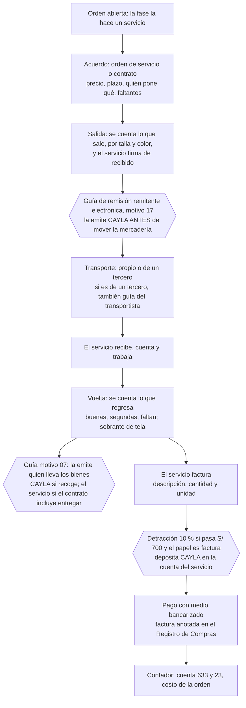

# 04 · Tercerización: papeles, control, dinero y tributos

**Frente 4 · 2026-10-16 · solo lectura.** Hipótesis que ataca: H3, H4, H7, H9, H10 (sección 5 del brief). Nada de esto diseña pantallas ni tablas: es lo que Felipe y el contador necesitan saber antes de decidir.

**Cómo leí las fuentes y qué límites tuve.** Evidencia: **A** = medido por mí en la base de producción (`cayla-dynamic`, schema `retail`, solo `SELECT`, 2026-10-16) · **B** = norma o informe de SUNAT, de la Ley o del Reglamento, leído del texto oficial (PDF o HTML de sunat.gob.pe), tesis o documento oficial · **C** = artículo académico, nota gremial o ficha de un tercero · **D** = lo dijo Felipe y está escrito en el repo · **E** = inferido por mí (dicho como «inferencia»). La búsqueda web de la sesión es un tope compartido entre agentes y se agotó a mitad del trabajo; desde ese punto leí solo con direcciones que ya conocía. Lo que no pude abrir está en «Lo que no encontré» o en la lista del contador. **Ningún dato fiscal sale de memoria**: o tiene fuente primaria o es pregunta al contador. Las normas se citan por su texto oficial; lo que resumo es con mis palabras.

## Veredicto en diez líneas

1. **H9 se contradice.** Mandar tela, piezas cortadas o prendas a un servicio **sí obliga a una guía de remisión electrónica**, y la obliga a CAYLA como dueña de la mercadería, no al Taller «por emitir comprobantes». El Reglamento no trae excepción para el traslado a transformar. Sin guía, lo que arriesga CAYLA es el comiso de la mercadería o una multa del 15 % de su valor (B).
2. **H10 se confirma en sus números y se matiza en su alcance.** Fabricación de bienes por encargo: 10 % si la operación pasa S/ 700 (B). Pero solo corre si CAYLA entrega tela, piezas o bienes intermedios (no si entrega solo avíos), si el servicio factura como empresa de tercera categoría, y quien deposita es CAYLA, hasta el día de pago o el quinto día hábil del mes siguiente a anotar la factura, lo que ocurra primero.
3. **El papel que dé el servicio decide el resto.** Factura: sustenta gasto, crédito fiscal y detracción. Boleta o ticket de un Nuevo RUS: no sustenta ni gasto ni crédito. Recibo por honorarios: solo para un oficio individual, sin IGV y con una retención que el repo todavía no resolvió. Nada: la compra queda sin respaldo (B).
4. **La tela que sale no es una venta** si el contrato y los papeles dicen lo mismo, pero el Tribunal Fiscal ha visto venta gravada en casos donde el contratista facturaba bruto y se «descontaba» lo entregado (C, leído a través de un solo artículo; los casos son de minería con explosivos y combustibles, no de tela, así que para la tela es una analogía), y SUNAT dice que cada caso se juzga por su contrato y sus papeles (B). Es la trampa más cara de los descuentos.
5. **«Faltante = enviado − devuelto» es una buena ecuación de control, pero no es una regla de dinero.** Para cobrarle al servicio hay reglas civiles supletorias (el que inutiliza la tela por negligencia la paga) y para deducir una pérdida hay pruebas que pedir antes (informe técnico, destrucción ante notario, denuncia). No hay norma tributaria que fije el descuento (B/C).
6. **El plan contable tiene una cuenta hecha para esto** (633, para la producción que se encarga a terceros con insumos que da la propia empresa), y la tabla de categorías de gasto de CAYLA, que ya enlaza cada categoría con su cuenta, no la tiene (A/B).
7. **Lo que la base guarda hoy no alcanza para una guía**: el Taller no tiene dirección ni ubigeo cargados, el servicio no tiene dirección, y la Salida no tiene peso ni unidad (A). Si algún día se quisiera emitir la guía desde el ERP, es integración con valor legal: **detener y confirmar con Felipe**.
8. **La brecha de la guía ya estaba abierta en Traslados** (Taller a tiendas) y Felipe la dejó para el contador el 2026-09-16 (D). SUNAT dice por escrito que desde el 2024-01-01 todos los obligados la emiten en forma electrónica (B).
9. **La informalidad del proveedor es la regla, no el caso raro** (D/B): Felipe estima que más de un tercio de sus compras llega sin factura y el taller pequeño entrega proforma, nota o nada. Cualquier flujo que suponga factura del servicio va a fallar en una parte de las órdenes.
10. **Hay 26 preguntas para el contador** (sección 8) y 14 candidatas para la ronda de Felipe (al final). Ninguna de las dos listas pide construir algo.

## 1 · Hipótesis: veredictos

| # | Hipótesis (ADR-0400) | Veredicto | Evidencia que manda |
|---|---|---|---|
| H3 | Tercerizar es una fase entera con un quién; no se reparte entre dos talleres | **Matiza** | Nada en las normas obliga a un solo servicio por fase: el remitente emite una guía por cada destinatario y punto de llegada y cada servicio factura aparte (B, RCP art. 18.1). Lo que sí cambia todos los papeles es **quién pone la tela**, y ADR-0400 no lo modela como pregunta (tres modelos, sección 2.1). En picos de demanda, las pymes de confección de Lima subcontratan «por capacidad» a varios (C/B, tesis UNMSM 2007, confianza baja) |
| H4 | Se paga por prenda, con mínimo y fijo opcional | **Matiza** | A SUNAT no le importa la unidad de pago (prenda, docena, kilo, minuto). Le importan tres cosas que la hipótesis no mira: el **adelanto** obliga a emitir comprobante por lo percibido (B, RCP art. 5.5) y cuenta como pago para la fecha del depósito de la detracción (B, cartilla SPOT); un **fijo por orden** (ponchado, matriz) puede ser otra operación y el comprobante sujeto a detracción no puede mezclar operaciones distintas (B, cartilla SPOT); y el **mínimo** no tiene efecto tributario. Las prácticas de pago de Lima no las pude verificar (sin dato; ver Frente 2) |
| H7 | Las segundas no entran al stock; faltante = enviado − devuelto | **Matiza** | No hay regla tributaria especial para segundas: siguen siendo existencias de CAYLA con costo. Una segunda que se vende más barata no es «desmedro» deducible (el desmedro exige destrucción probada) (B/C). El control por piezas es correcto; el control por tela es otra ecuación (sale − usada − devuelta − perdida) |
| H9 | La guía de una Salida basta como texto | **Contradice** | RCP art. 17 y 18.1.1: el propietario de los bienes al inicio del traslado emite la guía remitente, también cuando el traslado es parte de un servicio que transforma el bien; debe emitirse antes de mover (art. 17.5); sin excepción para transformación (art. 21); sanción: comiso o multa del 15 % del valor, tope 6 UIT (Tabla I) (B, alta). Contraejemplo: si el contrato dice que el servicio recoge y entrega, la guía es del servicio (art. 18.1.3) y el ERP solo anotaría su número |
| H10 | Maquila con tela de CAYLA = fabricación por encargo, detracción 10 % sobre S/ 700, el ERP solo avisa | **Matiza** | Tasa y umbral verificados (B). El alcance depende de lo que CAYLA entrega (solo avíos queda fuera), del régimen del servicio (solo si factura como tercera categoría y con crédito fiscal) y de quién deposita (CAYLA). «El ERP solo avisa» es una práctica, no una norma; si el contador no deposita a tiempo, la multa es del 50 % del importe no depositado |

## 2 · El flujo con sus papeles

### 2.1 Tres formas de tercerizar que cambian todos los papeles

La pregunta que ordena los papeles no es la fase sino **quién pone qué**. ADR-0400 solo describe la primera.

| Modelo | Qué entrega CAYLA | Qué es para SUNAT | Guía | Detracción | Cuenta del plan contable |
|---|---|---|---|---|---|
| **M1 · Con tela o piezas de CAYLA** (corte y costura con tela propia; ADR-0400 la llama «consumo» de la Salida) | Tela, piezas cortadas, bienes intermedios; opcionalmente avíos | Servicio de «fabricación de bienes por encargo»; la entrega no es venta si los papeles son coherentes (B, Informe 082-2006) | Remitente: CAYLA, motivo 17 (ida) | 10 % si > S/ 700 y el servicio es de tercera categoría (B) | 633 «Producción encargada a terceros» y 23 «Productos en proceso» (B, PCGE) |
| **M2 · «Paquete completo»** (el servicio compra la tela y entrega la prenda hecha; CAYLA solo da avíos, molde, ficha) | Solo avíos o diseños | Queda **excluido** del numeral 7 del Anexo 3 si el usuario entrega solo avíos o solo diseños (B, RS 056-2006). Lo que sigue (¿venta de prenda terminada?, ¿otro servicio?) es pregunta al contador | Del servicio hacia CAYLA, como venta/compra (inferencia, E) | No sé: contador | Compra de producto terminado (E) |
| **M3 · Servicio sobre prenda o pieza ya hecha** (bordado, estampado, lavandería) | La pieza o la prenda | Puede caer en el mismo numeral 7 (la RS 056-2006 habla de que el usuario recibe un bien igual o distinto en naturaleza o forma al que entregó) o en «demás servicios gravados» (12 %). No encontré pronunciamiento sobre estos tres servicios | Remitente: CAYLA, motivo 17 | 10 % o 12 %: contador | 633 (si CAYLA da el bien) |

*Inferencia (E):* el Taller ya trabaja M1 y M3. M2 es el caso que, si existe, no está en el modelo.

### 2.2 Diagrama del flujo (M1, con quién emite cada papel)

### 2.3 Paso a paso: qué viaja, qué papel nace, quién, y dónde se rompe

| # | Paso | Qué viaja o se cuenta | Papel | Quién lo emite o firma | ¿Obligatorio? | Dónde se rompe | Evidencia |
|---|---|---|---|---|---|---|---|
| 0 | Acuerdo con el servicio | Precio, mínimo, plazo, quién pone la tela y los avíos, cómo se trata el faltante | Orden de servicio o contrato (en Perú el contrato de obra no es solemne: basta el acuerdo) | CAYLA y el servicio | **No lo exige SUNAT**; lo recomienda la doctrina para sostener que la tela entregada no se vende, y SUNAT mira los términos del contrato para calificar la entrega | Si el acuerdo vive solo en un chat, no prueba nada ante el Tribunal Fiscal; un contrato solo tampoco prueba que el servicio se prestó | C (Hernández Berenguel) + B (Informe 082-2006; Informe 057-2017) |
| 1 | Salida | Tela, piezas o prendas, por talla y color, con su peso | Conteo firmado de recibido (papel comercial) **y** guía de remisión remitente electrónica, motivo 17 | CAYLA (propietaria al inicio del traslado) | **Sí** para la guía; el conteo no lo exige SUNAT | Mover sin guía: comiso o multa del 15 % del valor. La guía lleva el peso bruto total; el conteo del Taller es por unidades | B (RCP 17, 18.1.1, 21; RS 123-2022 art. 19) |
| 2 | Transporte | La misma carga | Guía del transportista si el traslado lo hace un tercero; no hace falta si el vehículo es categoría L o M1 y ya hay guía remitente | El transportista | Depende | «Transporte propio» exige unidades propias; no hallé cómo se califica una persona que lleva el paquete en bus, taxi o a pie (pregunta al contador) | B (RCP 17.2, 21.2.2) |
| 3 | Recepción en el servicio | Lo que llegó | Conteo del servicio | El servicio | No (comercial) | El primer faltante se descubre aquí, no en la Vuelta; si nadie cuenta al recibir, no se sabe en qué lado se perdió | E (inferencia) |
| 4 | El servicio trabaja | Tela en su poder; retazos y sobrante | Ninguno exigido | — | — | La tela sigue siendo de CAYLA en poder ajeno; si el servicio la inutiliza por negligencia, la paga (regla civil supletoria); retazos: R-28 dice que se botan | C (Código Civil 1773, 1774.3, 1788 vía artículo) + D |
| 5 | Vuelta | Buenas, segundas, faltan; tela sin usar | Conteo firmado y clasificado; guía motivo 07 (recojo de bienes transformados) | Quien lleva los bienes: CAYLA si recoge; el servicio si el contrato incluye entregar | **Sí** para la guía; el conteo no | Sin guía de vuelta y sin conteo clasificado, el faltante se discute de memoria | B (RCP 18.1.3; Informe 117-2003) |
| 6 | Papel del servicio | El servicio prestado, con cantidad y unidad | Factura (a pedido de CAYLA), boleta/ticket (Nuevo RUS), recibo por honorarios (oficio individual) o nada | El servicio | Depende de su régimen | La boleta no sustenta gasto ni crédito; una factura que dice solo «servicio de maquila» es débil; debe llevar cantidad y unidad | B (RCP 4, 6, 8.1.9) |
| 7 | Detracción | 10 % del importe a pagar | Constancia de depósito del Banco de la Nación; leyenda en la factura | CAYLA deposita; el servicio abre su cuenta y pone la leyenda | Sí si el servicio es de tercera categoría, el papel es factura y la operación pasa S/ 700 | Pagar todo sin depositar convierte al servicio en el obligado; multa del 50 % del importe no depositado | B (cartilla SPOT; TUO DL 940 art. 12) |
| 8 | Pago | Dinero al servicio (adelanto o saldo) | Comprobante por lo percibido en cada pago; medio de pago bancarizado | El servicio; CAYLA paga | El comprobante sí (servicios: culminación, percepción o vencimiento, lo que ocurra primero); el umbral de bancarización: pregunta al contador | Un adelanto sin comprobante ni depósito; pago en efectivo sobre el umbral | B (RCP 5.5) + D (R-09, sin verificar contra la ley) |
| 9 | Contabilidad | Costo de la orden | Anotación en el Registro de Compras; cuenta 633 (servicio), 23 (en proceso) | CAYLA con su contador | Sí (Registro de Compras) | CAYLA tiene mapeo a cuenta por categoría de gasto y no tiene 633 | B (Ley IGV art. 19; PCGE) + A |

## 3 · Tabla de documentos

| Documento | Qué es | Quién lo emite | ¿Obligatorio? | Evidencia |
|---|---|---|---|---|
| Guía de remisión remitente electrónica, motivo 17 | Sustenta el traslado de la tela, piezas o prendas hacia el servicio | CAYLA, como propietaria al inicio del traslado | **Sí**, antes de mover; no hay excepción para transformación | B · RCP arts. 17, 18.1.1, 21; Informe 117-2003; catálogo 20 (RS 240-2024) |
| Guía remitente, motivo 07 «recojo de bienes transformados» | Sustenta el traslado de vuelta | Quien lleva los bienes: CAYLA si recoge (Informe 117-2003); el servicio si el contrato incluye el recojo o la entrega (art. 18.1.3) | **Sí** | B |
| Guía de remisión del transportista | Cuando un tercero hace el transporte | El transportista | Depende: no se exige si el vehículo es L o M1 y ya hay guía remitente; si el dueño de la carga es NRUS, emisor de recibos por honorarios o no obligado, emite solo la del transportista | B · RCP 18.2, 21.2.2 |
| Factura | Comprobante del servicio; sustenta gasto, crédito fiscal y detracción | El servicio, si es de tercera categoría con RUC; CAYLA la puede pedir para sustentar gasto | Depende del régimen del servicio | B · RCP art. 4.1 |
| Boleta de venta o ticket | Comprobante del Nuevo RUS | El servicio en Nuevo RUS | No sustenta gasto ni crédito (salvo excepciones de ley con RUC del adquirente) | B · RCP 4.3.2; cartilla Nuevo RUS (2020) |
| Recibo por honorarios | Servicio de cuarta categoría | Persona natural que presta un servicio individual (profesión, arte, ciencia u oficio) | Depende; sin IGV; la retención del 8 % la dejó el repo al contador | B · RCP 4.2; D · ADR-0195:64, F8.md:249 |
| Formulario 820 | Comprobante por operaciones no habituales | SUNAT, a pedido de una persona natural no habitual | Depende | B · RCP art. 6.2 |
| Liquidación de compra | Comprobante que emite el comprador | CAYLA | **No aplica a servicios de confección**: en el texto que leí la lista es cerrada (agropecuario, pesca artesanal, madera, minería artesanal, artesanía, desechos) | B · RCP 6.1.3 |
| Constancia de depósito de detracción | Prueba del depósito en el Banco de la Nación | El banco; deposita CAYLA | Sí, si la operación está sujeta | B · cartilla SPOT; TUO DL 940 |
| Leyenda «Operación sujeta al Sistema de Pago de Obligaciones Tributarias» y número de cuenta de detracciones | Marca en la factura del servicio | El servicio | Sí, si está sujeta; esa factura no puede incluir otras operaciones | B · cartilla SPOT |
| Contrato u orden de servicio | Qué se pidió, quién pone qué y qué pasa con el faltante | CAYLA y el servicio | No lo exige SUNAT; sostiene que la tela no se vendió y que el servicio ocurrió | C/B · Hernández Berenguel; Informe 082-2006 |
| Conteo de Salida y de Vuelta firmado | Prueba de cantidades y de estado | CAYLA y el servicio | No (comercial); es la base de cualquier reclamo | E |
| Informe técnico de merma; acta de destrucción de desmedro | Prueba para deducir mermas y desmedros | CAYLA con profesional independiente; destrucción ante notario con aviso a SUNAT 2 días hábiles antes (hasta 10 UIT, informe propio con aviso) | Solo si CAYLA quiere deducir | B · RLIR art. 21.c; Informes 94 y 95-2023 |
| Prueba del delito o inutilidad de la acción | Para deducir una pérdida por robo | CAYLA | Solo para deducir | B · LIR art. 37.d |
| Registro de Compras | Anotación de la factura | CAYLA | Sí, para el crédito fiscal | B · Ley IGV art. 19.c |

## 4 · Hallazgos

H-4.1 · El dueño de la mercadería que se manda a un servicio para transformarla debe emitir una guía de remisión remitente
  Evidencia: B · RCP art. 17.1 (la guía sustenta el traslado de bienes entre direcciones distintas) y art. 18.1.1 (la emite el propietario o poseedor al inicio del traslado, incluso cuando el traslado forma parte de un servicio con o sin transformación del bien); Informe SUNAT 117-2003: quien entrega sus insumos para transformar y los recoge, emite la guía remitente; Informe 32-2024, que repite el texto vigente · sunat.gob.pe (capituloV.pdf, i1172003.htm, i000032-2024-7T0000.pdf) · consultada 2026-10-16
  Confianza: alta · Aplica a: ambos
  Lo contradiría: una norma de 2025 o 2026 que exceptúe el traslado a transformación (la RS 108-2026, la más reciente que leí, solo toca comercio exterior)
  Releído por el Frente 10 (2026-10-16): el texto del Capítulo V que publica SUNAT (PDF convertido a texto) dice en el art. 17.1 que la guía sustenta el traslado entre distintas direcciones, en el 17.5 que se emite antes de mover los bienes y en el 18.1 que el propietario o poseedor al inicio del traslado la emite «con ocasión de ... prestación de servicios que involucra o no transformación del bien»; el Informe 117-2003 (conclusión 3) dice lo mismo para quien entrega insumos para transformar. Un matiz: desde la RS 123-2022 el epígrafe del Capítulo V dice «guías de remisión en formatos impresos o importados» y la guía electrónica se rige por esa resolución; la RS 240-2024 repite en sus considerandos que desde el 2024-01-01 todos los sujetos la emiten en forma electrónica.
  Implicación: contradice H9 y la premisa A3 de ADR-0400 («el Taller no emite comprobantes: la guía va como texto»); la obligación es de CAYLA como propietaria, no del Taller.

H-4.2 · No hay excepción para el traslado a transformación, y la guía se emite antes de mover
  Evidencia: B · RCP art. 17.5 (la guía debe emitirse antes de que la mercadería se mueva); art. 21 completo: las excepciones vigentes son casos de zonas francas y mercancía extranjera, transporte internacional, envíos postales, títulos valores, afiches impresos, bienes de cooperativas agrarias, transporte interprovincial de pasajeros y ventas a consumidores finales, y envases y embalajes vacíos; ninguna cubre tela, piezas cortadas ni prendas; las excepciones de venta con entrega del vendedor se derogaron el 2022-07-13 (RS 123-2022) · sunat.gob.pe capituloV.pdf, RS 123-2022, RS 108-2026 · consultada 2026-10-16
  Confianza: alta · Aplica a: ambos
  Lo contradiría: una excepción por volumen, peso o valor que no encontré
  Implicación: afecta la decisión 4 de ADR-0400 (Salida con «guía como texto»): el número que se anota nace de un papel que debe existir antes de la salida física.

H-4.3 · La guía hoy es electrónica para todos y se puede emitir sin sistema propio
  Evidencia: B · RS 240-2024, considerandos (SUNAT dice que, según el anexo X de la RS 123-2022, desde el 2024-01-01 todos los sujetos la emiten en forma electrónica); RS 123-2022 (arts. 2-A, 18 y 19 que incorpora: se emite por el Portal SUNAT, la APP Emprender o un sistema del contribuyente) y la lista de datos del art. 19: exige motivo, puntos de partida y llegada, fecha de inicio, descripción, unidad de medida y cantidad, **peso bruto total**, vehículo y conductor (transporte privado) o RUC del transportista (público), y la factura relacionada · sunat.gob.pe · consultada 2026-10-16
  Confianza: media-alta (no leí el anexo X, solo la frase de SUNAT)
  Aplica a: ambos
  Lo contradiría: que CAYLA figure en un caso del anexo X con otro plazo
  Implicación: si el Taller usa la app de SUNAT, no hay integración con valor legal que construir; si un día se quisiera emitir desde el ERP, **detener y confirmar con Felipe**.

H-4.4 · En la Vuelta, la guía la emite quien lleva los bienes
  Evidencia: B · RCP art. 18.1.3 (el prestador de servicios, con la maquila entre sus ejemplos, emite la guía remitente solo si el contrato incluye el recojo o la entrega); Informe 117-2003 (si el dueño recoge con su movilidad, emite él); Informe 32-2024 (el poseedor distinto del propietario también está obligado); art. 18.2.2 (con transporte público y dueño de la carga NRUS, emisor de recibos por honorarios o no obligado a comprobantes, solo emite la guía el transportista) · sunat.gob.pe · consultada 2026-10-16
  Confianza: alta · Aplica a: ambos
  Lo contradiría: que el contrato con el servicio diga algo distinto; no sé cuál es el acuerdo real (pregunta a CAYLA)
  Matiz del Frente 10: el último párrafo del art. 18.1 dice que, cuando la guía la emite el prestador de servicios (los casos 1.3 a 1.6), para las infracciones del art. 174 n.º 8 a 10 del Código Tributario «se considerará como remitente al propietario o poseedor de los bienes al inicio del traslado»; es decir, aunque la emita el servicio, el dueño no queda fuera de esas multas. Pregunta nueva para el contador (n.º 5 de la sección 8, ampliada).
  Implicación: afecta la Vuelta de ADR-0400 decisión 4: el campo «guía» puede ser de CAYLA o del servicio según quién lleve.

H-4.5 · Mover mercadería sin guía cuesta el comiso o el 15 % de su valor
  Evidencia: B · Código Tributario art. 174.8, Tabla I y nota 7: comiso, sustituible por multa del 15 % del valor de los bienes con tope de 6 UIT (6 UIT si no se determina el valor) · sunat.gob.pe tablaI.pdf · consultada 2026-10-16
  Confianza: alta · Aplica a: ambos
  Lo contradiría: una gradualidad o rebaja vigente que no leí
  Releído por el Frente 10: en la Tabla I, el art. 174 n.º 8 («remitir bienes sin portar ... la guía de remisión», o sin haberse emitido la electrónica) tiene sanción de comiso, y la nota (7) dice que la multa que lo sustituye es el 15 % del valor de los bienes, con tope de 6 UIT (6 UIT si no se determina el valor). Esa Tabla I es la de las personas generadoras de renta de tercera categoría, incluido el régimen MYPE tributario.
  Implicación: dimensiona qué arriesga CAYLA si H9 se deja como texto: la mercadería detenida, no el dinero pagado al servicio.

H-4.6 · La base de CAYLA no tiene hoy los datos que pide una guía
  Evidencia: A · `ubicacion_datos_fiscales` tiene dirección y ubigeo solo para una tienda (el Taller y dos tiendas no tienen fila); `proveedores_produccion` no tiene dirección (0 filas); `produccion_salidas` y `produccion_salida_lineas` solo guardan cantidad por variante y un texto de guía; `configuracion_empresa` tiene un solo RUC · consulta SQL 2026-10-16
  Confianza: alta · Aplica a: ambos
  Lo contradiría: otra fuente de direcciones fuera de esas tablas
  Implicación: cualquier camino de guía desde el ERP necesitaría datos que hoy no existen y es una integración con valor legal: **detener y confirmar con Felipe**. No propongo construirla.

H-4.7 · La tasa del 10 % y el umbral de S/ 700 de «fabricación de bienes por encargo» están verificados
  Evidencia: B · página de SUNAT «En la prestación de servicios» (Anexo 3: numeral 7, 10 %, operaciones mayores a S/ 700; consigna la RS 086-2025 como la modificación más reciente que muestra); cartilla de SUNAT del Sistema de Detracciones (2019-2020); RS 071-2018 (sube a 12 % solo los numerales 1, 3, 5 y 10, no el 7) · orientacion.sunat.gob.pe, sunat.gob.pe/legislacion/superin/2018/071-2018.pdf · consultada 2026-10-16
  Confianza: alta para 2025; media para octubre de 2026 (no pude ver cambios de 2026)
  Aplica a: ambos
  Lo contradiría: una resolución de 2026 que cambie la tasa o el umbral
  Implicación: confirma la cifra de ADR-0400 «supuestos» (verificada; la fuente que citaba la investigación previa era otra: ver sección 7).

H-4.8 · Cuándo es «fabricación por encargo»: tela, piezas o bienes intermedios sí; solo avíos no; el dinero para comprar insumos también cuenta
  Evidencia: B · RS 056-2006 (el usuario entrega materias primas o insumos; **no** es fabricación por encargo cuando entrega solo avíos textiles —etiquetas, entretelas, botones, cierres, elásticos, cajas de embalaje— o solo diseños); Informe 151-2006 (el contrato de fabricación por encargo es un contrato de obra, gravado con IGV solo si la retribución es renta de tercera categoría; el dinero que el encargante da para comprar insumos cuenta como bien) · sunat.gob.pe · consultada 2026-10-16
  Confianza: alta · Aplica a: ambos
  Lo contradiría: un pronunciamiento específico sobre bordado, estampado o lavandería (no encontré ninguno)
  Implicación: afecta H3 y H10: el modelo M2 («paquete completo») queda fuera del numeral 7 y ADR-0400 no distingue quién pone la tela.

H-4.9 · Quién deposita la detracción, cuándo, y qué pasa si no
  Evidencia: B · Cartilla SPOT de SUNAT (2019-2020): en servicios gravados el obligado es el usuario (CAYLA); hasta la fecha de pago parcial o total o el quinto día hábil del mes siguiente a anotar el comprobante en el Registro de Compras, lo que ocurra primero; si CAYLA paga todo sin depositar, el servicio pasa a ser el obligado; el servicio abre una cuenta en el Banco de la Nación, informa el número y pone la leyenda; no se aplica si el importe es de S/ 700 o menos ni si el comprobante no permite crédito fiscal ni gasto; la factura sujeta no puede incluir otras operaciones; TUO del DL 940, art. 12 (multa del 50 % del importe no depositado) y primera disposición final (el crédito fiscal se ejerce desde el período en que se acredite el depósito si fue tardío) · sunat.gob.pe · consultada 2026-10-16
  Confianza: alta (la oportunidad del depósito, de una versión de 2019-2020; el art. 16 de la RS 183-2004 consolidado por SUNAT dice lo mismo). Aviso del Frente 10: la multa del 50 % sale de la página de SUNAT con el TUO del DL 940, que dice estar actualizada al 20 de junio de 2012; no descarto cambios posteriores, así que el 50 % y la oportunidad del depósito van también a la lista del contador (pregunta 7 y 13)
  Aplica a: ambos
  Lo contradiría: un cambio posterior de la oportunidad del depósito
  Implicación: matiza H10: «el ERP solo avisa y el contador deposita» solo cierra si el contador conoce la fecha de pago; el adelanto adelanta también la fecha del depósito.

H-4.10 · Lo que el servicio da como papel decide qué se puede sustentar
  Evidencia: B · RCP art. 4.1 (factura cuando el usuario la pide para sustentar gasto o costo, o con sujetos del IGV con crédito fiscal); art. 4.3.2 (la boleta no permite crédito fiscal ni sustentar gasto o costo, salvo casos de ley con RUC del adquirente); art. 4.2 (recibo por honorarios para el ejercicio individual de una profesión, arte, ciencia u **oficio** y otros servicios de cuarta categoría); art. 6.1.2 (quien presta servicios debe emitir comprobante; una persona natural, solo si es habitual) y 6.1.3 (la liquidación de compra es para una lista cerrada que no incluye la confección); cartilla del Nuevo RUS de SUNAT (2020): no permite facturas, solo boletas y tickets, para quienes atienden consumidores finales o ejercen un oficio, con tope anual de ingresos de S/ 96,000 en esa edición · sunat.gob.pe · consultada 2026-10-16
  Confianza: alta · Aplica a: taller de ~10 operarias (más probable que un servicio sea pequeño)
  Lo contradiría: que los servicios de CAYLA tengan todos RUC de tercera categoría (no lo sé)
  Implicación: matiza la propuesta de ADR-0400 «el proveedor dice si su papel lleva IGV» y corrige un detalle de la investigación previa: un recibo por honorarios **sí cabe** para un oficio individual.

H-4.11 · La factura del servicio debe decir qué se hizo y cuántas; y cada pago mueve su fecha de comprobante
  Evidencia: B · RCP art. 8.1.9 (descripción o tipo de servicio, cantidad y unidad de medida); Informe 124-2019 (con el Informe 012-2001, «servicio de costura» describe la confección; contexto drawback); Informe 057-2017 (una factura que solo dice «servicio de maquila» no basta; el contrato no prueba el servicio); RCP art. 5.5 (en servicios, el comprobante se emite al terminar el servicio, al percibir la retribución —por lo percibido— o al vencer cada plazo de pago, lo que ocurra primero) · sunat.gob.pe · consultada 2026-10-16
  Confianza: alta para la norma; media para aplicarla a CAYLA (los informes citados son de exportadores con drawback)
  Aplica a: ambos
  Lo contradiría: que el contador acepte facturas de descripción genérica
  Implicación: une la Vuelta de ADR-0400 con el papel: las prendas buenas que vuelven son la cantidad que la factura debe nombrar; un adelanto de ADR-0400 «sin adelantos» (supuesto) simplifica, pero la práctica puede no ser así.

H-4.12 · La tela que se entrega no es venta, pero el papel puede hacerla parecer venta
  Evidencia: B · Informe SUNAT 082-2006 (entrega de combustible en contrato de obra: no es operación gravada con renta ni IGV; el IGV la deja fuera entre sus retiros no gravados: la entrega de bienes a un tercero para fabricar otros bienes que la empresa le encargó; se evalúa caso por caso según el contrato) · C · Hernández Berenguel (PUCP, «foro jurídico»): casos del Tribunal Fiscal 05475-4-2003 y 07718-3-2007 donde, con el precio bruto y el descuento del valor de los materiales o con la factura por valor neto sin alusión al descuento, el Tribunal vio una venta gravada con IGV (**ambos casos son de contratistas mineros y de explosivos o combustibles, no de tela**: el Frente 10 releyó el artículo y el Informe 082-2006, que trata de combustible en una obra y no menciona descuentos; aplicarlo a la tela es una analogía, E); recomienda cláusulas expresas con los artículos 1773, 1774, 1784 y 1788 del Código Civil · sunat.gob.pe i0822006.htm; artículo en archivo local · consultada 2026-10-16
  Confianza: baja a media (el Informe es B pero es de combustible en una obra; todo lo que sostiene «el descuento se lee como venta» es un solo artículo, nivel C, con casos de minería)
  Aplica a: ambos
  Lo contradiría: una línea posterior del Tribunal Fiscal que acepte descuentos como neutrales
  Implicación: afecta cualquier «descuento al servicio» (ADR-0400, supuesto «faltantes»): lo que sale de CAYLA como tela debe seguir siendo consumo de CAYLA y no aparecer como línea de la factura del servicio.

H-4.13 · Faltantes y tela perdida: hay reglas civiles supletorias y pruebas tributarias que pedir antes
  Evidencia: C · Código Civil, citado en Hernández Berenguel: art. 1773 (los materiales los da el comitente salvo pacto o costumbre), 1774.3 (el contratista paga los materiales que inutiliza por negligencia o impericia), 1788 (si la obra se pierde sin culpa, devuelve los no perdidos), 1784 (responde por la calidad de los materiales que él puso). B · RLIR art. 21.c (merma: pérdida física por causas inherentes a la naturaleza o al proceso productivo; el informe técnico independiente se pide «cuando la SUNAT lo requiera»; desmedro: pérdida cualitativa irrecuperable, se prueba con destrucción ante notario y aviso previo de 2 días hábiles; hasta 10 UIT basta un informe propio con aviso); LIR art. 37.d (pérdida por delito de terceros: deducible neta de seguros y solo si se probó judicialmente el hecho o es inútil la acción); Informe 94-2023 (la merma incluye la de la comercialización si es inherente al bien final) · sunat.gob.pe · consultada 2026-10-16
  Confianza: media-alta (el texto primario del Código Civil no pude abrirlo)
  Aplica a: ambos
  Lo contradiría: un pacto distinto en el contrato con el servicio
  Implicación: matiza el supuesto de ADR-0400 «en Lima no hay norma sobre faltantes, lo fija la relación»: no hay norma tributaria que fije el descuento, pero hay reglas civiles supletorias y no todo faltante es deducible.

H-4.14 · Las segundas siguen siendo existencias de CAYLA y no son «desmedro» deducible si se venden
  Evidencia: B · RLIR art. 21.c (el desmedro hace «inutilizables» las existencias y se prueba destruyéndolas); C · nota de la SNI sobre los Informes 94 y 95-2023 (el Tribunal Fiscal exige acreditar la destrucción porque no todo desmedro se destruye: se puede vender más barato) · consultada 2026-10-16
  Confianza: media · Aplica a: ambos
  Lo contradiría: que el contador trate las segundas por otra vía (por ejemplo, desvalorización de existencias)
  Implicación: afecta H7 y ADR-0400 decisión 4 y actualización d: si las segundas «no entran al stock», existen físicamente con costo pero fuera del inventario; hay que decidir dónde se ven.

H-4.15 · El plan contable tiene una cuenta para producción encargada a terceros con insumos del dueño; CAYLA no la tiene en sus categorías
  Evidencia: B · PCGE (MEF, versión con NIIF 16): la cuenta 633 agrupa el servicio de producción que se encarga a terceros a quienes la empresa les da los insumos; la 23 (productos en proceso, 231 al costo) acredita los faltantes de productos en proceso; la 24 es de materias primas; el PCGE no dice cómo anotar el insumo que está en poder de un tercero (sí para mercadería en consignación) · A · `categorias_gasto`: 13 categorías con su `cuenta_pcge` (631, 632, 634 a 637, 639, 656, 64, 651, 625, 609), ninguna 633 · mef.gob.pe PCGE_2019.pdf · consultada 2026-10-16
  Confianza: alta · Aplica a: ambos
  Lo contradiría: que el contador lleve el servicio en otra subcuenta por un motivo que no conozco
  Implicación: afecta ADR-0362 d.63 y el supuesto «el papel del servicio sigue como gasto en Finanzas»: el plan contable ya le da un lugar propio.

H-4.16 · Lo que las tablas del papel del servicio guardan y no guardan
  Evidencia: A · `comprobantes_produccion.tipo` solo admite factura, boleta, nota_venta y sin_comprobante (no recibo por honorarios), mientras `compras.tipo` sí lo admite, solo para gasto o activo; el IGV solo puede ser mayor a cero si el tipo es factura (ambas tablas); ninguna tabla de `retail` guarda detracción, retención, régimen del servicio, cuenta de detracciones ni «tarifa con o sin IGV» (`proveedor_tarifas` no tiene la marca); `compras`, `comprobantes_produccion`, `proveedores_produccion` y `produccion_fases` tienen 0 filas · consultas SQL 2026-10-16 · AUDITORIA-COMPRAS-2026-09-21.md:115 dice lo mismo («sin detracción, retención ni percepción»)
  Confianza: alta · Aplica a: ambos
  Lo contradiría: columnas que mi consulta no listó por filtro
  Implicación: matiza el supuesto de ADR-0400 «el proveedor dice si su papel lleva IGV»: el tipo de papel sí lo dice, pero por comprobante, no por servicio ni por tarifa.

H-4.17 · La informalidad del proveedor es la base, no la excepción
  Evidencia: D · Felipe, 2026-09-12 (`docs/datos/15-COMO-OPERA-CAYLA.md:75`, R-07): más del 30 % de las compras llega sin factura, de proveedores pequeños (talleres de Gamarra, producción artesanal) que entregan proforma, nota o nada, y su R-09 (:116): un pago en efectivo de S/ 2,000 o más hace perder crédito y gasto, y Felipe confirmó que eso ocurre. B · MINCETUR (OEEIC), diciembre 2023, con datos de INEI 2021: 90.5 % de las unidades productivas del país son informales; Lima 82.7 %. C · IEES-SNI, marzo 2021, con datos de la ENAHO 2019: en textil y confecciones, 78.1 % del empleo es informal y las microempresas concentran el 80 % de los puestos con 88.7 % de informalidad laboral · consultada 2026-10-16
  Confianza: media (las cifras de fuera miden empleo y unidades productivas, no cuántos servicios dan factura)
  Aplica a: taller de ~10 operarias
  Lo contradiría: que los servicios que CAYLA usa hoy tengan todos RUC y factura (pregunta a CAYLA)
  Implicación: matiza ADR-0400 y la investigación previa («un taller de maquila factura, 3.ª categoría»): una parte de los servicios no va a dar el papel que el flujo supone.

H-4.18 · Por qué se tercerizan fases: capacidad en picos antes que especialidad
  Evidencia: B (con confianza baja) · Tesis UNMSM 2007, «Desarrollo de las pymes en el mercado exportador, sector confecciones»: la subcontratación más usada es la de capacidad, cuando los pedidos superan lo instalado en épocas de pico, y lo que más se contrata es la confección completa; la subcontratación por especialidad es menor; se elige por capacidad suficiente (de 10 a 15 máquinas por taller), calidad aceptable y compromiso de entrega; el control de calidad dentro del taller ajeno es difícil y para muchas pymes la subcontratación es una alternativa de emergencia · consultada 2026-10-16
  Confianza: baja (2007, pymes exportadoras de un distrito de Lima) · Aplica a: taller de ~10 operarias
  Lo contradiría: la práctica actual de CAYLA
  Implicación: contraejemplo parcial de H3 («casi no ocurre»): partir una fase entre dos servicios es la forma más común de subcontratar en picos.

H-4.19 · La maquila es «tercerización» para la ley laboral, con condiciones y una responsabilidad condicionada
  Evidencia: B · Ley 29245 (El Peruano, 2008-06-24, texto original): art. 2 (actividades especializadas con recursos propios, por su cuenta y riesgo, pluralidad de clientes, equipamiento, inversión de capital, pago por obra o servicio; nunca se admite la sola provisión de personal); art. 3 (incluye los contratos de obra y aquellos en que un tercero se hace cargo de una parte integral del proceso productivo); art. 5 (si es provisión de personal, los trabajadores pasan a tener relación directa con la empresa principal); art. 9 (la empresa principal es solidariamente responsable por derechos laborales y de seguridad social de los trabajadores **desplazados**, hasta un año después del desplazamiento) · consultada 2026-10-16
  Confianza: media (es el texto de 2008; fue modificado después por el DL 1038 y no leí el texto vigente)
  Aplica a: ambos
  Lo contradiría: que el servicio trabaje en su propio local, sin desplazar personal a CAYLA (en ese caso el art. 9 no se activa por su letra; pregunta al abogado laboral)
  Implicación: no toca ninguna decisión de ADR-0400; es un riesgo de elegir mal al servicio (contrato mínimo y exigencia de que tenga RUC y personal propio).

H-4.20 · La brecha de la guía en Traslados ya está abierta y ya se dejó al contador
  Evidencia: D · BACKLOG.md:4773-4780 («hueco legal real … desde 2023 mover mercadería entre establecimientos la exige … retomar con su contador»); DECISIONES-2026-09-21-menu-comercial.md:255 (D-83: guías electrónicas en segunda etapa, campo opcional para anotar el número de la guía «hecha donde se hace hoy»); pantallas/traslados.md:249, 431. B · RS 240-2024 (todos emiten GRE electrónica desde 2024-01-01) · consultada 2026-10-16
  Confianza: alta · Aplica a: ambos
  Lo contradiría: que la guía de traslado sí se emita hoy en la app de SUNAT (D-83 lo sugiere)
  Implicación: la decisión sobre las guías de Producción y la de Traslados es la misma; no resolverla en ADR-0400 solo.

H-4.21 · Partir una fase entre dos servicios no cambia nada en los papeles
  Evidencia: B · RCP art. 18.1 (el remitente emite una guía por cada punto de llegada y destinatario) · E (inferencia): cada servicio emite su factura y cada una se juzga por su propio importe para el umbral de S/ 700; no encontré norma sobre fraccionar una operación para quedar bajo el umbral · consultada 2026-10-16
  Confianza: media (la parte del umbral es inferencia)
  Aplica a: ambos
  Lo contradiría: una regla antielusión sobre fraccionamiento (pregunta al contador)
  Implicación: H3 es una decisión de simplicidad de CAYLA, no una exigencia legal.

## 5 · Matriz de riesgos (probabilidad × costo)

**Escalas.** Probabilidad (estimación mía, E; sin datos de CAYLA): *alta* = ocurre si el Taller sigue como hoy; *media* = ocurre en algunas órdenes; *baja* = raro. Costo: *alto* = detiene mercadería o pasa de una orden entera; *medio* = pierde un crédito o un gasto; *bajo* = molestia contable. El costo de las sanciones es el público (no hay montos de CAYLA).

| Orden | Riesgo | Prob. | Costo | Qué lo evita | Evidencia |
|---|---|---|---|---|---|
| 1 | Mover tela, piezas o prendas a un servicio sin guía (ida) | media-alta | alto: comiso o multa del 15 % del valor, tope 6 UIT | Guía motivo 17 antes de mover | B (H-4.1, H-4.5) |
| 2 | Traer las prendas de vuelta sin guía (la tiene el que las lleva) | media-alta | alto: igual | Guía motivo 07 | B (H-4.4) |
| 3 | El servicio da boleta, ticket o nada: gasto no sustentado y sin crédito fiscal | alta | medio-alto (el IGV de esa compra —la tasa de 18 % con el impuesto de promoción municipal figura en una nota del artículo de Hernández Berenguel, C; el contador confirma la vigente— y la deducción de la renta) | Pedir factura; si no, no hay costo deducible | B + D (H-4.10, H-4.17) |
| 4 | La tela entregada se lee como venta al servicio por papeles inconsistentes | baja-media | alto: IGV y renta sobre el valor de mercado | Contrato con las cláusulas, factura por servicio sin valor de tela, sin «descuento» | B/C (H-4.12) |
| 5 | Detracción omitida o tardía | media | medio: multa del 50 % del importe no depositado; crédito fiscal diferido | Calendario por orden: fecha de pago y quinto día hábil | B (H-4.9) |
| 6 | Tela perdida o inutilizada en el servicio, sin conteo ni cláusula | media | medio | Conteo firmado al salir, al recibir y al volver; cláusula del Código Civil | C (H-4.13) |
| 7 | Faltantes, mermas o desmedros que no se pueden deducir por falta de prueba | media | medio-bajo | Informe técnico a pedido; destrucción con aviso; denuncia si hubo delito | B (H-4.13) |
| 8 | Adelanto sin comprobante ni depósito de detracción | media (ADR-0400 supone que no hay) | medio | Comprobante por lo percibido y depósito en la fecha del pago | B (H-4.9, H-4.11) |
| 9 | Pago en efectivo sobre el umbral de bancarización | media (D: ocurre) | medio: crédito fiscal y gasto (umbral por verificar) | Medio de pago bancario; umbral: contador | D (sin fuente primaria leída) |
| 10 | Factura del servicio con descripción genérica | media | bajo-medio | Descripción, cantidad y unidad | B (H-4.11) |
| 11 | Costo del servicio sin cuenta propia (633) ni cuenta de proceso (23) | alta | bajo-medio (no es sanción; es costo mal armado) | Acordar la cuenta con el contador | B + A (H-4.15) |
| 12 | Calidad sin criterio de aceptación acordado antes: se paga por lo que no se vende | media | medio | Criterio escrito al enviar y plazo para reclamar | C (APTT cita niveles de muestreo AQL 1,0; 1,5 y 4,0 sin cifras de defecto) |
| 13 | Servicio que «presta personal» o trabaja dentro de CAYLA: relación directa y solidaridad | baja | alto | Contrato, RUC y personal propios | B (H-4.19) |
| 14 | Pérdida o robo en tránsito sin seguro | baja | medio | Seguro de transporte o del taller (no hay dato) | B (LIR 37.d) |
| 15 | Faltan los datos para emitir la guía (direcciones, ubigeo, peso) | alta | bajo en sí, pero bloquea el cumplimiento de 1 y 2 | Cargarlos donde corresponda | A (H-4.6) |

## 6 · Contraejemplos y matices

- **H9.** Si el contrato con el servicio dice que él recoge la tela y entrega las prendas, la guía de ambos viajes es del servicio (RCP 18.1.3) y el ERP solo anota su número: ahí «texto» alcanza. Eso no vuelve la regla general sino un caso particular, y obliga a que el servicio tenga RUC y emita guías electrónicas.
- **H10.** No aplica si CAYLA solo entrega avíos; si el importe es de S/ 700 o menos; si el servicio da boleta, ticket o recibo por honorarios (el comprobante no permite crédito fiscal); ni al servicio de un Nuevo RUS. La detracción tampoco existe si el servicio compra la tela y vende la prenda (modelo M2): ahí es compra de un bien.
- **H7.** Una segunda no es merma: la merma es pérdida física por causas inherentes al proceso; la segunda es un bien entero con defecto.
- **H3.** El ejemplo local que encontré (pymes exportadoras de Lima, 2007) dice lo contrario de «casi no ocurre»: en picos se parte.
- **Lo que no es obligación.** Ninguna norma pide a CAYLA llevar Salida y Vuelta en el ERP; sirven de prueba y de control, que es otra cosa.

## 7 · Lo que la investigación previa marcó `[externo, sin verificar]` y su estado

| Afirmación previa | Estado | Fuente y nota |
|---|---|---|
| Detracción del 10 % en fabricación por encargo > S/ 700 | **Verificada** | Página SUNAT del Anexo 3, cartilla SPOT, RS 071-2018. El informe que la investigación previa citó para esto («Informe 057-2017») **no trata de detracciones**: es sobre el comprobante de la maquila para el drawback. La cifra sale de otras fuentes; la cita estaba equivocada |
| «Informe 117-2003» (guía por transformación) | **Verificada** | El dueño que entrega insumos y recoge emite la guía remitente |
| Motivos de traslado «17 ida / 07 vuelta» (`anexo1-000240-2024.pdf`) | **Verificada** | Catálogo 20: 07 «Recojo de bienes transformados», 17 «Traslado de bienes para transformación» |
| «Informe 151-2006» (detracción) | **Verificada, y va más allá** | El dinero que se da para comprar insumos también cuenta como bien |
| «El Taller no emite comprobantes: la guía va como texto» (A3, ADR-0400) | **Refutada en lo que toca a la guía** | La obligación de la guía es del propietario o poseedor de la mercadería, no de quien emite comprobantes |
| «Recibo por honorarios no se propone para maquila: un taller de maquila factura» | **Matizada** | Un oficio individual puede dar recibo por honorarios; la factura es lo de una empresa de tercera categoría |
| «En Lima no hay norma sobre descuentos por faltantes, lo fija la relación» (ADR-0400) | **Matizada** | Sin norma tributaria; sí reglas civiles supletorias (C) y condiciones para deducir pérdidas (B) |
| «El proveedor dice si su papel lleva IGV» (sin columna) | **Matizada** | El IGV solo existe si el tipo de comprobante es factura (A); falta la marca por tarifa |
| Tarifas de Lima, comprobantes de la maquila de Gamarra | **Sigue sin verificar** | Frente 2. La ficha de Gamarra que intenté abrir devolvió «410 Gone» |

## 8 · Preguntas para el contador

Se suman a la que ya tienen abierta (A-08 de `15-COMO-OPERA-CAYLA.md`: herramientas del Taller, gasto o activo) y a las de Finanzas (F5.md:267; F8.md:248-249; ADR-0195:64: retención del recibo por honorarios).

**Guías de remisión**
1. ¿El Taller está declarado como establecimiento anexo en el RUC, con su dirección? (de eso depende el motivo 04 y el punto de partida)
2. Para mandar tela, piezas o prendas a un servicio, ¿qué guía emite CAYLA hoy, desde dónde (portal, app Emprender, sistema propio) y quién la firma? ¿Y para el traslado del Taller a las tiendas?
3. Si la mercadería la lleva una persona del Taller en moto, taxi, bus o a pie, o un courier, ¿es transporte privado o público para la guía? ¿Cambia quién emite?
4. Si el servicio es Nuevo RUS, solo da recibo por honorarios o no tiene RUC, ¿quién emite la guía de ida y la de vuelta?
5. Si el contrato dice que el servicio recoge y entrega, ¿CAYLA debe conservar copia de sus guías? ¿Y sigue expuesta, como dueña de los bienes, a las multas del art. 174 n.º 8 a 10 aunque la guía la emita el servicio? (el último párrafo del art. 18.1 del Reglamento la considera remitente para esas infracciones)
6. ¿Hay alguna excepción por peso, volumen o valor para un bulto pequeño de piezas? (no la encontré)
7. ¿Qué cambió en 2025 y 2026 en guías de remisión y en detracciones, aparte de la RS 108-2026 (comercio exterior)?

**IGV y detracción**
8. ¿Siguen en 10 % y S/ 700 la tasa y el umbral de «fabricación de bienes por encargo» a octubre de 2026?
9. Costura con tela de CAYLA es el numeral 7. ¿Y bordado, estampado y lavandería sobre piezas o prendas: numeral 7 (10 %), mantenimiento (12 %) o demás servicios (12 %)?
10. Si el servicio compra la tela y entrega la prenda hecha, ¿es compra de un bien sin detracción? ¿Qué guía y qué comprobante corresponden? ¿Cambia algo si CAYLA solo da los avíos?
11. ¿Sobre qué importe se calcula el 10 %: el total con IGV? ¿Qué pasa si el servicio mezcla en una factura la mano de obra, los avíos que él vendió y el ponchado o la matriz?
12. Si una orden se parte entre dos servicios o en varias facturas para quedar bajo S/ 700, ¿SUNAT lo acepta?
13. ¿Quién deposita hoy las detracciones (CAYLA, el contador), con qué calendario y quién guarda la constancia? ¿Cómo se sabe la cuenta de cada servicio?
14. Si CAYLA adelanta dinero al servicio (para tela o mano de obra), ¿cuándo debe emitirse el comprobante y cuándo depositarse? (el Informe 151-2006 cuenta ese dinero como bien)
15. ¿CAYLA es agente de retención del IGV? ¿Se cruza con la detracción?

**Comprobantes y gasto**
16. Si el servicio solo da boleta o ticket de Nuevo RUS, ¿hay forma de sustentar el costo, o se le pide factura o se pierde? ¿Y para un servicio sin RUC?
17. Recibo por honorarios a un oficio individual: ¿cuándo corresponde, entra al registro de compras, y cómo se trata la retención del 8 % y desde qué monto?
18. Bancarización: ¿cuál es el umbral vigente y qué medios valen (¿Yape y Plin?, ¿depósito en ventanilla?)? El repo supone S/ 2,000 en efectivo (R-09), sin verificar aquí.
19. ¿Cómo se reconocen el gasto y el crédito del IGV si el servicio entrega antes de dar su factura?

**Costo y contabilidad**
20. ¿El servicio va a la 633 y el proceso a la 23? ¿Cómo se registra la tela que está en poder del servicio (el plan contable no lo dice)?
21. ¿Cuánto del costo de las segundas y de los faltantes se reparte entre las prendas buenas y cuánto es gasto del período? (la NIC 2 trata los desperdicios anormales aparte; no la leí aquí)
22. Una segunda que se vende más barata: ¿valor de realización o desvalorización (cuenta 29)? ¿Cómo afecta la renta?
23. ¿Qué prueba hay que pedir cuando el servicio devuelve menos tela o menos prendas: informe técnico, acta, notario? ¿A partir de qué monto vale la pena?
24. ¿Cómo se cobra un faltante al servicio sin que SUNAT lo lea como venta de tela: nota de crédito del servicio, descuento en el pago o un cobro aparte? (Informe 082-2006; resoluciones 05475-4-2003 y 07718-3-2007 del Tribunal Fiscal)
25. Tela robada o inutilizada en el servicio: ¿qué prueba hace deducible la pérdida (LIR art. 37.d)?
26. ¿Cuánto tiempo hay que conservar guías, facturas, constancias de depósito y conteos?

*(Pregunta al abogado laboral, no al contador: con la Ley 29245 vigente, ¿qué contrato mínimo evita la «provisión de personal» con un servicio chico, y se activa la solidaridad si el trabajo es en el local del servicio?)*

## Lo que no encontré

- **Tolerancia de faltantes y de segundas** en maquila de talleres pequeños de Lima: no hay dato público fiable; preguntar al Taller.
- **Cómo se pagan los servicios en Lima** (adelantos, garantías, retenciones de pago): sin dato verificado en mi frente; ver Frente 2. No hay norma sobre adelantos que no sea la de emitir comprobante por lo percibido.
- **Un pronunciamiento de SUNAT sobre bordado, estampado o lavandería** y la detracción: no lo encontré.
- **El estudio CAF/ADEX «La confección del progreso»**, la tesis UNMSM `tesis8.pdf` (error de certificado) y la ficha de Gamarra (410): no pude leerlos. No quedan fuentes C de Gamarra en este frente.
- **El texto primario del Código Civil** (arts. 1771 a 1788): las dos direcciones que probé dieron 404. Lo cito a través de un artículo de la PUCP (nivel C).
- **El anexo X de la RS 123-2022** (calendario de emisores): leí solo la frase de SUNAT que lo resume.
- **Bancarización (monto vigente), retención del IGV y retención del 8 % del recibo por honorarios**: las páginas de SUNAT que abrí eran índices sin texto. Van a la lista del contador.
- **Ley del IGV, art. 4 (nacimiento de la obligación en servicios)**: no pude abrirlo; usé el RCP art. 5.5, que dice cuándo se emite el comprobante.
- **Cambios de 2025-2026** en guías y detracciones más allá de las RS 086-2025 y 108-2026: no los puedo descartar.
- **Ley 29245 vigente** (con el DL 1038 y su reglamento): leí el texto original de 2008.
- **Si vender retazos cae en la detracción de «recortes y desperdicios»** (la cartilla muestra un 15 % para esa categoría): no lo pude confirmar; R-28 dice que hoy se botan.
- **Seguro de la tela en el servicio y en tránsito**: no hay dato.
- **Cuántos servicios usa CAYLA y cómo documenta cada uno**: el Taller nunca abrió una orden y `proveedores_produccion` tiene 0 filas.

## Preguntas que solo CAYLA puede contestar

*(HECHO = solo CAYLA sabe cómo es; DECISIÓN = preferencia de Felipe. Catorce candidatas para el banco de 60 del Frente 9; escritas en lenguaje de tienda, sin opciones todavía.)*

1. HECHO · ¿Qué papel acompaña hoy la tela, las piezas o las prendas cuando salen a un servicio (guía de SUNAT, nota escrita, mensaje, nada) y quién lo hace?
2. HECHO · ¿Cómo viaja la mercadería (alguien del Taller en moto o taxi, el servicio la recoge, courier) y quién la trae de vuelta?
3. HECHO · De los servicios que usas, ¿cuántos dan factura, cuántos boleta o recibo y cuántos nada?
4. HECHO · ¿Algún servicio compra su propia tela y te entrega la prenda hecha, o siempre le mandas tú la tela?
5. HECHO · ¿Le adelantas plata a algún servicio? ¿Para qué y qué parte del total?
6. HECHO · Cuéntame el último caso en que volvió menos de lo que mandaste o con prendas falladas: ¿qué pasó con el pago?
7. HECHO · ¿Alguna vez se perdió o se inutilizó tela que estaba en un servicio? ¿Quién la pagó?
8. HECHO · ¿Con cada servicio hay contrato escrito, orden de servicio o solo un acuerdo por mensaje?
9. HECHO · ¿El contador ya depositó alguna vez la detracción de un servicio? ¿Cuándo se entera del pago?
10. HECHO · ¿El Taller figura en SUNAT como local de CAYLA, con su dirección?
11. DECISIÓN · Si un servicio no da factura, ¿se le sigue dando trabajo igual o se le exige papel? (cada opción tiene su costo fiscal; ver H-4.10)
12. DECISIÓN · Cuando falta tela o faltan prendas, ¿el sistema solo lo muestra, o también sugiere cuánto descontarle al servicio para que decida el líder? (ADR-0400 lo deja al líder; el papel del descuento importa, ver H-4.12)
13. DECISIÓN · Las prendas de segunda que vuelven de un servicio, ¿dónde quieres verlas hasta que se vendan o se liquiden? (reabre en parte ADR-0400 decisión 4; ver H-4.14)
14. DECISIÓN · La guía de remisión de lo que sale a un servicio, ¿se sigue emitiendo en la app de SUNAT y el sistema solo anota su número, o algún día se quiere emitir desde el ERP? (solo descrito; detener y confirmar con Felipe: integración con valor legal)

## Fuentes

Todas consultadas el 2026-10-16. Enlace muerto = no abrió o no se pudo leer.

| Nivel | Fuente | URL | Estado |
|---|---|---|---|
| B | Reglamento de Comprobantes de Pago, caps. I, II, III y V (texto con versiones) | sunat.gob.pe/legislacion/comprob/regla/capituloI.pdf, capituloII.pdf, capituloIII.pdf, capituloV.pdf | abrió |
| B | RS 123-2022/SUNAT (guías electrónicas, requisitos y emisores) | sunat.gob.pe/legislacion/superin/2022/123-2022.pdf | abrió (la ruta `/2022/000123-2022.pdf` da 404) |
| B | RS 240-2024/SUNAT y su Anexo I (catálogo 20) | sunat.gob.pe/legislacion/superin/2024/000240-2024.pdf; .../anexo1-000240-2024.pdf | abrió |
| B | RS 108-2026/SUNAT (guías, comercio exterior) | sunat.gob.pe/legislacion/superin/2026/000108-2026.pdf | abrió |
| B | Informe SUNAT 117-2003 | sunat.gob.pe/legislacion/oficios/2003/oficios/i1172003.htm | abrió |
| B | Informe SUNAT 32-2024 | sunat.gob.pe/legislacion/oficios/2024/informe-oficios/i000032-2024-7T0000.pdf | abrió |
| B | Código Tributario, Tabla I | sunat.gob.pe/legislacion/codigo/tablaI.pdf | abrió |
| B | SUNAT «En la prestación de servicios» (Anexo 3) | orientacion.sunat.gob.pe/3142-03-en-la-prestacion-de-servicios-empresas | abrió |
| B | Cartilla «Sistema de Detracciones del IGV» (2019-2020) | orientacion.sunat.gob.pe/sites/default/files/inline-files/Cartilla_detracciones.pdf | abrió |
| B | TUO del DL 940, arts. 12 y primera disposición final | sunat.gob.pe/legislacion/detracciones/ | abrió |
| B | RS 183-2004/SUNAT, versión consolidada con modificaciones hasta 2008 | sunat.gob.pe/legislacion/superin/2004/183.htm | abrió (sin el Anexo 3) |
| B | RS 056-2006/SUNAT (precisiones al numeral 7) | sunat.gob.pe/legislacion/superin/2006/056.htm | abrió |
| B | RS 071-2018/SUNAT | sunat.gob.pe/legislacion/superin/2018/071-2018.pdf | abrió |
| B | Informe SUNAT 151-2006 | sunat.gob.pe/legislacion/oficios/2006/oficios/i1512006.htm | abrió |
| B | Informe SUNAT 082-2006 | sunat.gob.pe/legislacion/oficios/2006/oficios/i0822006.htm | abrió |
| B | Informes SUNAT 057-2017 y 124-2019 (drawback y maquila) y Carta 099-2012 | sunat.gob.pe/legislacion/oficiosAd/2017/informes/2017-INF-057-5D1000.pdf; .../2019/informes/2019-INF-124-340000.pdf; .../oficios/2012/informe-oficios/c099-2012.pdf | abrieron (el de 2019 con capa de texto de baja calidad) |
| B | TUO de la Ley del IGV, cap. VI (arts. 18 y 19) | sunat.gob.pe/legislacion/igv/ley/capitul6.htm | abrió; `capitul1.htm` (arts. 3 y 4) ilegible |
| B | Ley del Impuesto a la Renta, cap. VI (art. 37); Reglamento, cap. VI (art. 21.c) | PDF de los capítulos en sunat.gob.pe | leídos de la copia que otro agente de la sesión dejó en la carpeta de resultados; **no anoté la URL exacta** |
| B | Informe SUNAT 94-2023 (merma, 2023-08-17) y nota de la SNI sobre los informes 94 y 95-2023 | PDF en sunat.gob.pe; nota de la SNI | leídos de la misma copia, **URL no anotada**; la nota SNI es nivel C y es de donde sale el Informe 95-2023 |
| B | Cartilla del Nuevo RUS (PDF creado en 2020) | PDF en sunat.gob.pe | leída de la misma copia, **URL no anotada**; los topes de ingresos son de esa edición |
| B | Plan Contable General Empresarial (MEF) | mef.gob.pe/contenidos/conta_publ/documentac/PCGE_2019.pdf | abrió |
| B | Ley 29245 de tercerización (El Peruano, 2008-06-24) | leyes.congreso.gob.pe/Documentos/Leyes/29245.pdf | abrió (escaneo, lo leí como imagen) |
| B | MINCETUR (Oficina de Estudios Económicos e Inteligencia Comercial), «Aportes para reducir la informalidad en el Perú», documento de política No. 2, dic. 2023 | PDF de 7 páginas | leído de la copia de la sesión, **URL no anotada** |
| B | Tesis UNMSM 2007, «Desarrollo de las pymes en el mercado exportador, sector confecciones» | PDF de 156 páginas | leída de la copia de la sesión, **URL no anotada**; ver H-4.18 |
| C | Hernández Berenguel, «Entrega de bienes a contratistas para autoconsumo y sus efectos tributarios», foro jurídico (PUCP) | PDF de 7 páginas | leído de la copia de la sesión, **URL no anotada** |
| C | IEES-SNI, «Reporte sectorial: industria textil y confecciones», marzo 2021 | PDF de 47 páginas | leído de la copia de la sesión, **URL no anotada** |
| C | APTT, «Calidad post costura» (2025-12-10) | apttperu.com/calidad-post-costura-estrategias-para-la-competitividad-textil-peruana/ | abrió |
| D | `docs/datos/15-COMO-OPERA-CAYLA.md` (R-07, R-09, R-28 a R-31, A-08); `docs/BACKLOG.md:4773`; `docs/datos/DECISIONES-2026-09-21-menu-comercial.md:235,255`; `docs/pantallas/traslados.md:249,431`; `docs/finanzas/fases/F5.md:267`, `F8.md:248-249`; ADR-0195:64; ADR-0362; ADR-0400 y la investigación del 13-oct en la rama `claude/production-module-redesign-136cca` | repo | leídos |
| A | `SELECT` sobre `retail.*` (ubicaciones, ubicacion_datos_fiscales, configuracion_empresa, categorias_gasto, compras, comprobantes_produccion, proveedores_produccion, proveedor_tarifas, produccion_salidas y vueltas, gastos) | proyecto `cayla-dynamic` | consultadas |
| — | Estudio CAF/ADEX «La confección del progreso» | scioteca.caf.com | **ilegible** |
| — | Tesis UNMSM `tesis8.pdf` | eventosindustrial.unmsm.edu.pe | **error de certificado** |
| — | Ficha de Gamarra «corte y confección a pedido» | fabricantes.gamarra.com.pe | **410, enlace muerto** |
| — | Código Civil (Congreso, SPIJ) | leyes.congreso.gob.pe/.../CodigoCivil.pdf; spij.minjus.gob.pe/... | **404** |
| — | ISO 2859-1 (AQL) | iso.org | **403** |
