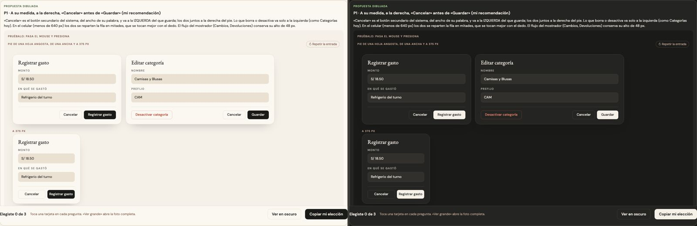

# Cancelar y el pie de una hoja — una sola pieza (ADR-0358, ronda 11)

**Decidido:** 2026-10-14, Felipe, **tocándola** (página de elegir con demos vivas; fuentes en [rondas/11](rondas/11/README.md)).
**Elegida:** P1. **Pieza:** `pie-acciones` (`app/estilos/pie-acciones.css`) y `<PieAcciones izquierda>` (`components/ui/PieAcciones.tsx`).

## Qué se comparó

El censo (Admin y el terminal del mostrador, con escenarios) encontró que «Cancelar» es casi siempre el botón secundario (21 de 24), pero el
pie se armaba de dos maneras y quedaban caras sueltas. En el código había 124 «Cancelar»:

| Forma | Cuántos | Dónde |
|---|---:|---|
| Dos mitades iguales (`flex-1`, `botonCancelar`) | 45 | Caja, Vender, Colaboradores y casi todas las hojas angostas |
| Cada botón a su medida, a la derecha | 62 | Categorías, Colores, Configuración, Finanzas, la ficha del producto |
| Sutil o discreto | 11 | Nueva compra, Roles, Nuevo producto |
| Versalitas sueltas | 2 | Editar marca (¡después de «Guardar»!), la decisión de un faltante |
| El del flujo del mostrador (versalitas de 48 px) | 4 | Cambios, Devoluciones |

## Lo que eligió

**P1 · a su medida, a la derecha, «Cancelar» antes de «Guardar».** «Cancelar» es el botón secundario del sistema, del ancho de su palabra, y
va a la IZQUIERDA del botón que guarda; los dos juntos a la derecha del pie. Lo que borra o desactiva va solo a la izquierda (`izquierda` de
`<PieAcciones>`, o un botón con `mr-auto`), como Categorías. En el celular (menos de 640 px) los de la derecha se reparten la fila en mitades y lo
que borra baja a su propia fila. El flujo del mostrador conserva su alto de 48 px.

## El movimiento de la pieza

El de todo botón (sube con sombra y cruza la luz al pasar el mouse, se encoge al presionar, la onda donde tocaste). Lo que solo cambiaba de color
(las versalitas sueltas) gana el movimiento.

## Migración (2026-10-14)

**Deuda al decidir: 116 pies en 86 archivos; migrada el mismo día, deuda 0.** Un script pasó cada pie con «Cancelar» a `pie-acciones` y le sacó
el `flex-1`; después se revisaron a mano los que tenían una nota o algo que borra a la izquierda. La regla también llegó a los pies que dicen
«Mejor no» en lugar de «Cancelar» (Apartados, Vender: la misma función). Además:

- **La clase va sin `@layer`** (`pie-acciones.css`): así decide el ancho de sus botones y enlaces aunque alguno todavía traiga `flex-1`. Solo
  toca botones y enlaces (una nota a la izquierda conserva su `flex-1`) y no a la flecha de `<Volver>`.
- **El orden:** Editar marca, «Liquidar desde» de Análisis y el aviso de una venta sin conexión (Vender y la cola de Caja) tenían «Cancelar»
  DESPUÉS de la acción; ahora va antes.
- **El flujo del mostrador** (`BotonSecundario` de `FlujoGuiado`): el secundario del sistema, en letra normal, con sus 48 px (también
  «Rechazar» y «Nueva devolución»).
- **«Cancelar conteo»** no es salir de una hoja: anula un conteo en curso. Pasó a `btn-peligro` (ronda 7, lo peligroso en rojo).
- **Se quedan como están:** el pie de Finanzas (`fin-botones`, ya a la derecha y a su medida; el kit es una decisión, ADR-0195), la barra de
  herramientas del dibujo (`GeneradorDibujo`, excepción) y los formularios en línea de Nuevo producto (cambiaron de cara, no de lugar).

## Firmas

Un «Cancelar» a secas en un `Boton`, `button` o enlace con `flex-1`, `botonCancelar`, `btn-sutil`, `peso="discreto"` o `label-cayla`. Las
pruebas con el código de antes la encontraron 57 veces en 41 archivos; hoy, ninguna.
