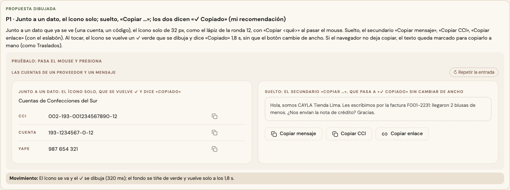
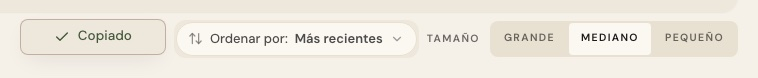

# Copiar — una sola pieza (ADR-0358, ronda 13)

**Decidido:** 2026-10-15, Felipe, **tocándolo** (página de elegir con demos vivas que copian un texto de ejemplo; fuentes en
[rondas/13](rondas/13/README.md)). **Elegida:** P1. **Pieza:** `<BotonCopiar>` (`components/ui/BotonCopiar.tsx`; CSS en
`app/estilos/avance-anillo-copiar.css`).

## Qué se comparó

**Nueve caras en once pantallas:** un ícono de 14 px que se volvía «✓ Copiado» (Pagar), un círculo de 20 px (el destino de un medio de
pago), una píldora «COPIAR» en versalitas (las cuentas de un proveedor), el código de la talla que era el botón (Existencias), «COPIAR MENSAJE»
en versalitas (la nota de crédito), el secundario con ícono y sin «Copiado» (el proveedor, Traslados), «Copiar» sin ícono a media fila (una
terminal nueva), «COPIAR ENLACE» con el eslabón (Productos) y el eslabón solo (Existencias). Unas decían «Copiado» y otras no decían nada.

## Lo que eligió

**P1 · junto a un dato, el ícono solo; suelto, «Copiar …»; los dos dicen «✓ Copiado».**

- **`forma="icono"`:** junto a un dato que ya se ve (una cuenta, un CCI, el código de una talla, una línea de Terminal), el ícono solo de
  32 px, como el lápiz de Editar, con «Copiar <qué>» al pasar el mouse y para el lector.
- **`forma="boton"`** (la de fábrica): suelto, el secundario «Copiar mensaje», «Copiar CCI», «Copiar correo y clave», «Copiar enlace» (con el
  eslabón, `icono="enlace"`). En una barra de filtros, `soloIconoEnCelular`.
- **Al copiar,** el ícono se vuelve un ✓ verde que se dibuja y dice «Copiado» 1,8 s, sin que el botón cambie de ancho.
- **Si el navegador no deja usar el portapapeles,** prueba el camino viejo (un texto oculto que se copia; lo hacía la nota de crédito y ahora
  lo tienen todos); si tampoco, avisa y llama a `alFallar` (Traslados deja el mensaje marcado; las cuentas de un proveedor muestran los
  datos completos).
- Lo que una pantalla decía además al copiar (el aviso «Enlace copiado: quien lo abra ve tu sede», «Pégalo en el chat de …») se conserva con
  `alCopiar`.

La otra propuesta (la píldora «COPIAR» junto a cada dato) no la eligió: en una lista de cuentas pesaba más que los datos.

## El movimiento de la pieza

El ícono se va y el ✓ se dibuja (320 ms); el fondo se tiñe de verde y vuelve solo a los 1,8 s. Junto a un dato, «Copiado» sale en un globito
sobre el ícono (no corre lo de al lado). En el botón suelto, «✓ Copiado» ocupa la misma celda que la palabra. Todo `btn-cayla` conserva su
movimiento al pasar el mouse.

## Migración (2026-10-15)

**Deuda 0.** Pagar (cuenta, CCI y celular), el destino de un medio de pago, las cuentas de un proveedor, «Copiar CCI» de su ficha, la nota de
crédito, una terminal nueva («Copiar correo y clave»), Traslados («Copiar mensaje»), «Copiar enlace» de Productos y de Existencias, el código
de una talla (el código queda a la vista y el ícono va a su lado) y la línea de instalación de la guía de impresión.

**Se queda, con su `unificar-fijo`:** «Copiar enlace de esta vista» en el menú «Más» de Movimientos (es una opción de un menú, no un botón).

## Firmas

`navigator.clipboard` y el ícono `<Copy>` fuera de la pieza. Con el código de antes reconocen los 12 archivos.
