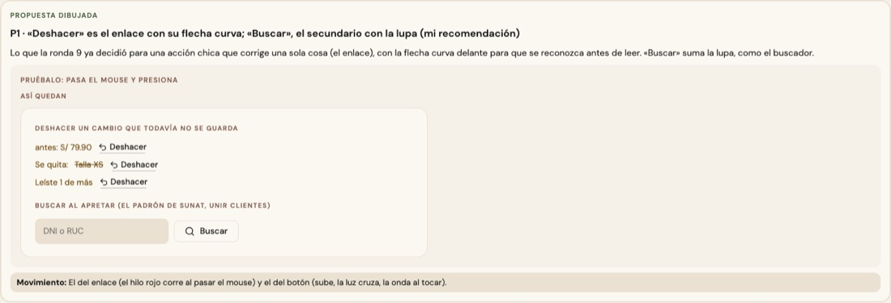

# «Deshacer» — una sola pieza (ADR-0358, ronda 15)

**Decidido:** 2026-10-15, Felipe, **tocándolo** (página de elegir; fuentes en [rondas/15](rondas/15/README.md)). **Elegida:** P1. **Pieza:**
`<BotonDeshacer>` (`components/ui/BotonDeshacer.tsx`).

Vuelve atrás un cambio que todavía no se guarda: un precio, una talla o un color que se quita, una lectura de más.

## Qué se comparó

Tres caras: el enlace (cuatro lugares), versalitas taupe con la flecha curva (Editar producto) y versalitas subrayadas (Editar marca).

## Lo que eligió

**P1 · el enlace con la flecha curva delante**: lo que la ronda 9 ya decidió para una acción chica que corrige una sola cosa, con la flecha
para que se reconozca antes de leer. El «Deshacer» de un aviso (`avisar.exito(…, { accion })`) es del aviso, no de esta pieza.

## El movimiento

El del enlace: el hilo rojo corre al pasar el mouse y el texto pasa a rojo profundo.

## Migración (2026-10-15)

**Deuda 0.** Editar producto (el «antes: … · Deshacer» de un dato, y los de una corrección, un color o una talla que se quitan), Editar marca,
Llegó mercadería y Recibir (la última lectura).

**Se queda:** el «Deshacer» de Preferencias de un cliente, que en la barra que guarda vuelve todas las marcas a como estaban: hace de
«Cancelar», no deshace una sola cosa (`unificar-fijo` en la línea).

## Firmas

Un botón cuyo texto es «Deshacer» fuera de la pieza (hasta 3 líneas). Con el código de antes reconoce 5 archivos.
