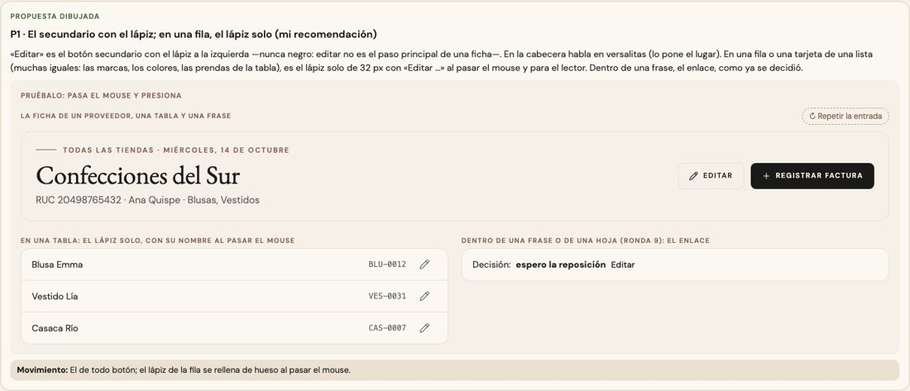
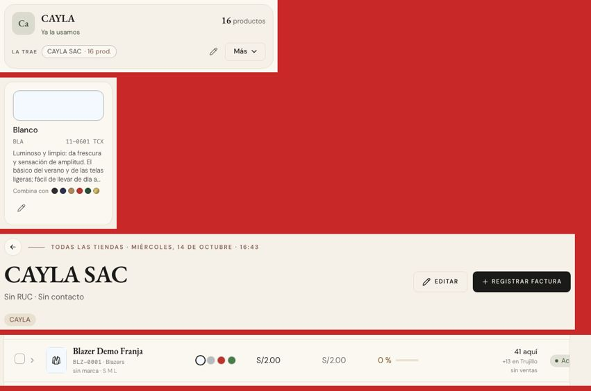

# Editar algo — una sola pieza (ADR-0358, ronda 12)

**Decidido:** 2026-10-14, Felipe, **tocándola** (página de elegir con demos vivas; fuentes en [rondas/12](rondas/12/README.md)).
**Elegida:** P1. **Piezas:** `<BotonEditar>` y `<LapizEditar>` (`components/ui/BotonEditar.tsx`).

## Qué se comparó

El botón que abre la edición de algo entero (un proveedor, una orden, una categoría, una prenda de la tabla). Tenía diez caras:

| Forma | Dónde |
|---|---|
| el secundario con el lápiz | la ficha de un proveedor, las órdenes de compra e insumos, la vista rápida |
| el secundario sin lápiz | cada marca de la lista |
| negro | la ficha de un cliente, el detalle de una categoría, «no se puede eliminar» |
| versalitas de 10 px | Colores, Etiquetas |
| sutil chico | Familias, los gastos fijos |
| secundario de 44 px | «Corregir conteo» |
| el lápiz de 32 px sin borde | la tabla de Productos |
| el lápiz de 28 px con borde | la ficha de stock |
| el botón de fila con el lápiz | las metas de Rendimiento |
| el enlace | las cuentas de un proveedor y de Configuración, un faltante |

## Lo que eligió

**P1 · el secundario con el lápiz; en una fila, el lápiz solo.**

- **`<BotonEditar href | onClick chico>`:** abrir la edición de algo entero es el botón SECUNDARIO con el lápiz a la izquierda y «Editar» (o
  «Editar» + qué: «Editar prendas», «Corregir conteo»). Nunca negro: editar no es el paso principal de una ficha. En la cabecera habla en
  versalitas (lo pone el lugar, ronda 3).
- **`<LapizEditar que href | onClick>`:** en una fila o una tarjeta de una lista (muchas iguales: las marcas, los colores, las familias, las
  prendas de la tabla, las metas), donde no cabe la palabra, el lápiz solo de 32 px, con «Editar <que>» al pasar el mouse y para el lector.
- **Dentro de una frase o de una hoja**, corregir una sola cosa sigue siendo el enlace (`btn-enlace`, ronda 9): «Decisión: espero · Editar»,
  «Editar el producto» al crear una orden.

La otra propuesta (el lápiz solo en todas partes) no la eligió: hay que adivinar qué hace el ícono antes de pasar el mouse.

## El movimiento de la pieza

El de todo botón en `<BotonEditar>`; el lápiz de la fila se rellena de hueso al pasar el mouse (como los íconos de la fila de Productos).

## Migración (2026-10-14)

**Deuda 0.** `<BotonEditar>`: la ficha de un proveedor, las órdenes de compra e insumos, «todas las acciones» de una prenda en la tabla de
Productos, el detalle de una categoría y «no se puede eliminar» (eran negros), la ficha de un cliente (era negro), Editar prendas de un
apartado, Corregir conteo (con su «Abriendo…») y «Editar fijos». `<LapizEditar>`: la fila de Productos, cada marca, cada color, cada
familia, cada gasto fijo, cada cuenta de Configuración y de un proveedor y cada meta de Rendimiento.

**Se quedan, con su motivo:** la vista rápida de un producto (de diseño propio; su «Editar» ya es el secundario con el lápiz) y la ficha de
stock (el lápiz de corregir un color va junto al tacho, los dos con su borde; y el chico de la celda es la pista de que la talla se edita).

## Firmas

Un `<Pencil` dibujado fuera de la pieza, y «Editar» negro, sutil o en versalitas (`AccionTarjeta`). Con el código de antes, 11 lápices a
mano; hoy, ninguno fuera de las excepciones.
