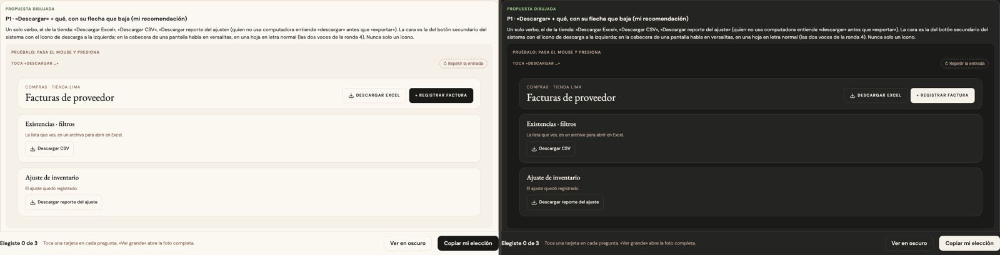
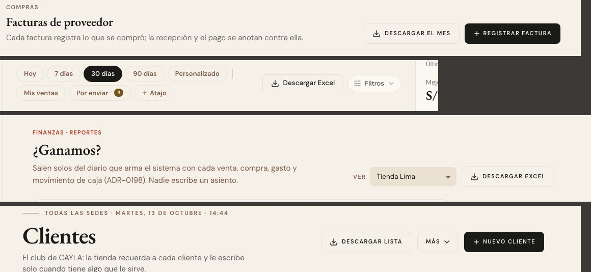

# Descargar un archivo — una sola pieza (ADR-0358, ronda 10)

**Decidido:** 2026-10-13, Felipe, **tocándola** (página de elegir con demos vivas; fuentes en [rondas/10](rondas/10/README.md)).
**Elegida:** P1. **Pieza:** `<BotonDescargar>` (`components/ui/BotonDescargar.tsx`); su movimiento, en `app/globals.css` (junto al de todo botón).

## Qué se comparó

| Forma | Dónde | Cómo se veía |
|---|---|---|
| «DESCARGAR EXCEL» sin ícono | Finanzas ▸ Reportes (seis pestañas) | botón secundario |
| «EXPORTAR MES» con ícono | Compras | `BotonAncla` con el ícono escrito a mano |
| «Exportar CSV» | Existencias (tres vistas) | secundario chico, sin ícono |
| «EXPORTAR» a mano | Historial de ventas | un `<a>` de 36 px en versalitas con borde de tinta |
| «Exportar» | Clientes | secundario |
| «Exportar a Excel con estos filtros» | Movimientos | enlace |
| «Descargar reporte de este ajuste» | Ajustar inventario | versalitas grises que se ponían rojas |
| solo un ícono | Plan de campaña | sin palabra |

Dos verbos («Exportar» y «Descargar») y cuatro caras para lo mismo.

## Lo que eligió

**P1 · «Descargar» + qué.** Un solo verbo, el de la tienda: quien no usa computadora entiende «descargar» antes que «exportar». El texto
dice qué baja: «Descargar Excel», «Descargar CSV», «Descargar el mes», «Descargar la lista», «Descargar reporte del ajuste». La cara es el
botón secundario del sistema con el ícono de descarga a la izquierda; en la cabecera de una pantalla habla en versalitas y en una hoja en
letra normal (las dos voces de la ronda 4, que pone el lugar). **Nunca «Exportar», nunca solo un ícono.** `peso="primario"` solo cuando bajar
el archivo ES la acción de esa hoja (la lista de compra del plan).

## El movimiento de la pieza

El de todo botón (sube 2 px con sombra, la luz cruza, se encoge al presionar, la onda donde tocaste) y, propio de descargar, **la flecha baja
2 px** al pasar el mouse (como la de «ver» avanza 4). Mientras se arma el archivo en el navegador (`onClick` + `cargando`), el hilo barre el
borde de abajo, como «Guardando…». Con `href` es una descarga directa (`<a download>`): no pasa por el loader de pantalla. Sin rebote ni
bucle; con «reducir movimiento», sin el viaje. Lo que traían las de hoy (el cambio de color) se queda.

## Migración (2026-10-13)

**Deuda al decidir: 17 sitios en 15 archivos; migrada el mismo día, deuda 0.** Compras («Descargar el mes»), Historial de ventas
(«Descargar Excel», solo en escritorio como antes), las seis pestañas de Finanzas ▸ Reportes, Existencias (tres «Descargar CSV»), Movimientos
(«Descargar Excel con estos filtros» y el ítem del menú «Más»), Clientes, Ajustar inventario, el plan de campaña («Descargar la lista», que
antes era solo un ícono) y la hoja de exportar el plan. Las guías que nombraban «Exportar» dicen «Descargar».

**Clientes a 375 px.** «Descargar lista» con su ícono ocupaba más que «Exportar» y «+ Nuevo cliente» bajaba de fila. En el celular dice
«Descargar» a secas y sin el ícono, los tres botones llevan `px-3` y 8 px entre ellos: caben en una fila (342 de 343 px). Más angosto, la fila
se parte sola.

**Lo que se arregló de paso: el alto del botón con ícono.** Dentro de `<Boton>`, una caja `inline-flex` (la del «+» de «+ Nuevo cliente», la
del ícono de descarga) armaba su propia línea de texto y el botón crecía sobre sus vecinos de la cabecera: 39,75 · 45,25 · 43,25 px en la
misma fila de Clientes. Las cajas pasaron a `flex` (de bloque) y el ícono de 16 px lleva `-my-1`: los tres miden 40 px, el alto que la
ronda 4 le dio a la cabecera. Toca a todo «+ …» dibujado por `<Boton>` (mide hasta 3,5 px menos).

## Firmas

`<Download` fuera de la pieza (un botón a mano o solo el ícono) y «Exportar» como texto de un botón, un ítem de menú o una etiqueta.
Excepciones: ninguna.
