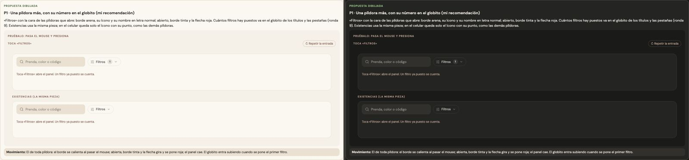
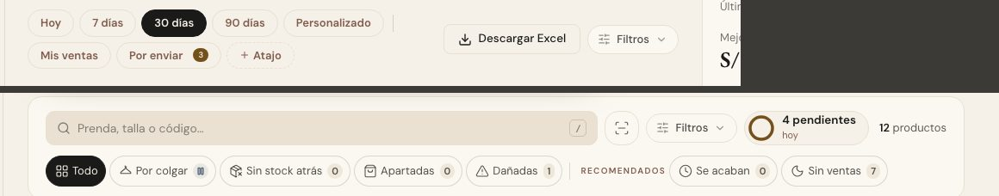

# Abrir los filtros — una sola pieza (ADR-0358, ronda 10)

**Decidido:** 2026-10-13, Felipe, **tocándola** (página de elegir con demos vivas; fuentes en [rondas/10](rondas/10/README.md)).
**Elegida:** P1. **Pieza:** `<BotonFiltros>` (`components/ui/FiltrosPildora.tsx`), con la cara de `.pildora-filtro`
(`app/estilos/campos-y-casillas.css`).

## Qué se comparó

Ya era una sola pieza (`BotonFiltros`), pero con dos caras, y desde la ronda 6 las píldoras que abre hablan en letra normal: el botón había
quedado en otra voz.

| Forma | Dónde | Cómo se veía |
|---|---|---|
| A · «FILTROS · 1» | Productos, Compras, Por pagar, Historial de ventas | versalitas de 11 px, borde de tinta al 15 %, el conteo escrito |
| B · el cuadrado | Existencias | 40 × 40 solo ícono, con una cifra negra sobre la esquina |
| C · a mano | Movimientos en el celular | 44 px, letra normal y una cifra negra al lado |

## Lo que eligió

**P1 · una píldora más, con su número en el globito.** «Filtros» con la cara de las píldoras que abre: borde arena, el ícono de los
deslizadores y su nombre en letra normal; abierto, borde tinta y la flecha roja. Cuántos filtros hay puestos va en el globito de los títulos
y las pestañas (`titulo-cuenta`, ronda 9), pegado al nombre; el lector oye «Filtros · 2 puestos». Existencias usa la misma pieza. En el
celular (`soloIcono`), solo el ícono en un círculo de 38 px con un punto si hay filtros puestos, como «Ordenar» de Productos.

## El movimiento de la pieza

El de toda píldora: el borde se calienta al pasar el mouse; abierta, borde tinta, y la flecha gira y se pone roja; el panel cae (su propia
entrada, que no cambió). El globito entra subiendo cuando se pone el primer filtro. Sin rebote ni bucle; con «reducir movimiento», sin el
viaje. Lo que traía la A (el cambio de color) se queda.

## Migración (2026-10-13)

**Deuda al decidir: la pieza y un botón a mano; migrada el mismo día, deuda 0.** Cambiar `<BotonFiltros>` cambió las cinco barras que ya lo
usaban (Productos, Compras, Por pagar, Historial de ventas y Existencias, que deja el cuadrado). El botón a mano de Movimientos en el celular
pasó a la pieza; abre la misma hoja de siempre.

## Firmas

Un botón con el ícono `SlidersHorizontal` y «Filtros» al lado fuera de la pieza, y el conteo escrito («Filtros · 2»). Excepciones: ninguna.
