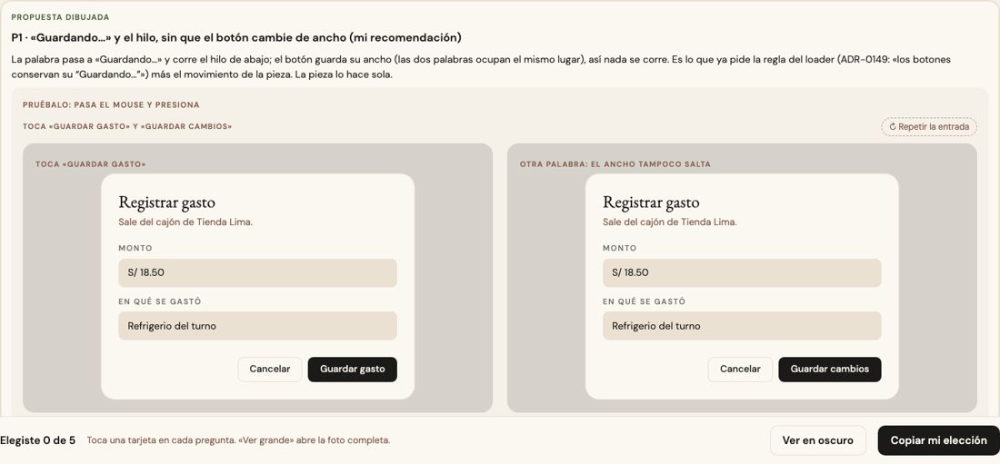
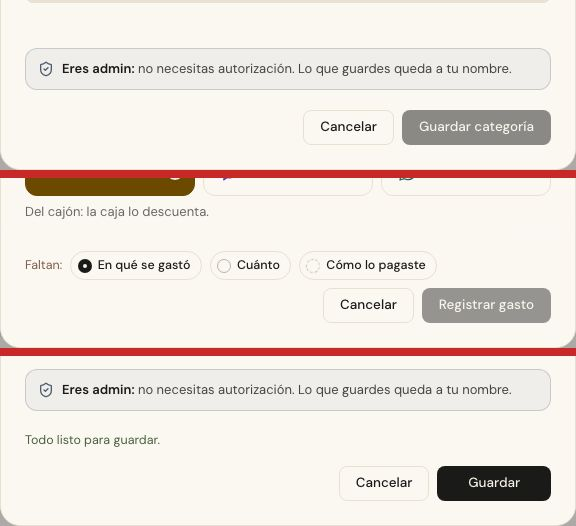

# Mientras guarda — una sola pieza (ADR-0358, ronda 12)

**Decidido:** 2026-10-14, Felipe, **tocándola** (página de elegir con demos vivas que esperan 2 s; fuentes en [rondas/12](rondas/12/README.md)).
**Elegida:** P1. **Pieza:** `<Boton cargando>` (`components/ui/campos.tsx`, con `PalabraEnEspera` y `HiloEnEspera`); lo mismo
`<BotonCompacto cargando>` y los botones del flujo del mostrador (`BotonPrincipal`, `BotonRojo` de `FlujoGuiado`).

## Qué se comparó

Tocaste «Guardar»: ¿qué hace el botón mientras la base responde? Entre 106 botones que guardan había cuatro maneras, casi en partes iguales:

| Forma | Cuántos |
|---|---:|
| no cambia nada | 21 |
| dice «Guardando…» y no se mueve | 35 |
| corre el hilo de abajo y la palabra se queda | 35 |
| las dos cosas | 15 |

Y una quinta en los flujos del mostrador y en Bajar al piso o Cuadrar el piso: una rueda que gira junto a la palabra.

## Lo que eligió

**P1 · «Guardando…» y el hilo, sin que el botón cambie de ancho.** La palabra pasa a «Guardando…», corre el hilo de abajo y el botón se
apaga para que un doble clic no guarde dos veces. Las dos palabras ocupan la misma celda (una invisible), así que el botón no se corre: es
tan ancho como la más larga de las dos. Era lo que ya pedía la regla del loader (ADR-0149: «los botones conservan su “Guardando…”») más el
movimiento de la pieza. La otra propuesta (solo el hilo) no la eligió.

**Cada uno con su verbo:** «Guardando…» es el de fábrica; lo que no es guardar dice lo suyo con `textoCargando` («Anulando…»,
«Desactivando…», «Reactivando…», «Eliminando…», «Abriendo…», «Enviando…», «Cerrando…»). Imprimir dice «Imprimiendo…» y descargar
«Preparando…» (lo ponen `BotonImprimir` y `BotonDescargar`).

**Solo si guarda:** la pieza reserva el lugar de «Guardando…» únicamente cuando se le pasa `cargando` (también en `false`). Un botón que no
guarda no cambia.

## El movimiento de la pieza

El hilo que barre abajo (1,1 s) mientras espera: en bucle solo mientras la base responde, como el giro de antes (una señal, ADR-0136). El
de todo botón al pasar el mouse y al presionar. La rueda que giraba se va: la espera es el hilo.

## Migración (2026-10-14)

**Deuda 0.** Un codemod (`rondas/12/guardando.mjs`) pasó a la pieza 121 botones que cambiaban la palabra a mano (los `<button
className="btn-cayla btn-…">` pasan a `<Boton peso>`), y a mano los que tenían condiciones compuestas o clases propias: Cerrar caja,
Nuevo traslado, Ventas sin registrar, el paso a paso de Existencias, Pedir y apartar, los flujos de Cambios y Devoluciones y su
aprobación, Bajar al piso y Cuadrar el piso, la cola de SUNAT. Otro (`rondas/12/verbos2.mjs`) le puso su verbo a 19 botones que no
guardaban.

**Se quedan, con su `unificar-fijo`:** el botón grande del mostrador con el monto (Cobrar, Confirmar apartado, Entregar), que es el diseño
del spike de Vender; el enlace que abre WhatsApp y anota a la vez (no es un botón); y el estado de la planilla de Contar mientras se
guarda sola.

## Firmas

`? "Guardando…" :` escrito a mano y una rueda `<Loader2 … animate-spin>`: con el código de antes, 53 y 6 (las otras esperas a mano decían otro verbo); hoy, ninguna fuera de las
excepciones marcadas.
