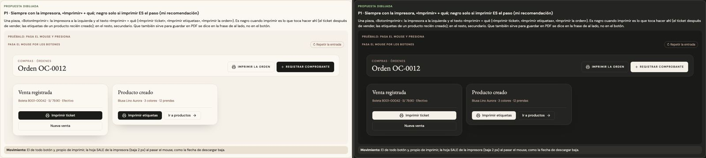

# Imprimir — una sola pieza (ADR-0358, ronda 11)

**Decidido:** 2026-10-14, Felipe, **tocándola** (página de elegir con demos vivas; fuentes en [rondas/11](rondas/11/README.md)).
**Elegida:** P1. **Pieza:** `<BotonImprimir href | onClick peso chico>` (`components/ui/BotonImprimir.tsx`); su movimiento, en `app/globals.css`.

## Qué se comparó

| Forma | Dónde |
|---|---|
| Negro con la impresora | después de vender, Apartados, Rótulos, la guía del traslado, «Imprimir lo que entró», Proformas |
| Secundario con la impresora | las órdenes de compra e insumos, el plan de campaña, la boleta A4 del detalle de una venta, el pase de traslado |
| Sin la impresora (negro o secundario) | las etiquetas de un producto recién creado, de una orden recibida, de un envío recibido, de una campaña, el cartel del club |
| El del ticket de un cambio, hecho a mano | Cambios |

Y varios textos para lo mismo: «Imprimir o guardar PDF», «Imprimir o guardar en PDF», «Guía», «Volver al precio normal».

## Lo que eligió

**P1 · siempre con la impresora, «Imprimir» + qué; negro solo si imprimir ES el paso.** La impresora a la izquierda y el texto dice qué sale:
«Imprimir ticket», «Imprimir etiquetas», «Imprimir la orden». Es negro cuando imprimir es lo que toca hacer ahí (el ticket después de vender,
las etiquetas de lo que acaba de llegar o de crearse, las pantallas de etiquetas, rótulos y cartel); en el resto, secundario. Que también sirve
para guardar en PDF se dice en la frase de al lado o en su `title`, no en el botón.

## El movimiento de la pieza

El de todo botón y, propio de imprimir, **la hoja sale de la impresora** (el papel baja 2 px) al pasar el mouse, como la flecha de descargar baja y
la de ver avanza. Con «reducir movimiento», quieta.

## Migración (2026-10-14)

**Deuda 0: 24 botones en 22 archivos.** Textos que cambiaron: «Imprimir o guardar PDF» → «Imprimir la orden» (órdenes de compra e insumos, con el
PDF en el `title` y en su guía), «Imprimir o guardar en PDF» → «Imprimir la proforma» (la frase de arriba ya habla del PDF), «Guía» → «Imprimir
la guía» (el pase de traslado), «Imprimir» → «Imprimir la lista» (el plan) e «Imprimir la copia» (reimprimir un apartado), «Volver al precio
normal» → «Imprimir con el precio normal» (las etiquetas de una campaña terminada). Las etiquetas de un producto recién creado pasaron a negro
(imprimirlas es el paso que sigue).

**Se quedan, con su motivo:** los «Etiquetas» de la tabla de Productos y de la vista rápida (llevan a la pantalla de etiquetas: es ver en otra
pantalla), la opción «Imprimir de nuevo» de una lista, el ícono de reimprimir en la fila compacta de Apartados (junto al de WhatsApp) y la guía de
impresión, que DIBUJA el botón para explicarlo.

## Firmas

`<Printer` fuera de la pieza, «Imprimir o guardar», y un botón del sistema que dice «Imprimir…» sin la pieza. Con el código de antes: 23 en 19
archivos; hoy, ninguna.
