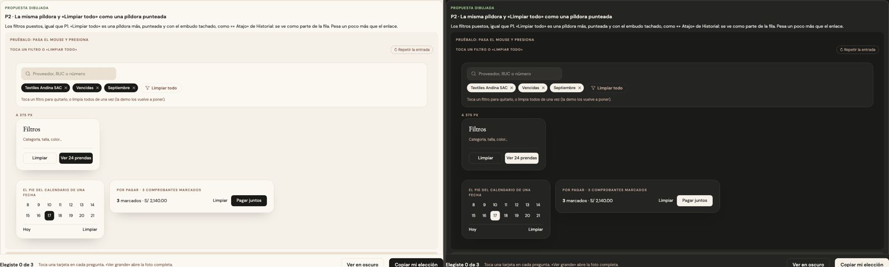

# Limpiar los filtros — una sola pieza (ADR-0358, ronda 11)

**Decidido:** 2026-10-14, Felipe, **tocándola** (página de elegir con demos vivas; fuentes en [rondas/11](rondas/11/README.md)).
**Elegida:** P2. **Piezas:** `<FiltroPuesto>` y `<BotonLimpiar>` (`components/ui/FiltrosPuestos.tsx`), CSS en `app/estilos/vacio-aviso-buscador.css`.

## Qué se comparó

| Forma | Dónde |
|---|---|
| Cada filtro puesto: una pastilla en versalitas de 10 px con su ×, hecha a mano | Compras, Historial de ventas, Productos, Existencias, el filtro de Por pagar |
| «LIMPIAR TODO» en versalitas grises que se ponen rojas | Compras, Historial de ventas, Productos, Existencias, Recibidas |
| «Quitar filtros» y «Limpiar filtros» como enlace | Frescura, Movimientos |
| «Limpiar» sutil o secundario en la hoja de filtros del celular | Productos, Existencias, Movimientos |
| «HOY» y «LIMPIAR» en versalitas | el calendario de toda fecha, «Pagar juntos» de Por pagar |

En los vacíos ya estaba decidida (ronda 5) otra cara para el filtro puesto: la píldora de tinta con su ✕.

## Lo que eligió

**P2 · la píldora de los vacíos y «Limpiar todo» como una píldora punteada.** Cada filtro puesto es `<FiltroPuesto>`: la píldora de los
vacíos (`vacio-filtro`), tinta con su ✕, que pasa a rojo profundo al apuntarla; un toque la quita. Al final de la fila, «Limpiar todo» es
`<BotonLimpiar>`: una píldora más, punteada, con el embudo tachado (como «+ Atajo» de Historial). El verbo es siempre «Limpiar» + qué: «Limpiar
todo» si también borra la búsqueda, «Limpiar filtros» si no; nunca «Quitar filtros». En la hoja de filtros del celular, «Limpiar» es el
secundario (con `pie-acciones`, como «Cancelar»); en el calendario de una fecha y en «Pagar juntos», el enlace del sistema (y «Hoy», su vecino).

## El movimiento de la pieza

La píldora entra con la fila (`anim-entrada`, lo que ya hacían las de Compras), pasa a rojo profundo al apuntarla y se encoge al presionarla. La
punteada calienta su borde al pasar el mouse y también se encoge al presionarla. Con «reducir movimiento», sin el viaje.

## Migración (2026-10-14)

**Deuda 0.** Ocho filtros puestos (Compras, Historial, Productos, Existencias —también «Orden» y «Vista»— y el filtro de Por pagar, que ahora se
quita tocando la píldora entera y no solo su ×), once «Limpiar» (las filas de filtros, Frescura y Movimientos, y los «Limpiar filtros» que se
ven con el panel abierto en Productos y Existencias), las tres hojas del celular, el calendario de fecha y «Pagar juntos». «Quitar filtros»
(Frescura, el vacío del plan de campaña) pasó a «Limpiar filtros», también en la guía de Frescura. Recibidas decía «Limpiar» a secas: ahora
«Limpiar todo».

## Firmas

«Limpiar» en un botón con `label-cayla` o `btn-sutil`; la pastilla hecha a mano (`rounded-full border border-tinta/15 bg-tinta/[0.04]`); y
«Quitar (los) filtros». Con el código de antes: 16 en 8 archivos; hoy, ninguna.
