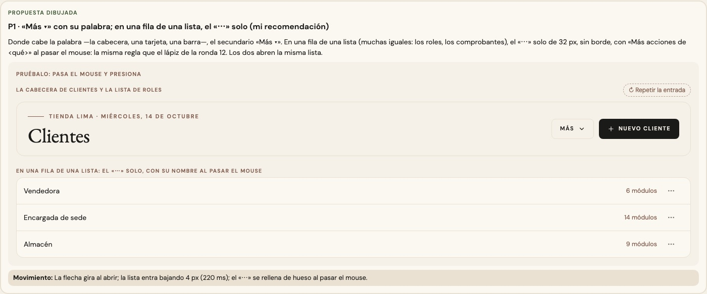
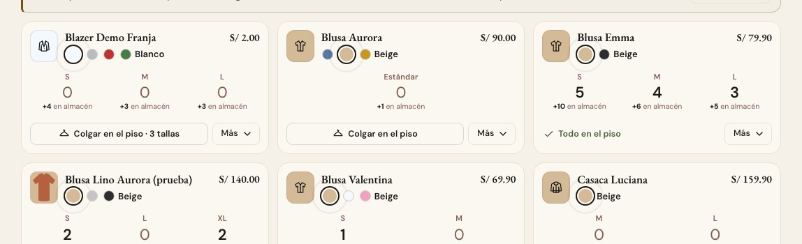
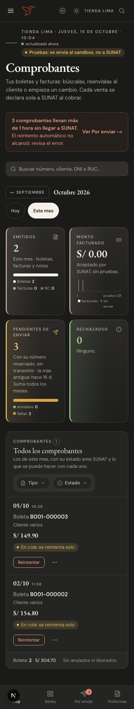

# El menú «Más» — una sola pieza (ADR-0358, ronda 13)

**Decidido:** 2026-10-15, Felipe, **tocándolo** (página de elegir con demos vivas que abren su lista; fuentes en
[rondas/13](rondas/13/README.md)). **Elegida:** P1. **Pieza:** `<MenuAcciones>` (con `texto="Más"` o sin él) y `<BotonPuntos>` para el
«⋯» que abre una hoja (`components/ui/MenuAcciones.tsx`).

El botón que guarda las acciones de vez en cuando: descargar el Excel, copiar el enlace de una vista, imprimir el cartel, desactivar un rol.

## Qué se comparó

**Cuatro caras:** «Más ▾» con su palabra (Clientes, Marcas, Por regularizar), «⋯» de 36 px con borde (Roles, Movimientos), «⋯ Opciones», el
botón de fila de cada comprobante de Facturación (abre una hoja), y un «Más ▾» hecho a mano en el pie de cada tarjeta de Existencias.

## Lo que eligió

**P1 · «Más ▾» con su palabra; en una fila de una lista, el «⋯» solo.**

- **Donde cabe la palabra** —la cabecera de una pantalla, una tarjeta, una barra de herramientas—, el secundario **«Más ▾»**
  (`<MenuAcciones texto="Más">`). En la cabecera habla en versalitas (lo pone el lugar, ronda 4).
- **En una fila de una lista** (muchas iguales: los roles, los comprobantes), el **«⋯» solo de 32 px, sin borde**, como el lápiz de Editar,
  con «Más acciones de <qué>» al pasar el mouse y para el lector (`<MenuAcciones>` sin `texto`). Si abre una hoja en vez de una lista,
  `<BotonPuntos que onClick>` (en el celular, 44 px con `className`).
- Los dos abren la misma lista, que entra como la de un combo.

La otra propuesta (el «⋯» en todas partes) no la eligió: en la cabecera había que adivinar qué había detrás.

## El movimiento de la pieza

La flecha de «Más ▾» da media vuelta al abrir (300 ms); la lista entra con `anim-revelar` (240 ms, la de los combos; antes no tenía
entrada); el «⋯» se rellena de hueso al pasar el mouse y mientras está abierto. Todo `btn-cayla` conserva su movimiento.

## Migración (2026-10-15)

**Deuda 0.** Movimientos pasó de «⋯» a «Más ▾» (está en la cabecera); el «⋯» de cada rol pasó a 32 px sin borde (en la pieza); cada
comprobante de Facturación pasó de «⋯ Opciones» al «⋯» solo (`BotonPuntos`, su guía y su escenario del auditor ahora lo buscan por «Más
acciones de»); y el «Más ▾» de las tarjetas de Existencias tomó la cara del secundario de la pieza a 32 px, como su vecino «Colgar en el
piso» (su lista propia, anclada a la tarjeta, se queda). Clientes, Marcas y Por regularizar ya usaban la pieza con su palabra.

A 375 px, en oscuro (el «⋯» de cada comprobante, de 44 px para el dedo): 

## Firmas

Los tres puntos dibujados fuera de la pieza (`<MoreHorizontal>`, `<MoreVertical>`, `<Ellipsis>`, o «⋯» como texto de un botón). Con el código
de antes reconocen el de Facturación.
