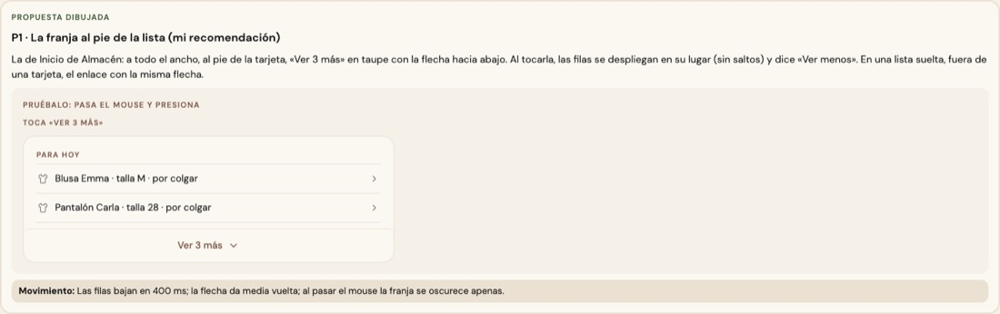
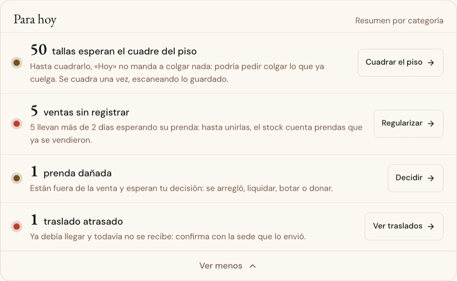

# «Ver más / Ver menos» — una sola pieza (ADR-0358, ronda 15)

**Decidido:** 2026-10-15, Felipe, **tocándolo** (página de elegir: «Ver 3 más» abre y cierra de verdad; fuentes en
[rondas/15](rondas/15/README.md)). **Elegida:** P1. **Pieza:** `<BotonVerMas>` y `<FilasDeMas>` (`components/ui/VerMas.tsx`; CSS en
`app/estilos/globito-vermas.css`).

Una lista muestra sus primeras filas y guarda las demás. «Siguiente» y «Anterior» ya los resuelven la paginación (ronda 8) y los pasos a paso
(`FlujoGuiado`): no hubo que decidir nada.

## Qué se comparó

**Cinco caras:** la franja al pie de la lista con la flecha que gira (Inicio de Almacén), un texto taupe sobre una raya (Existencias ▸ Para
hoy), un botón sutil (la ficha de un cliente), un enlace (Finanzas ▸ Resumen) y una tecla con ícono (las familias de Nuevo producto).

## Lo que eligió

**P1 · la franja al pie de la lista**, la de Inicio de Almacén: a todo el ancho, al pie de la tarjeta, «Ver 3 más» en taupe con la flecha hacia
abajo. Al tocarla, las filas de más bajan **en su lugar** (sin saltos) y dice «Ver menos». En una lista suelta, fuera de una tarjeta
(`forma="enlace"`), el enlace con la misma flecha.

La otra propuesta (siempre el enlace) no la eligió.

## El movimiento

Las filas bajan en 400 ms (`grid-template-rows` 0fr → 1fr, sin medir alturas; cerradas quedan `inert`); la flecha da media vuelta; al pasar el
mouse la franja se oscurece apenas. Con «reducir movimiento», sin transición.

## Migración (2026-10-15)

**Deuda 0.** Inicio de Almacén (la pieza nació aquí: su `VerMas` ahora la usa), Existencias ▸ Para hoy (la franja), la ficha de un cliente
(el enlace: es una lista dentro de la ficha) y Finanzas ▸ Resumen (el enlace). Las tres últimas ahora despliegan sus filas en su lugar; antes
aparecían de golpe.

**Se queda:** la tecla «Ver más» de las familias de Nuevo producto, que es una tarjeta más entre las de familia y dice lo que esconde
(«Calzado, Accesorios…»), no el pie de una lista (`unificar-fijo` en la línea).

## Firmas

El texto «Ver menos» fuera de la pieza. Con el código de antes reconoce 4 archivos.
