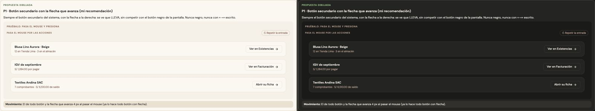
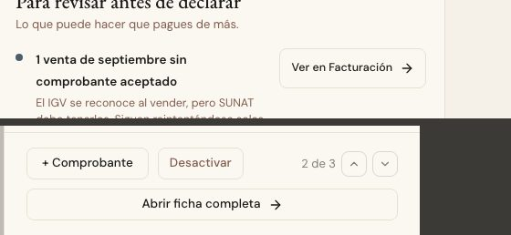

# Ver en otra pantalla — una sola pieza (ADR-0358, ronda 10)

**Decidido:** 2026-10-13, Felipe, **tocándola** (página de elegir con demos vivas; fuentes en [rondas/10](rondas/10/README.md)).
**Elegida:** P1. **Pieza:** `<BotonVer>` (`components/ui/BotonDescargar.tsx`, junto a `<BotonDescargar>`: dos botones de una sola función).

## Qué se comparó

Un botón que no guarda nada: lleva a ver la prenda en Existencias, el impuesto en Facturación, la ficha del proveedor. Pesaba distinto en
cada lado.

| Forma | Dónde |
|---|---|
| negro con ícono («Ver en Existencias») | la vista rápida de un producto, Revisar producto, el resultado de Conteo y de Cuadre del piso |
| sutil («Ver en Facturación») | Finanzas ▸ Impuestos |
| secundario («Ver qué falta», «Ir a Conteo») | Análisis, el plan de campaña, Configuración |
| negro con la flecha escrita («Abrir ficha completa →») | la vista rápida de un proveedor |

El negro dice «esto es lo principal de aquí», y llevar a otra pantalla casi nunca lo es.

## Lo que eligió

**P1 · el botón secundario con la flecha que avanza.** Siempre el secundario del sistema, con la flecha a la derecha: se ve que LLEVA, sin
competir con el botón negro de la pantalla. **Nunca negro, nunca con «→» escrito.** Lo que ya estaba decidido no cambia: dentro de una frase
es el enlace (ronda 8) y junto a un resumen, «Ver las 9 →» (`<EnlaceVer>`). Con `href` es un `<BotonEnlace>` (`alNavegar` cierra lo que haga
falta antes de ir, como el resumen del día en Vender); con `onClick`, un `<Boton>`.

## El movimiento de la pieza

El de todo botón (sube, la luz cruza, se encoge al presionar, la onda) y la flecha que **avanza 4 px** al pasar el mouse, que ya hacía todo
botón con flecha. La flecha escrita no se movía: ahora sí.

## Migración (2026-10-13)

**Deuda al decidir: 17 botones en 12 archivos; migrada el mismo día, deuda 0.** La vista rápida de un producto («Ver en Existencias», que
conserva su lugar al pie), Revisar producto, el resultado de Conteo y de Cuadre del piso («Ir a Existencias» y «Ver Movimientos», que
eran negro y secundario), Envío recibido, Producto creado, Análisis, Impuestos, Configuración («Ver el cartel del club»), el aviso de stock del plan,
el resumen del día de Vender («Historial» y «Caja», con su ícono) y la vista rápida de un proveedor («Abrir ficha completa»).

**Lo que se quedó a propósito: la acción de un vacío.** En un `<Vacio>` (ronda 5) ir a otra pantalla ES el paso principal («Crear el primer
proveedor», «Ver los últimos 90 días»): sigue negro y lleva su `unificar-fijo` (Compras ▸ Nueva, Órdenes, Por revisar, Comprobantes de
producción, Conteo y Movimientos).

## «Ver» al lado de una fila (2026-10-14)

En Caja, cada pendiente del turno («2 ventas sin comprobante») tenía un «Ver» que lleva a resolverlo: un botoncito de 24 px hecho a mano. El
`<BotonVer>` chico mide 44 px y agrandaba cada fila; el «Ver las 9 →» rojo gastaba el rojo en cada una. Felipe eligió **P1 · el enlace del
sistema** (`btn-cayla btn-enlace`, fuentes en [rondas/pendientes](rondas/pendientes/README.md)): la fila no crece y se lee como una acción
chica, con el hilo que se llena al pasar el mouse. El enlace lleva su nombre completo para el lector («Ver 2 ventas sin comprobante»).

## Firmas

Un `Link`, `BotonEnlace` o `<a>` negro (`btn-primario` o `peso="primario"`) cuyo texto empieza por «Ver», «Ir a» o «Abrir ficha», con o sin
un ícono delante; «→» escrito en un botón del sistema que lleva a otro lado; y un «Ver» de 11 px hecho a mano al lado de una fila (2026-10-14).
Excepciones: ninguna.
