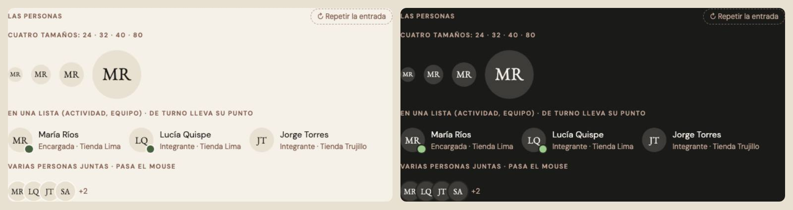

# Avatares — una sola pieza (ADR-0358, ronda 8)

**Decidido:** 2026-10-13, Felipe, **tocándolos** (página de elegir con demos vivas; fuentes en [rondas/6-8](rondas/6-8/README.md)).
**Elegida:** P1. **Pieza:** `<AvatarPersona>` y `<PilaPersonas>` (`components/ui/AvatarPersona.tsx`), CSS en
`app/estilos/enlaces-paginas-caras.css`.

## Qué se comparó

| Forma | Dónde | Cómo se veía |
|---|---|---|
| A · `AvatarPersona` | lateral, Mi perfil, Responsable, Buscador, Colaboradores, Actividad | serif sobre arena; el tamaño lo ponía cada pantalla: 28, 32, 36, 72, 80 |
| A mano | Roles (pilas y lista, sans de 10 px), Entregar apartado (arena al 70 %, 48 y 36), el cliente del ticket | círculos de iniciales con su propio tamaño y letra |
| Decididas a propósito | Historial de la prenda (tono por persona, ADR-0354), Observatorio (ADR-0322), la página pública del club | se quedan como están |

## Lo que eligió

**P1 · AvatarPersona en cuatro tamaños.** Iniciales en serif sobre arena, en **24** (dentro de una línea), **32** (listas), **40** (fichas y
combos) o **80** (Mi perfil): `tamano`. Quien está de turno lleva un punto verde con borde de papel (`deTurno`, lo que Colaboradores ya
dibujaba aparte). Varias personas juntas, `<PilaPersonas>`: se pisan con un borde de papel y «+N» al final. Una cuenta de terminal (Roles)
lleva el círculo gris de siempre (`terminal`) y nunca busca foto. `className` solo ubica (márgenes, el tinte de la fila del lateral).

## El movimiento de la pieza

La foto de Dynamic entra con un fundido (420 ms) en vez de saltar sobre las iniciales. La pila se abre al pasar el mouse (240 ms) para ver a
cada uno. Nada más: una cara no se mueve sola. Con «reducir movimiento», sin el viaje.

## Migración (2026-10-13, el mismo día)

Los 9 usos de la pieza pasaron a `tamano` (28 → 32, 36 → 40, 72 → 80); los 3 archivos a mano (Roles, Entregar apartado, el cliente del
ticket) pasaron a la pieza con las mismas iniciales de antes. **Deuda: 0.** Verificado en Colaboradores (Equipo, con su punto de turno, y
Roles y accesos, con sus pilas y las terminales en gris).
