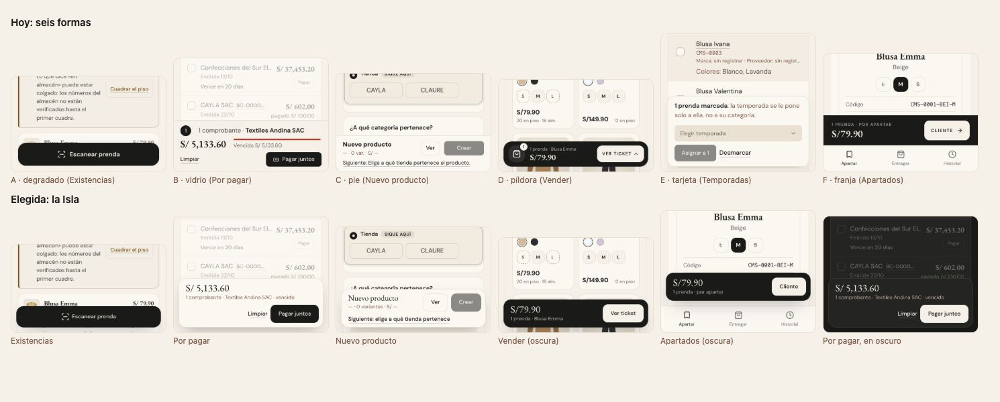

# La barra de abajo del celular — la Isla (ADR-0358, ADR-0479 actividad 12)

**Decidido:** 2026-10-23, Felipe, mirando las fotos en las pantallas reales (`unificar/elegir.mjs`). **Elegida:** la «Isla» para las dos
preguntas. **Pieza:** la clase `barra-abajo` (`apps/web/app/estilos/barra-abajo.css`) y `<BarraDeAbajo>` / `<BarraDeAbajoResumen>`
(`apps/web/components/ui/BarraDeAbajo.tsx`).

## Qué se comparó

Medido en local a 375 × 812 con toque emulado, fotografiado en las pantallas reales. Hoy había 8 formas de barra de abajo, que son dos funciones:

| Función | Forma de hoy | Dónde |
|---|---|---|
| Lo que toca hacer en la pantalla | A · degradado crema con un botón negro | Existencias, Cambios, Devoluciones, Caja, Inicio de almacén |
| | B · vidrio con línea, de borde a borde (`BarraFija`) | Por pagar, Roles, Contar, Cuadrar el piso, Recepción del envío, Plan del piso, Vitrina, cambios sin guardar |
| | C · pie pegado del formulario | Nuevo producto, Bajar al piso, Recibir, Abrir conteo |
| Lo que llevas elegido | D · píldora oscura flotante | Vender (el ticket), Existencias y Productos (prendas marcadas) |
| | E · tarjeta clara flotante | Temporadas |
| | F · franja oscura de borde a borde | Apartados |

Las pestañas de abajo (Comprobantes, Apartados) ya eran una sola forma y no entraron a la pregunta. Las propuestas, «Isla» y «Vidrio»
(`docs/unificar/propuestas/barra-movil.html`), se fotografiaron dentro de las pantallas reales, en claro y oscuro.

## Por qué esta

La Isla es la forma que ya tenía la barra del ticket de Vender (la pantalla del celular que más se usa), llevada a todas: se separa de lo de
atrás sin taparlo de borde a borde, y el degradado de la A dejaba el contenido medio borrado bajo el botón. Una sola forma con dos tonos
dice dos cosas sin texto: la clara es lo que toca hacer; la oscura, lo que llevas elegido.

## La pieza y su movimiento

- **Forma:** flota a 12 px de los bordes (y de la isla, la muesca y la barrita del iPhone), esquinas de 18 px, borde arena y sombra suave
  (flota, así que lleva sombra: ADR-0012). Clara en papel; oscura en tinta (en modo oscuro, al revés, como todo token).
- **Contenido:** un resumen a la izquierda (la cifra en serif, el detalle en taupe) y las acciones a la derecha, donde va el pulgar; si no
  caben, bajan a su fila y siguen a la derecha. Con una sola acción (`data-sola`), la isla es el botón (52 px). Los botones del sistema
  dentro, de 44 px. En la oscura, el principal va en crema.
- **Movimiento:** entra una vez subiendo 12 px (260 ms, `--ease-cayla`, sin rebote). Sus botones traen el de todo botón (`.mov-boton`), que
  en el teléfono ya no queda pegado (actividad 7). Lo que ya tenía cada barra se conserva: `BarraFija` sube al aparecer y baja al irse; la
  cifra del ticket se asienta al cambiar. Con «reducir movimiento», aparece de una.
- **Variantes con nombre:** `data-tono="tinta"`, `data-sola`, `data-pegada` (dentro del flujo de un formulario) y `--sobre` (sobre unas
  pestañas de abajo).

## Lo que queda distinto a propósito

- **Escritorio:** `BarraFija` sigue de borde a borde con su vidrio (sus clases `sm:` le ganan a la pieza); la isla es del teléfono. Las
  barras de selección de Existencias y Productos ya eran una isla oscura centrada en escritorio y siguen así.
- **Las pestañas de abajo:** son navegación, no una barra de acción.

## Deuda al decidir

14 archivos la dibujan a mano (firmas en `apps/web/unificar/familias.mjs`): los cinco del degradado, las tres píldoras, la tarjeta de
Temporadas, la franja de Apartados, `BarraFija` y los cuatro pies de formulario. Se migran en el mismo PR, módulo por módulo.
