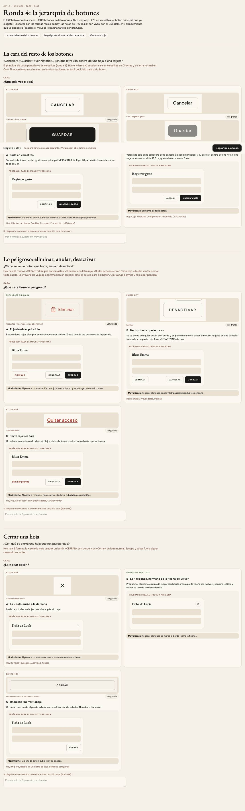
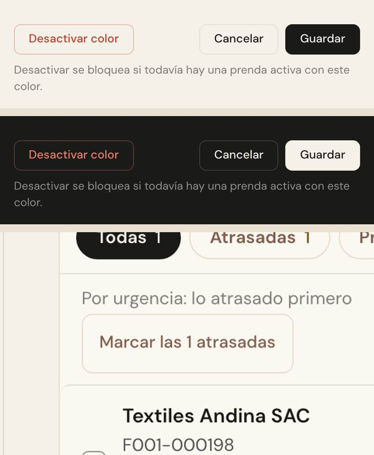

# Los botones del ERP — dos voces, una pieza (ADR-0358, ronda 4)

**Decidido:** 2026-10-07, Felipe, **mirando y tocando** (página de elegir con hojas vivas, `apps/web/unificar/.salida/elegir-ronda4/`).
**Pieza:** `btn-cayla` (`app/globals.css`) y `<Boton>` / `<BotonEnlace>` / `<BotonAncla>` (`components/ui/campos.tsx`), que la dibujan.

El censo de la tarde (242 vistas, Admin) contó 198 formas de botón en 1.568 usos: el ERP hablaba con dos voces repartidas al azar
(~1.100 botones en letra normal, ~470 en versalitas), el mismo «Cancelar» cambiaba de cara de una hoja a otra, lo peligroso tenía 10
formas y cerrar una hoja, 6.

## Lo que eligió

1. **Dos voces a propósito (B), con más animación al hacer clic.** La voz la pone el LUGAR, no cada pantalla:
   - dentro de la **cabecera de una pantalla** (`data-voz="cabecera"`: `EncabezadoPagina`, `CabeceraPantalla` y las cabeceras propias de
     Compras, Producción, Recibir, Proveedores y Por pagar) los botones hablan en **VERSALITAS de 11 px y 40 px**, como la acción principal;
   - en **hojas, tarjetas y filas**, en **letra normal de 13,5 px**, que se lee como una frase.
   Los pesos: `btn-primario` (la acción), `btn-secundario` (su pareja, «Cancelar»), `btn-sutil` y `btn-peligro`; `<Boton>` los dibuja con
   `peso="primario | fantasma | discreto | peligro"`.
2. **Lo peligroso, rojo desde el principio (A):** borrar, anular, desactivar, quitar acceso o una foto van en `btn-peligro` (borde y letra
   rojos, se tiñe de rojo suave al pasar el mouse); en la barra de vidrio de Comprobantes, `BotonCompacto variante="fila-alerta"`. Cuenta
   dentro del máximo de 2 rojos por pantalla.
3. **Cerrar una hoja que no guarda nada: la × sola, arriba a la derecha (A).** `<Modal conCerrar>`; `ModalRuta` la usa por defecto.
   El botón «Cerrar» del pie desaparece (y el pie, si quedaba vacío). Escape y tocar fuera siguen cerrando.

## El movimiento

Todo botón (`btn-cayla` menos el enlace de texto, y `.mov-boton`) se mueve igual: al pasar el mouse sube 2 px con su sombra y cruza una
luz (650 ms), el «+» da un cuarto de vuelta y la flecha que va adelante avanza; al presionar se encoge un 3 % y **una onda de su propio
color nace donde tocaste y se apaga en 450 ms** (`<OndaBotones>`, montado una vez en `app/layout.tsx`: lo que Felipe pidió, «más
animaciones para que sea más interactivo cuando haces clic»). Sin rebote ni bucle; con «reducir movimiento» queda solo el color.
Verificado en el ERP: la onda corre en las hojas de Clientes y Caja y el botón baja al 97 %.

## Lo que se migró

- Las piezas: `btn-cayla` toma el movimiento y la onda; `<Boton>` pasa a dibujarse con `btn-cayla`; las cabeceras dicen su voz.
- 41 versalitas copiadas a mano en 26 archivos (Compras, Recibir, Producción, Catálogo, las constantes `botonCancelar`/`botonPrimario` de
  `<Modal>`, el menú «Más», las pantallas de error y el login).
- 15 botones peligrosos en 12 archivos.
- 17 hojas a la ×.

## Lo que queda distinto a propósito

- **El mostrador entró en su propia pasada el mismo día** (Vender, Apartados y el «Buscar» de Cambios y Devoluciones): 25 botones en 14
  archivos. Los compactos conservan su alto (28–36 px) con letra de 12,5 px para caber en el ticket; los de cobro (`h-14`, «Cobrar»,
  «Apartar», «Entregar») conservan su cara y cambian «solo subir» por el movimiento único. Las categorías del catálogo de Vender pasan a
  la píldora del sistema (son un filtro). Probado a 1440 y 375 px sin botones cortados.
- **El selector de mes** de Comprobantes (`SelectorMesFacturacion`): es un filtro de período, familia de pestañas.
- **«Cerrar caja»** con su candado: es una operación, no cerrar una hoja.
- **«Aplicar todos completos» y «Completar todo»** de Conteo conservan su letra rojiza: no borran nada, es un énfasis.
- **«Archivar» en la hoja de una recomendación** (Tienda web ▸ Recomendaciones) es el secundario con el ícono de archivo, no el rojo de
  `accion.eliminar`: no borra nada, saca la recomendación de la bandeja y se deshace desde el aviso. Lo eligió Felipe mirando la
  propuesta, el 2026-10-16. Va a la izquierda del pie, como lo que quita.
- Los botones grandes de los pasos de Cambios y Devoluciones (`FlujoGuiado`, 48 px con el monto) conservan su cara: ya tienen el
  movimiento único.

## Deuda al decidir

`boton`: 0 tras la pasada del mostrador (al decidir eran 14). `accion.eliminar` y `accion.cerrar`: 0. Las firmas (`apps/web/unificar/familias.mjs`) atrapan la
versalita copiada a mano, un enlace o un botón sutil teñido de rojo para borrar, y un «Cerrar» escrito al pie de una hoja.

## Ronda 9 (2026-10-13): «Desactivar color» y las acciones chicas

**«Desactivar color» · P1, como Categorías.** Iba dentro de una frase como enlace (`btn-enlace`, sin rojo): ahora es `<Boton
peso="peligro">` a la izquierda del pie, con Cancelar y Guardar a la derecha y, debajo, la nota de cuándo se bloquea. Conserva sus dos
toques («¿Seguro? Confirmar»). La hoja de Proveedor tenía el mismo enlace en una frase, pero ninguna pantalla se lo mostraba (la lista solo
la abre para un proveedor nuevo); Felipe: «no se desactivan proveedores desde esa hoja», así que se quitó. Una firma nueva de `accion.eliminar` atrapa desactivar, eliminar, anular, borrar o
archivar escrito como enlace (con su texto hasta tres líneas más abajo; «Archivados (3)», que muestra lo archivado, no cuenta).

**Las acciones chicas dentro de una hoja · P2, según lo que hacen.** Eran versalitas rojas de 10–11 px; en la migración de las rondas 6–8
pasaron todas a enlace. Ahora: lo que **cambia varias cosas de un toque** es `btn-cayla btn-sutil btn-chico` (Repartir todas en partes
iguales, Partes iguales, Marcar las N atrasadas, Los espero todas, Agregar … al envío, Usar S/ …, Cerrar con faltante, Reasignar), con el
movimiento de todo botón y la onda al clic; lo que **corrige una sola cosa** sigue `btn-enlace` (Cambiar, Editar, Deshacer, Revisar,
Cambiar contraseña). No hay firma: la diferencia es lo que hace, no cómo está escrito.

## El censo de después (2026-10-13): los «+ Agregar …» a mano y una fila que se apretaba

Cinco acciones chicas que agregan algo seguían en versalitas grises a mano («+ Agregar otra prenda» al mover mercadería y al pedir a otra
sede, «+ Agregar línea» en Nueva compra, «+ Agregar prenda fuera de comprobante» y «+ Agregar comprobante» en Recepción): por la regla de la
ronda 9 son `<Boton peso="discreto">` chico, con el «+» que da su cuarto de vuelta. «Cambiar» de Nuevo producto corrige una sola cosa: pasó a
`btn-enlace`. Y al abrir la lista de productos de Nueva compra el auditor no encontró la caja: la caja de la ronda 6 se deja encoger, y en la
fila de líneas la columna «Talla y color» se quedaba con todo el ancho (78 px para Producto). La plantilla de la fila pasó a
`minmax(0, …)`. Quedan en versalitas a mano «Limpiar», «Cancelar», «Entendido» y «Descargar reporte»: son de familias todavía sin decidir.

**Ronda 10 (2026-10-13):** en la vista rápida de un proveedor, «Desactivar» era un botón discreto; pasó a `peso="peligro"`, como en la vista
rápida de un producto («Reactivar» sigue discreto). La firma de `accion.eliminar` ve el enlace teñido, no un botón discreto que dice
«Desactivar»: se encontró mirando la captura de la ronda 10.
