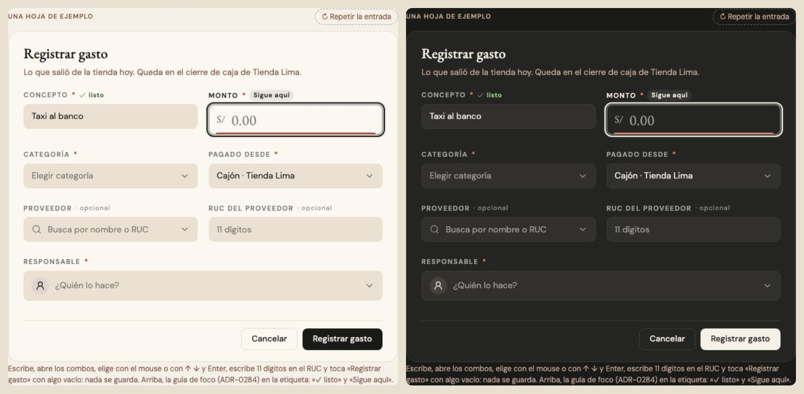
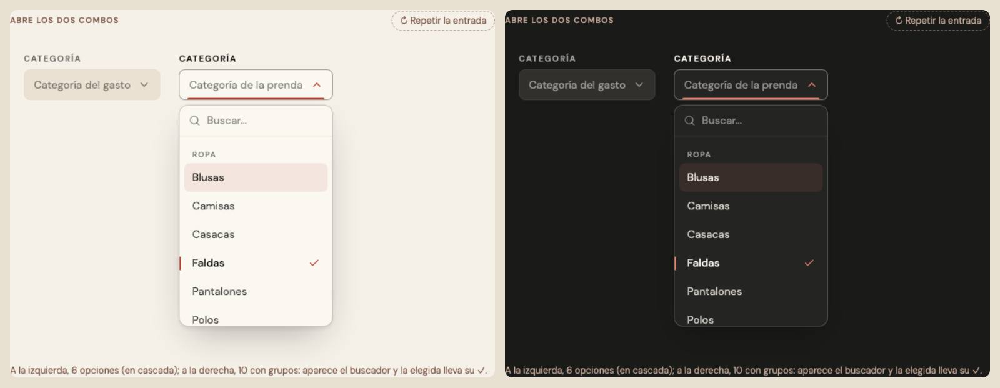
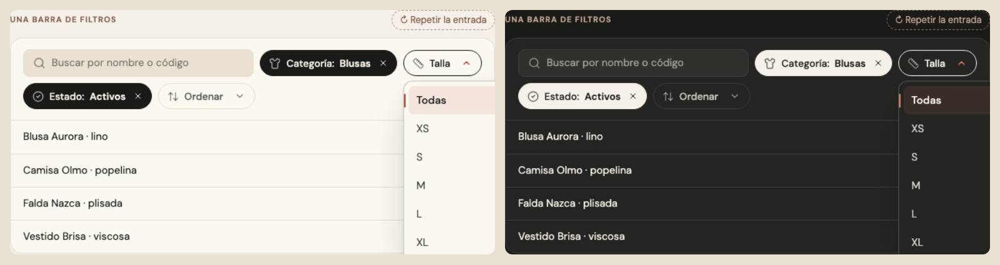

# Cajas, combos, la lista y los filtros que se abren — ronda 6 (ADR-0358)

**Decidido:** 2026-10-13, Felipe, **tocándolos** (página de elegir con demos vivas; fuentes en [rondas/6-8](rondas/6-8/README.md)).
**Elegidas:** P1 en las tres preguntas. Cubre cuatro familias del motor: `campo`, `combo` (y su lista) y `filtro` (el combo de una barra de
filtros); el título de cada campo está en [etiqueta-campo.md](etiqueta-campo.md).

**Piezas:** `CampoTexto`, `CampoMonto`, `Campo` y `Desplegable` / `CampoSelect` (`components/ui/campos.tsx`), `CampoFecha`, `ComboBuscable`,
`ComboResponsable` y `DesplegablePildora` (`components/ui/FiltrosPildora.tsx`). CSS: `app/estilos/campos-y-casillas.css`
(`caja-campo`, `combo-flecha`, `combo-tilde`, `combo-buscar`, `pildora-filtro`).

## Qué se comparó

Una sola pregunta para `campo` y `combo`: si la caja de texto y el combo se ven distinto, la persona no sabe cuál se escribe y cuál se abre.
Una misma hoja mezclaba hasta **cinco caras**: el hilo (CampoTexto, CampoSelect), la caja hundida (CampoSelect `caja`), la raya del
ComboBuscable (sin flecha), la caja crema del Responsable (48 px, borde rojo punteado mientras faltaba) y la cifra grande del CampoMonto.
El combo del censo, de 42 formas, quedó en 7 reales (las 23 píldoras de filtro eran una sola pieza con otro ícono). La lista abierta tenía
cuatro formas (Desplegable, ComboBuscable, Responsable, las píldoras). Los filtros que se abren, cuatro caras (el panel de píldoras en
versalitas, la caja con el valor, la pastilla de Cambios y Finanzas).

  

## Lo que eligió

1. **Dónde se escribe y dónde se elige · P1, la caja que se enciende.** Todo campo y todo combo de una hoja es la caja hundida en hueso de
   40 px (`caja-cayla caja-campo`). Con el cursor adentro o la lista abierta, la caja sube a papel, su borde se afirma y su borde de abajo
   DIBUJA el hilo rojo desde el centro. El hilo conserva lo que hacía sobre la línea: verde y fijo cuando el dato está bien
   (`valido`, el RUC encontrado), barre mientras consulta (`trabajando`), y el borde se pone rojo suave cuando el dato falta o está mal.
   El monto es la misma caja de 48 px con su «S/» y la cifra en serif; el Responsable, la misma caja de 48 px con su avatar.
   ComboBuscable lleva su lupa adentro: ahí se escribe para buscar.
2. **La lista que se abre · P1, una lista para todo combo.** La de Desplegable (cascada de 30 ms hasta 8 filas; con buscador, todas
   juntas) con lo que le faltaba: la elegida lleva el hilo rojo de canto y su ✓ que se dibuja; con más de 8 opciones, el buscador fijo arriba
   con su lupa (ADR-0209); el vacío chico de la ronda 5 nombrando lo buscado. Igual en ComboBuscable, el Responsable (que conserva «De
   turno ahora» y los avatares) y las píldoras de filtro cuando se elige una sola opción (con varias, siguen sus casillas).
3. **El combo que filtra una lista · P1, la píldora que dice su nombre.** Borde arena, su ícono y su nombre en letra normal («Talla»);
   puesta, se rellena de tinta, dice lo elegido («Talla: M») y lleva su ✕ adentro —como el filtro por clic de la ronda 1—. Reemplaza el
   panel de píldoras sin caja en versalitas que Felipe había pedido el 2026-09-17 («no me gusta que estén encapsulados en esos rectángulos
   blancos»): la decisión de hoy lo sustituye. El panel las separa con aire, ya no con rayas.

## El movimiento de las piezas

Caja: pasa de hueso a papel (220 ms) y el hilo se dibuja desde el centro (320 ms); la etiqueta de arriba se oscurece con ella (200 ms);
con el mouse, el borde se calienta (taupe). Combo: el chevron de 16 px gira media vuelta y se pone rojo; la lista cae 3 px (240 ms) y sus
filas entran en cascada; el valor elegido entra subiendo 6 px (260 ms; al cargar no anima). RUC: el hilo barre mientras consulta y luego
queda verde. Foco con teclado: el anillo común (ADR-0351). Píldora: al pasar el mouse el borde se calienta; abierta, borde tinta y flecha
roja; al elegir, se rellena de tinta (220 ms). Sin rebote ni bucle (el barrido del hilo es la señal de espera de siempre); con «reducir
movimiento», sin el viaje. Lo que traían las que reemplaza se queda: el hilo vivo (ahora en la caja), la cascada y el hilo de canto de la
lista, el giro rojo de la flecha.

## Lo que queda distinto a propósito

El kit de Finanzas (`fin-control`, `SelectFin`, ADR-0195): con la caja nueva está a 4 px de ser igual (36 contra 40) y Felipe dice si se
une. La pastilla de la sede en la cabecera (el marco). Las celdas de las matrices de tallas y colores, el papel impreso, los pases de
Traslados (ADR-0355), Análisis (ADR-0357), el Observatorio (ADR-0322), el buscador de la cabecera y la página pública del club.

## Deuda al decidir

- `campo`: 63 archivos con un `<input>` o un `<textarea>` dibujado a mano.
- `combo`: 7 archivos con un combo o una lista desplegable a mano.
- `filtro`: 11 archivos con un `Desplegable forma="caja"` haciendo de filtro en una barra (Actividad, Plan de compra, Catálogo…).

Todas las pantallas que usan las piezas ya cambiaron (cientos de campos y combos). Verificado en Compras ▸ Nueva compra (cajas, fechas,
combo de tienda con su lista y ✓, proveedor con su lupa) y en Catálogo ▸ Productos (el panel de filtros con las píldoras, una puesta).

## Migración (2026-10-13)

**`campo` 63 → 0, `filtro` 11 → 0, `combo` 7 → 3.** Una caja suelta es `caja-campo-input` (también `campoTexto` de `Modal.tsx`); una
caja con algo adentro (S/, un ícono, un botón) es `caja-cayla caja-campo` con el input `self-stretch`; un monto, `caja-campo-alta`. Los
filtros de una barra son `<DesplegablePildora>` (Actividad, Recibidas, Por regularizar, el plan de compra, las facturas del taller); un
`forma="caja"` dentro de un formulario pasó a `forma="campo"`. La firma de `filtro` se cortaba en la flecha de un `onValor={(v) => …}`
y dejaba escapar seis: ya no. **Excepciones:** el monto del gasto rápido y de Registrar ingreso (ADR-0368, ADR-0375), las celdas de las
matrices, el billete «Otro» de la hoja de cobro, el club público, los dos filtros de Frescura (su «Estado» tiene grupos con título) y el
combo de cada fila de Grupos del mix. **Quedan** tres combos con fotos o pistola: ver el tablero.
