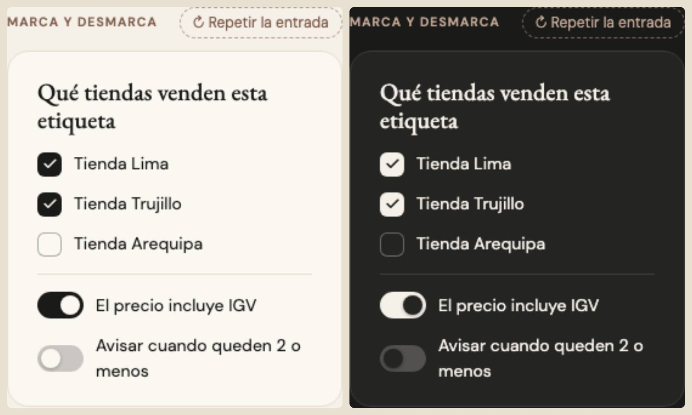

# Casillas e interruptores — una sola pieza (ADR-0358, ronda 6)

**Decidido:** 2026-10-13, Felipe, **tocándolas** (página de elegir con demos vivas; fuentes en [rondas/6-8](rondas/6-8/README.md)).
**Elegida:** P1. **Piezas:** `<Casilla>` (`components/ui/Casilla.tsx`) e `<Interruptor>` (`components/ui/campos.tsx`), CSS en
`app/estilos/campos-y-casillas.css`.

## Qué se comparó

| Forma | Usos | Cómo se veía |
|---|---:|---|
| A · `Casilla` + `Interruptor` | 26 + 6 | casilla de 18 px que se rellena de tinta con el ✓ de golpe; interruptor de 36 × 20 que se prende en **rojo** |
| B · la casilla del navegador | 24 en 19 archivos | 16 px con `accent-color`; cambia según el navegador |
| Interruptores a mano (`role="switch"`) | 4 archivos | Apartados, Vender (catálogo), Ajustar inicio, Pagar juntos |

## Lo que eligió

**P1 · la casilla que se dibuja y el interruptor en tinta.** Casilla de 20 px con esquinas de 6 y borde de 1,5 px: al marcarla, el fondo de
tinta crece desde el centro y el ✓ se traza; «a medias», un guion que se traza. El interruptor se prende en **tinta** (el rojo es el acento
de la pantalla, máximo 2, ADR-0169: un interruptor prendido no es una alarma), de 38 × 22, con la perilla que se estira al presionar.

## El movimiento de la pieza

Casilla: el fondo pasa de 40 % a lleno (220 ms) y el ✓ se traza (260 ms, 90 ms después); al presionar se encoge un poco (0,92); al pasar el
mouse, el borde pasa a tinta; el foco es el anillo común (ADR-0351; antes era un anillo rojo propio). Interruptor: la perilla se desliza
(280 ms) y se estira mientras se presiona (160 ms). Sin rebote ni bucle; con «reducir movimiento», el resultado sin el viaje. Lo que traía
la A (el cambio de color, el deslizar de la perilla) se queda; se suma el trazo y el estirón.

## Deuda al decidir

18 archivos con casillas del navegador o interruptores a mano (`node apps/web/unificar/deuda.mjs casilla`); `<Casilla>` e `<Interruptor>`
ya cambiaron en todas las pantallas que los usaban (Existencias, Productos, Compras, Catálogo, Clientes, Historial de ventas, Cuadre de piso).

## Migración (2026-10-13)

**Migrada el 2026-10-13: deuda 18 → 0.** `<Casilla>` aprendió `disabled` (la prenda que no se puede devolver, la que hereda su
etiqueta por categoría) y su «a medias» cubre la casilla de tres estados de Etiquetas. Los interruptores que van en una fila con su título
a la izquierda (Opciones de apartados, Ajustar Inicio, Pago junto) usan la cara de la pieza (`interruptor` + `interruptor-perilla`) con su
`unificar-fijo`. **Excepciones:** las casillas de Finanzas (Escenarios, Estado de resultados), que se dibujan como su spike (ADR-0195).
