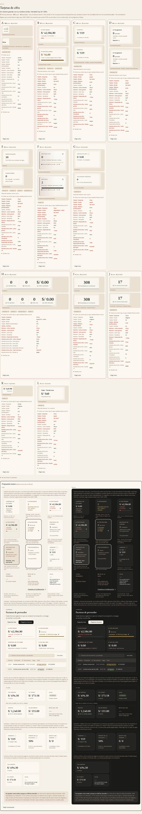

# Tarjetas de cifra — la tarjeta de Compras, en todo el ERP (ADR-0358)

**Decidido:** 2026-10-06, Felipe, **mirando** (página de `/unificar`). **Elegida:** **B**, la tarjeta de Compras tal cual era. **Pieza:**
`components/ui/TarjetaCifra.tsx`.

Un número grande con su nombre se dibuja siempre con la tarjeta de Compras: caja clara con borde, el nombre arriba en versalitas y el número
en letra serif. Si lleva a otro lado, una flecha al final de su último renglón (como ya tenía en Compras); si filtra la lista, la que está
filtrando se rellena de arena; si no hay dato, borde punteado, «—» y su motivo (como ya era la B).

## Cómo se llegó aquí

1. **2026-10-06, ronda 1.** El censo contó 17 formas; la depuración, 7 reales (5 decididas por ADR). Felipe eligió la recomendación por su
   descripción: la de Compras con «una marca por función» («Toca para filtrar», contorno de tinta en la que filtra). Se migraron ~23 archivos a la
   pieza: la «receta G» del Inicio, Comercial y Calidad, `TarjetaCifraAnalisis`, `TarjetaAvance` y las copias a mano.
2. **Ese mismo día, más tarde.** Al verla aplicada, eligió mirando la **B** tal cual. Se quitaron las marcas nuevas («Toca para filtrar», «Filtrando · toca
   para quitar», el contorno de tinta) y la que filtra volvió al fondo arena; la unificación se queda: todas las pantallas usan la misma pieza.

## Qué es la pieza

- Informa (sin `href` ni `onClick`): un `
`. Lleva (`href`, u `onClick` sin `activa`): enlace o botón, con la flecha. Filtra (`onClick` +
  `activa`): `<button aria-pressed>` y, puesta, fondo arena al 40 %; `aria-pressed` solo aquí (antes se anunciaban como interruptor cifras
  que no lo eran).
- `valor={null}` es «sin dato» y exige su motivo; `noSePudoLeer` lo separa de «no se pudo leer».
- Se quedan dos arreglos de contraste que casi no se ven: la unidad en taupe y el «—» en tinta al 65 %.
- No se tocaron (son de Felipe): `viva`, `acento`, `acentoTrazo`, `puntoPulsa` y `vivo`.

## Lo que queda distinto a propósito

El vidrio de Facturación (ADR-0124), las cifras de la cabecera (`ResumenSede`, ADR-0123/0220/0331), los grupos de «Qué hacer» de Análisis
(ADR-0245), el efectivo y «Ventas hechas» de Caja (ADR-0226/0319), las de Finanzas (ADR-0195), los tipos de Movimientos (ADR-0353), el
Observatorio (ADR-0322), Inicio de almacén (ADR-0292), la vista rápida (ADR-0136), el panel de la talla (ADR-0344), «Hoy» de Vender
(ADR-0221), Rendimiento por tienda (ADR-0325) y el titular «78 de 1,800 prendas» de Plan del piso ▸ Propuesta (ADR-0352, act. 2026-10-11: es el encabezado de su tarjeta, no una tarjeta de cifra). **El mostrador no cambió.**

## Preguntas resueltas (Felipe, 2026-10-07)

1. **«Piden algo hoy»** (Análisis): sigue abierta, va en su propia tarea.
2. **Producción** muestra «S/ 0.00» donde hay cero (capital en insumos, valor en proceso, por pagar; también el capital de Insumos). El «—» con borde
   punteado queda solo para cuando de verdad no se pudo leer el dato (`valor={null}`).
3. **La Caja del Inicio** sigue diciendo «Abierta» / «Cerrada» **en grande**, donde va el número: tiene que verse notorio (Felipe: no pasa a insignia).
   Al decidir la familia `estado`, esta tarjeta no se migra.

## Deuda

**0.** Las firmas atrapan las piezas que se fueron (`TarjetaCifraAnalisis`, `TarjetaIndicador`, `TarjetaSenal`, `TarjetaAvance`) y una tarjeta
de número dibujada a mano (`function Tarjeta({ etiqueta …`).

## Actualización 2026-10-26 — `compacta`, solo en la Vitrina (Felipe: «hagamos más compactos los KPI»)

`<TarjetaCifra compacta>` vuelve como **opt-in** y solo la usa Tienda web ▸ Vitrina ▸ Modelos: el contexto va en el mismo renglón del número
(«27 de 27 modelos», «0 Todos los que se ven tienen algo»), el relleno baja a 10 px y la tarjeta mide ~74 px en vez de ~135 (medido a 1440 px).
Solo con contexto de texto: no lleva `pie`, `accion` ni `reparto`. **Extenderla a otras pantallas es decisión de Felipe, mirando.**
