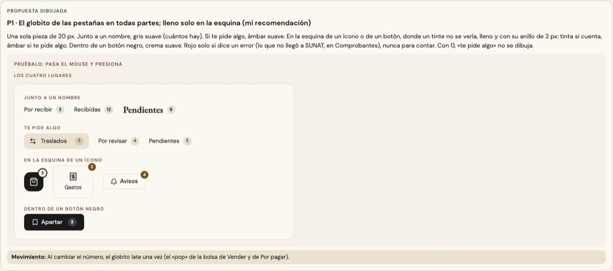

# El globito con número — una sola pieza (ADR-0358, ronda 15)

**Decidido:** 2026-10-15, Felipe, **tocándolo** (página de elegir con los cuatro lugares dibujados con el CSS real; fuentes en
[rondas/15](rondas/15/README.md)). **Elegida:** P1. **Pieza:** `<Globito>` (`components/ui/Globito.tsx`; CSS en `app/estilos/globito-vermas.css`).
`<Insignia>` (el número del menú) ya es un `<Globito pide>`.

El número chico que dice cuántos hay, o cuántos te piden algo.

## Qué se comparó

**Seis caras:** en las pestañas y los títulos, gris suave (la de la ronda 9); en el menú, ámbar lleno; en una pestaña con pendientes, ámbar
suave; en la bolsa de Vender, los apartados y los avisos del plan de compra, rojo con su anillo; en los accesos de Caja, ámbar lleno en la
esquina; en «Apartar», crema sobre negro; en «Pendientes» de Existencias, ámbar suave y más chico.

## Lo que eligió

**P1 · el globito de las pestañas en todas partes; lleno solo en la esquina.**

- Junto a un nombre: 20 px, **gris suave** (tinta al 10 %). Cuenta lo que hay.
- **Te pide algo** (`pide`): ámbar suave. Con 0 no se dibuja.
- **En la esquina** de un ícono o un botón (`esquina`), donde un tinte no se vería: lleno, 18 px, con su anillo de 2 px del color del fondo;
  tinta si cuenta, ámbar si te pide algo. Sobre una tecla negra (`sobreOscuro`), crema con anillo de tinta.
- **Dentro de un botón negro** (`sobreOscuro`): crema suave.
- **Rojo** (`error`) solo si el número dice un error (lo que no llegó a SUNAT, en Comprobantes), nunca para contar: la bolsa con 3 prendas no
  es un error.

La otra propuesta (lo que te pide algo, siempre lleno) no la eligió: una pantalla con varios pendientes se llenaba de ámbar.

## El movimiento

Con `late`, al cambiar el número late una vez (el «pop» de 500 ms de la bolsa de Vender y de la barra de Por pagar). Sin rebote ni bucle; con
«reducir movimiento», quieto.

## Migración (2026-10-15)

**Deuda 0.** El menú (`Insignia`: de ámbar lleno a ámbar suave; con el lateral plegado, lleno en la esquina), la bolsa de Vender y la del
escáner (de rojo a crema sobre la tecla negra), la tarjeta de prenda de Vender (cuántas lleva el ticket, con su latido; se fue el `Badge` que
solo usaba ella), los apartados del celular y los avisos del plan de compra (de rojo a ámbar lleno en la esquina), los accesos de Caja,
«Pendientes» de Existencias, «Apartar» y las fotos de un color en Nuevo producto.

**Se queda:** el contador de la cámara de Recibir (44 px sobre el video, el número protagonista del visor).

## Firmas

Un globito a mano: redondo, chico (16 a 24 px), con letra de 9,5 a 11 px y un fondo lleno; o el ámbar suave con cifras tabulares. Con el
código de antes reconocen 7 archivos (la matriz de fotos y la tarjeta de prenda se migraron leyendo el código).
