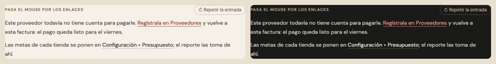
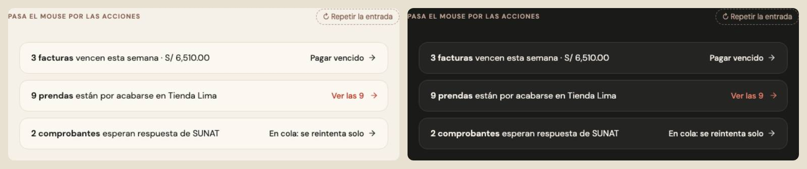

# Enlaces de texto — dos piezas (ADR-0358, ronda 8)

**Decidido:** 2026-10-13, Felipe, **tocándolos** (página de elegir con demos vivas; fuentes en [rondas/6-8](rondas/6-8/README.md)).
**Elegidas:** en una frase, **P1**; suelto, **P2**. **Piezas:** `btn-enlace` (`app/globals.css`) y `<EnlaceVer>` (`components/ui/EnlaceVer.tsx`,
CSS en `app/estilos/enlaces-paginas-caras.css`).

## Qué se comparó

| Forma | Usos | Cómo se veía |
|---|---:|---|
| A · `btn-enlace` | 136 | tinta subrayada; al pasar el mouse, taupe (parecía apagado) |
| B · el subrayado tenue | ~24 | subrayado al 30 % que se pone rojo; en Cambios y Devoluciones, más grande |
| C · el rojo que se subraya | ~15 | rojo sin subrayado; el subrayado aparece de golpe |
| Suelto · versalitas con «→» escrito | ~15 | «PAGAR VENCIDO →», «VER TODAS»: la flecha es un carácter y no se mueve |

 

## Lo que eligió

1. **Un enlace dentro de una frase · P1, el hilo que se llena.** En reposo, la palabra en tinta con un subrayado tenue; al pasar el mouse,
   un hilo rojo de 1,5 px corre de izquierda a derecha sobre el subrayado y el texto pasa a rojo profundo: el mismo hilo de los campos y las
   listas, diciendo «esto te lleva». Es `btn-enlace` (cambió por dentro: sus 136 usos ya lo tienen).
2. **El enlace suelto que lleva a ver más · P2, versalitas rojas con la flecha que avanza** (Felipe eligió la P2, no la recomendada).
   `<EnlaceVer href|onClick>`: VERSALITAS de 11 px en rojo con la flecha de lucide, que avanza 3 px al pasar el mouse. Es también la acción
   de un título de bloque (ronda 7). **Ojo:** gasta el rojo, el acento de la pantalla (máximo 2, ADR-0169): una pantalla con muchos
   resúmenes lleva su «ver más» solo en los que piden algo.

Lo que no es enlace: un botón que guarda (`<Boton>`); una acción chica dentro de un formulario («Deshacer», «Quitar») sigue siendo un
botón (`btn-cayla btn-enlace` si va como texto).

## El movimiento de la pieza

En una frase: el hilo rojo se dibuja (300 ms) y el texto pasa a rojo profundo (200 ms); al salir, se recoge; al presionar, rojo. Suelto:
la flecha avanza 3 px (220 ms), 5 al presionar, y el rojo se oscurece. Foco: el anillo común. Con «reducir movimiento», sin el viaje. El
subrayado es una imagen de fondo para poder dibujarse: va a 0,7 em bajo el centro de la línea (queda pegado al texto también en un
`btn-chico` de 44 px) y cada renglón lleva el suyo.

## Deuda al decidir

58 archivos dibujan un enlace a mano (`node apps/web/unificar/deuda.mjs enlace`): el rojo que se subraya, las versalitas rojas, el
subrayado tenue y la flecha escrita al final de un `btn-enlace`. Al migrar, cada uno se decide por lo que hace: si lleva a ver más,
`<EnlaceVer>`; si va dentro de una frase o es una acción de texto, `btn-enlace`.

## Migración (2026-10-13)

**Migrada el 2026-10-13: deuda 58 → 0.** Dentro de una frase o como acción chica, `btn-enlace`; para ir a ver más, `<EnlaceVer>` sin la
flecha escrita a mano. `<EnlaceVer>` aprendió `alNavegar` (cerrar la hoja o el cajón en el mismo clic que navega). «Todo el historial»
de Historial y de Apartados no era un enlace sino un período que se elige: pasó a `pildora-cayla`. El ritmo de Existencias conserva su
texto llano (diseño aprobado, `unificar-fijo`).

## Ronda 9 (2026-10-13)

Las acciones chicas dentro de una hoja que eran versalitas rojas y la migración pasó a `btn-enlace` se repartieron **según lo que hacen**
(Felipe, P2): las que cambian varias cosas de un toque son ahora un botón sutil chico; las que corrigen una sola siguen siendo este
enlace. Detalle y lista: [boton.md](boton.md), «Ronda 9».

## El censo de después (2026-10-13): cuatro «Ver … →» en versalitas a mano

Rastreado al código, el censo encontró enlaces sueltos que llevan a ver más dibujados en `label-cayla` con la flecha escrita: «Ver los 11 →»
(la caja abierta), «Ver todas las sedes →» (el historial de cierres de la caja), «Ver catálogo completo →» (Buscar) y el enlace de
`PasoSugerido`. Pasaron a `<EnlaceVer>` (la flecha que avanza la dibuja la pieza). Una firma nueva los atrapa. Queda exento, con su motivo,
«Ver en Productos →» de Categorías: es el rótulo de una tarjeta que ya es un enlace, y un `<EnlaceVer>` no se anida dentro de otro.

**El censo de mostrador (2026-10-13)** encontró tres más en Caja («Ver todos →», «Ver en Finanzas →», «Ver posventa →»): la clase iba en una
constante (`enlaceVer`) y la firma, que lee la clase escrita, no los veía. Pasaron a `<EnlaceVer>`.

## El subrayado que no se pintaba (2026-10-14, con el OK de Felipe mirando las láminas)

Una prueba ciega de /formidable (Finanzas ▸ Gastos) vio «Míralo en Impuestos» subrayado en una hoja y sin subrayado en otra. Medido en una
página de prueba con cada contexto en que el ERP usa la pieza (claro y oscuro): el renglón cae 0,7 em bajo el centro, y en una caja del alto
de la letra eso queda entre 1 y 1,5 px **debajo** del borde de la caja, donde el navegador ya no pinta el fondo. En reposo no se veía en 5 de
8 contextos (un enlace dentro de un párrafo, de una ayuda, de un texto de 15 px, partido en dos renglones, y los 118 `btn-cayla btn-enlace`);
en dos de ellos tampoco se veía el hilo rojo. Solo se pintaba siempre en un `<button>` dentro de una frase y en un `btn-chico` (44 px); en una
nota de 13 px, según en qué píxel cayera el renglón.

**El arreglo, en la pieza:** el renglón se mide desde el contenido (`background-origin: content-box`), y un relleno de 0,25 em abajo agranda el
área donde se pinta, con un margen negativo del mismo tamaño para que la caja no ocupe más (`.btn-enlace:not(.btn-chico)`). El renglón queda
en el mismo lugar que antes y la letra no se mueve: medido en los 8 contextos y en tres componentes reales (A favor con proveedores, el aviso
de «Agregar en su ficha» y «Todo el historial» de Movimientos) a 1440 y 375 px, con las mismas posiciones y los mismos altos antes y después.
Un `mb-*` en el mismo elemento le gana al margen negativo: ahí se descuenta a mano (`FiltrosMovimientos`, `mb-[calc(0.5rem_-_0.25em)]`).

## Control (2026-10-17)

Firma nueva: la «→» escrita al final del texto de lo que lleva a otra parte, «Ver … ›» y la «→» sola en su `` antes de cerrar el
enlace. Migrados: Comprobantes, el Historial de ventas, el plan de compra, la muestra, «Ver tallas», el perfil, «Es el mismo diseño» y «Usar
en un pago» (`<BotonVer>`, que suma `etiqueta`), dos subrayados a mano de Conteo (`btn-enlace`), «Seguir» de Nuevo producto y el Inicio de
Almacén. Excepciones: el aviso de cierre de Caja (ADR-0359) y, hasta la ronda 17, el selector de mes de Comprobantes y la guía de impresión.
Detalle: [control/2026-10-16.md](control/2026-10-16.md).
