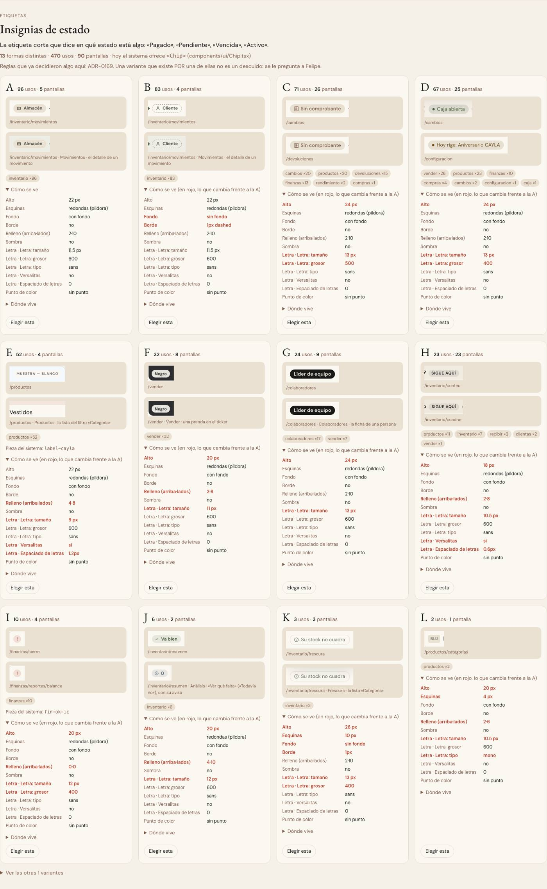
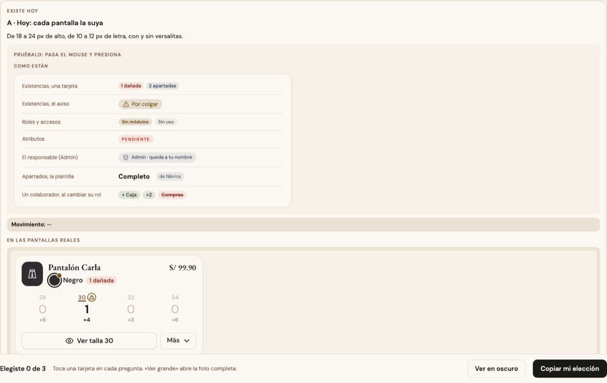
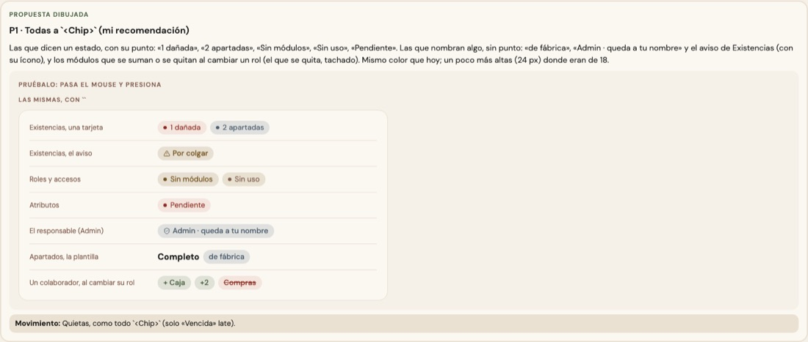

# Insignias de estado — la pieza ya era una (ADR-0358)

**Decidido:** 2026-10-07, Felipe, **mirando** (página de elegir de la ronda 2). **Pieza:** `<Chip>` (`components/ui/Chip.tsx`), como ya era.

El censo del 2026-10-07 contó 13 formas, pero depuradas son pocas: casi todo el ERP ya dibuja sus estados con `<Chip>` (con punto, o con
ícono si `versalitas={false}`; contorno de tinta para «Crítica»). Las demás no eran estados (el nombre de la categoría, el color de la prenda,
los códigos «BLU») o están decididas por un ADR («Almacén / Piso» de Movimientos, ADR-0353; «SIGUE AQUÍ» de la guía de foco, ADR-0284).

## Lo que Felipe eligió dejar como está

- **Análisis** («Va bien», «Para saber», «Datos incompletos»): con su palomita y su «i», no con el punto de `<Chip>`.
- **El rol en Colaboradores:** «Líder de equipo» en píldora negra, los demás roles en arena. El líder se ve de lejos.

## El movimiento

`<Chip vivo>` es lo único que se mueve solo: el punto que late en «Vencida» (ADR-0136). Lo demás no se mueve.

## El candado (2026-10-15, ronda 16)

Quedaban 12 píldoras de color escritas a mano en 7 pantallas (cada una con su alto, su letra y su ámbar). Con el globito con número ya
decidido (ronda 15), Felipe eligió **P1 · todas a `<Chip>`**, mirando las mismas recreadas con el CSS real (fuentes en
[rondas/16](rondas/16/README.md)):

- **Con su punto, las que dicen un estado:** «1 dañada» y «2 apartadas» en una tarjeta de Existencias, «Sin módulos» y «Sin uso» en Roles y
  accesos, «Pendiente» y «Rechazada» en Atributos.
- **Sin punto (`versalitas={false}`), las que nombran algo:** «de fábrica» en la plantilla de Apartados, «Admin · queda a tu nombre» (con su
  escudo) junto al responsable, el aviso de Existencias (con su triángulo) y los módulos que se suman o se quitan al cambiar el rol de un
  colaborador (el que se quita, tachado).

Mismo color que antes; un poco más altas (24 px) donde eran de 18. `<Chip>` aprendió `title` (lo que dice al pasar el mouse) para dos de
ellas. Los círculos de ícono de Devoluciones y «Confirmar cambios» no eran píldoras de estado y se quedan.

**Firma:** una píldora redonda con el fondo suave de un tono (verde, ámbar, rojo, pizarra, taupe, arena o tinta), letra de 10 a 12 px y su
relleno de píldora. Deuda 0.
