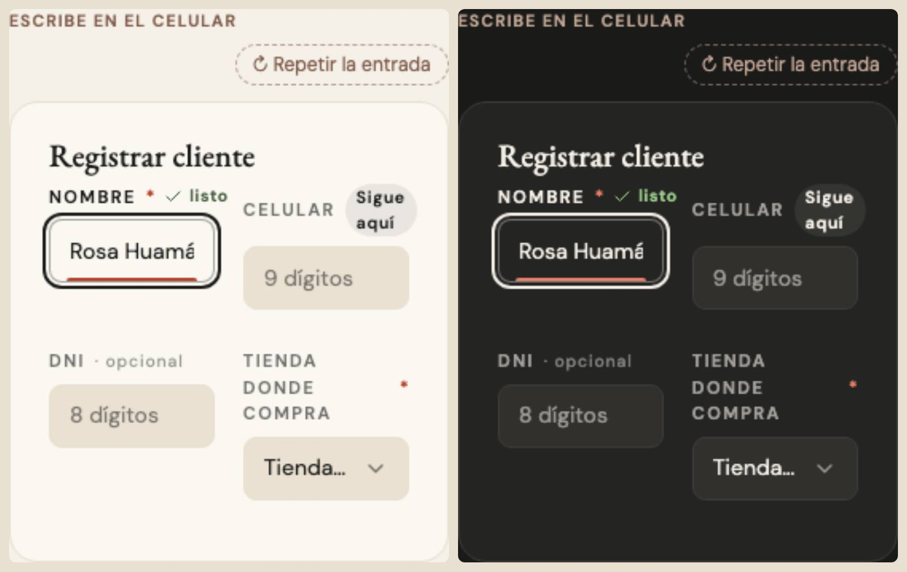

# Títulos de campo — una sola pieza (ADR-0358, ronda 6)

**Decidido:** 2026-10-13, Felipe, **tocándolo** (página de elegir con demos vivas; fuentes en [rondas/6-8](rondas/6-8/README.md)).
**Elegida:** P1. **Pieza:** la etiqueta de `<Campo>` (`components/ui/campos.tsx`, clase `campo-etiqueta` en `app/estilos/campos-y-casillas.css`).

## Qué se comparó

| Forma | Dónde |
|---|---|
| A · versalitas de `Campo` | todo CampoTexto, CampoSelect y CampoMonto (~240 campos) |
| B · letra normal a mano | las hojas hechas a mano (12 a 14 px, pesos distintos) |
| F · Finanzas (ADR-0195) | versalitas taupe, a veces al lado del control («VER Tienda Lima») |

## Lo que eligió

**P1 · versalitas que se encienden.** La de `Campo`, la más usada: VERSALITAS de 11 px en tinta al 62 %, el «*» rojo si es obligatorio,
«· opcional» en minúscula tenue si no lo es, y las marcas de la guía de foco (ADR-0284) al lado. Lo nuevo: se oscurece a tinta mientras su
caja está encendida (el cursor adentro o la lista abierta). El Responsable lleva la misma etiqueta.

## El movimiento de la pieza

Cuando la caja se enciende, el título pasa de tinta 62 % a tinta (200 ms); al salir, vuelve. Con «reducir movimiento», sin la transición.

## Deuda al decidir

4 archivos con un título de campo a mano (`node apps/web/unificar/deuda.mjs etiqueta-campo`): Nuevo color, Devoluciones (dos) y el
modal de Proveedor.

## Migración (2026-10-13)

**Migrada el 2026-10-13: deuda 4 → 0.** Los títulos de campo de Devoluciones, Nuevo color, el perfil y el login usan
`campo-etiqueta` dentro de un `campo`, o la pieza `<Campo>`.
