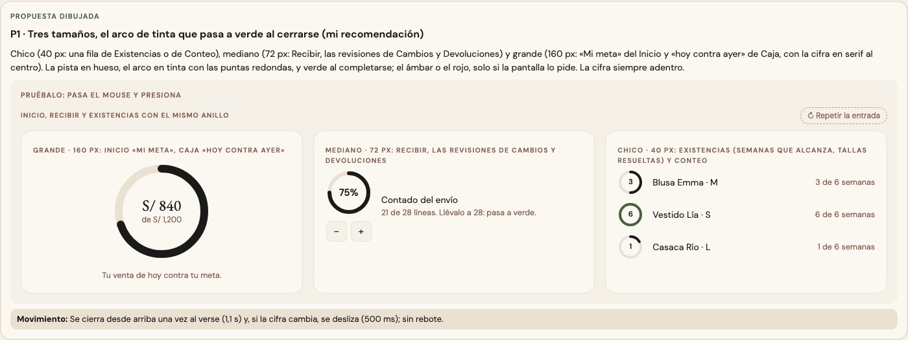
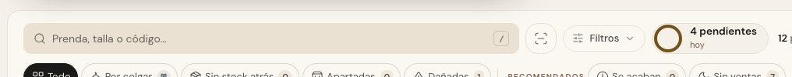

# El anillo — una sola pieza (ADR-0358, ronda 13)

**Decidido:** 2026-10-15, Felipe, **tocándolo** (página de elegir con demos vivas que se mueven con «−/+»; fuentes en
[rondas/13](rondas/13/README.md)). **Elegido:** P1. **Pieza:** `<Anillo>` (`components/ui/Anillo.tsx`; CSS en
`app/estilos/avance-anillo-copiar.css`).

Un anillo que se cierra con la cifra adentro: cuánto va de algo. Mi meta de hoy, lo contado de un envío, las revisiones de un cambio, las
semanas que alcanza una talla. No es la dona que reparte un total (lo cobrado por medio de pago: ronda 14).

## Qué se comparó

**15 anillos dibujados con cuatro técnicas distintas** (`strokeDashoffset` en JSX, `strokeDasharray "p 100"` con `pathLength`, el desfase en
CSS con una variable, el `dasharray` animado en CSS), de 32 a 168 px, con la pista en hueso, arena o tinta al 10 % y el arco en verde, ámbar,
rojo, tinta o el color del efectivo; unos se llenaban al llegar y otros no.

## Lo que eligió

**P1 · tres tamaños, el arco de tinta que pasa a verde al cerrarse.**

- **Tres tamaños con nombre:** `chico` (40 px: una fila de Existencias o de Conteo, el Inicio del almacén), `mediano` (72 px: Recibir, las
  revisiones de Cambios y Devoluciones) y `grande` (160 px: «Mi meta» del Inicio y «hoy contra ayer» de Caja, con la cifra en serif).
- **La pista en hueso y el arco en tinta** con las puntas redondas, que pasa a **verde** al cerrarse. El ámbar o el rojo, solo si la pantalla
  lo pide (`tono`). Sobre una superficie pintada de tinta (el titular de Caja, que se invierte con el tema), `sobreTinta`: pista y arco en
  crema.
- **La cifra va adentro** (`children`).

La otra propuesta (los mismos tamaños, verdes y quietos) no la eligió: el verde ya no decía «listo».

## El movimiento de la pieza

Se cierra desde arriba una vez al verse (1,1 s) y, si la cifra cambia, se desliza (500 ms) y cambia de color. Sin rebote. Sin JavaScript:
sirve en un Server Component («Mi meta» lo es). Con «reducir movimiento», quieto.

## Migración (2026-10-15)

**Deuda 0.** Pasaron a la pieza: Caja (grande, sobre la tinta del titular; antes 168 px con el color del efectivo), «Mi meta» del Inicio
(grande; antes verde y quieto), Existencias (el de «lo de hoy», chico; conserva su ámbar a propósito: es el recordatorio de lo que falta),
el aro de semanas de una talla (chico; ámbar con 1 semana o menos), Conteo (chico; antes rojo), Recibir (mediano; antes ámbar mientras
faltaba), las revisiones de Cambios y Devoluciones (mediano; antes ámbar mientras faltaba) y el Inicio del almacén (chico, en sus dos
lugares). Se borró el CSS que dejaron (`.cmp-anillo-*`, `.ia-ring`, `.anillo-progreso` y su `@keyframes cayla-anillo`).

**Se quedan, con su motivo:** los del Observatorio (ADR-0322), Análisis (ADR-0357) y la billetera de pases de Traslados (ADR-0355), por su
diseño; la dona de lo cobrado (un reparto, ronda 14); y el círculo del loader (ADR-0149), que no mide nada.

## Firmas

Un `<circle>` con su trazo partido (`strokeDasharray` o `strokeDashoffset`) fuera de la pieza, en una ventana de 12 líneas, y una pieza
homónima (`function Anillo`). Con el código de antes reconocen 6 archivos; no ven un anillo cuyo trazo se parte en CSS.
