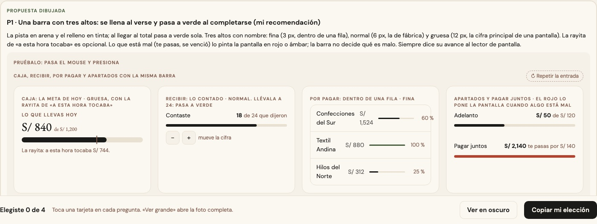
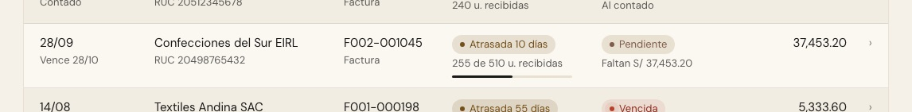

# La barra de avance — una sola pieza (ADR-0358, ronda 13)

**Decidido:** 2026-10-15, Felipe, **tocándola** (página de elegir con demos vivas que se mueven con «−/+»; fuentes en
[rondas/13](rondas/13/README.md)). **Elegida:** P1. **Pieza:** `<BarraAvance>` (`components/ui/BarraAvance.tsx`; CSS en
`app/estilos/avance-anillo-copiar.css`).

Una barra fina que se llena: cuánto va de algo contra su total o su meta. Lo vendido contra la meta, lo contado de un envío, lo pagado de
una factura, el adelanto de un apartado. No es la barra apilada (que reparte un total en partes, `grafico.barra`) ni una barra que compara
cantidades a escala de la mayor (la ronda 14).

## Qué se comparó

Un mapa del código (el censo no distingue una barra de avance de una caja cualquiera) contó **unas 45 en el ERP hechas de 38 maneras**:
siete altos (3, 4, 5, 6, 8, 10 y 12 px), la pista en arena, en hueso o en tinta al 10 %, el relleno en tinta, en verde, en ámbar o en
taupe sin una regla, la mitad que se llenaba al llegar y la otra mitad quieta, y **dos componentes distintos con el mismo nombre**
(`ui/BarraAvance`, quieta y en tinta, y la de `ComprobanteAvance`, que se llenaba en tonos). Unas le decían su avance al lector y otras no.

## Lo que eligió

**P1 · una barra con tres altos que se llena al verse y pasa a verde al completarse.**

- **La pista en arena y el relleno en tinta**, que pasa a **verde** solo al llegar al total. **Lo que está mal** (te pasas, se venció, falta
  un mínimo, llegó menos de lo facturado) lo pinta la pantalla con `tono="rojo"` o `"ambar"`: la barra no decide qué es malo.
- **Tres altos con nombre:** `fina` (3 px, dentro de una fila de una lista), `normal` (6 px, la de fábrica) y `gruesa` (12 px, la cifra
  principal de una pantalla, como la meta de hoy en Caja).
- **La rayita** de «a esta hora tocaba» o de un mínimo es opcional (`marca`, una o varias).
- **Siempre le dice su avance al lector** (`etiqueta`, y `texto` si el porcentaje no basta), salvo `decorativa`, cuando el texto de al lado
  ya lo dice.
- Una medida que **no es un avance** (los días de stock, cuántos módulos tiene un rol, el margen) pasa `tono="tinta"`: no se pone verde al
  llenarse.

La otra propuesta (quieta, siempre en tinta, de un solo alto) no la eligió.

## El movimiento de la pieza

Se llena desde cero una vez al verse (760 ms, con 38 ms de desfase por fila en una lista) y, si la cifra cambia, se desliza (500 ms) y cambia
de color (400 ms). Sin rebote. Sin JavaScript: sirve en un Server Component (Rendimiento y «Mi meta» del Inicio lo son). Con «reducir
movimiento», quieta.

## Migración (2026-10-15)

**Deuda 0.** Las dos `BarraAvance` son una sola: la del detalle de un comprobante (`ComprobanteAvance.BarraAvance`) se borró y sus
llamadas (Recepción, Pago, cada línea, el reparto por tienda) usan la del sistema; `tonoDeAvance` dejó de existir. Pasaron a la pieza las
barras a mano de Nueva compra («Listo N de 4»), Conteo, Por regularizar, Frescura, Recibir (la lista de comprobantes, las líneas contadas y
cada comprobante), las recepciones y su vista rápida, Recibir contando, el plazo de un proveedor (`PistaPlazo`), Por pagar (plazo y
pagado), Notas de crédito y el saldo a favor, Pagar juntos y el pago de un comprobante, la nota de crédito, Insumos (el saldo con su mínimo
y cada lote), Caja (la meta de hoy, gruesa), el Inicio del líder, Vender (la meta de cada tienda), Producción (días de stock con las rayitas
de 7 y 30), Roles, Productos (el margen), las etiquetas de una prenda, Apartados y la lista de Compras. Se borró el CSS que dejaron
(`cr-progreso`, `vsr-f-bar`, `cmp-mini`, `rc-barra`).

**Se quedan, con su motivo** (`familias.mjs`, `excepciones`): la barra del registro en la página pública del club (es para el cliente y
tiene su propia cara) y la de la ficha del Taller, que compara tallas (ronda 14). Las del Observatorio (ADR-0322), Análisis (ADR-0357) y
Finanzas (`.fin-umbral-barra`, ADR-0195) tienen su diseño por decisión; el trayecto con el camión (Inicio del almacén, Traslados) no es un
avance.

## Firmas

`role="progressbar"` fuera de la pieza, las clases de antes (`cr-progreso`, `vsr-f-bar`, `cmp-mini`, `rc-barra`) y una pieza homónima
(`function BarraAvance`). Con el código de antes reconocen 12 archivos. **No ven todo:** una pista con su relleno dibujada con clases de
Tailwind se parece a una barra de comparación; quien la dibuje a mano la encuentra en este registro.

## Actualización 2026-10-28: `sobreTinta`

La billetera de Mis compras (ADR-0559) es una tarjeta pintada de tinta, y la pista de arena con relleno de tinta no se ve sobre ella. Como `<Anillo sobreTinta>`, `<BarraAvance sobreTinta>` dibuja la pista y el relleno en crema (que se invierten con el tema, igual que la tarjeta) e ignora el verde de «completo». Es la misma pieza, no otra barra.
