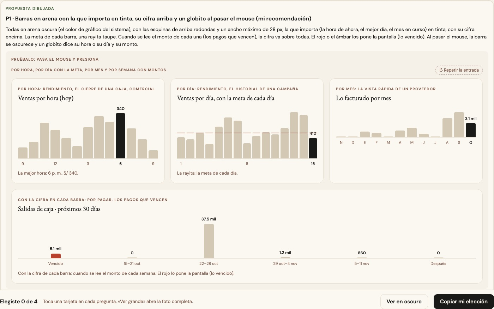
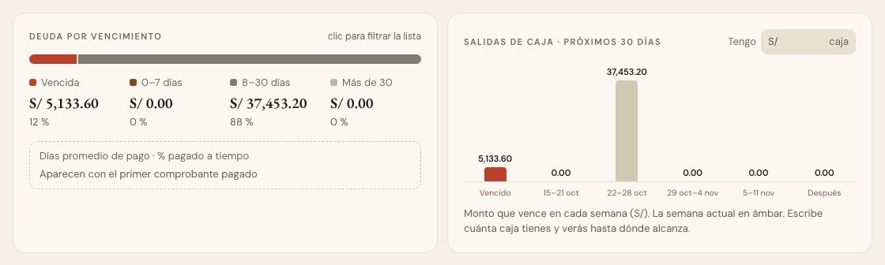
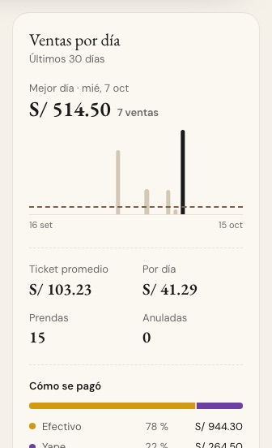
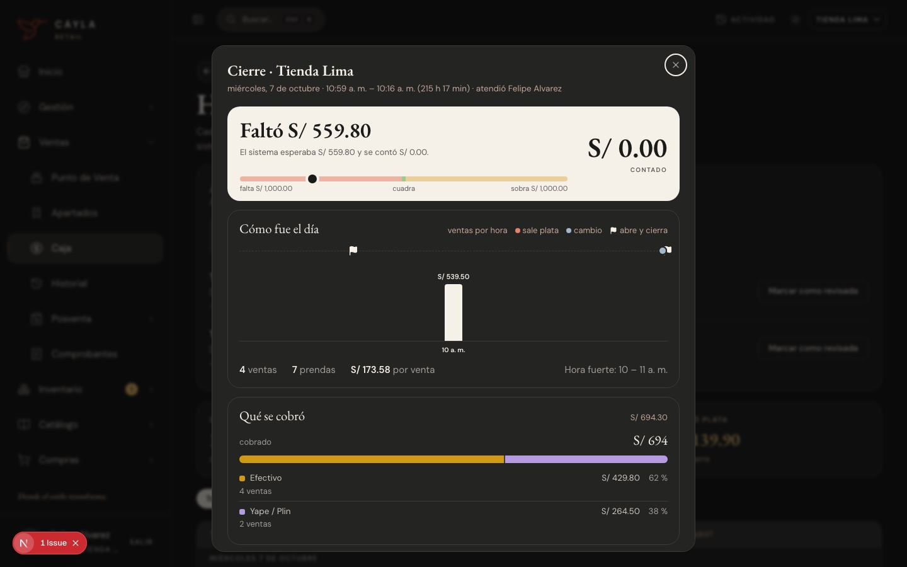

# Las barras por hora, día o mes — una sola pieza (ADR-0358, ronda 14)

**Decidido:** 2026-10-15, Felipe, **tocándolas** (página de elegir con demos vivas: cada barra dice lo suyo al pasar el mouse; fuentes en
[rondas/14](rondas/14/README.md)). **Elegida:** P1. **Pieza:** `<BarrasTiempo>` (`components/ui/BarrasTiempo.tsx`; CSS en
`app/estilos/graficos-tiempo.css`); `<BarrasMensuales>` la usa para lo facturado por mes.

Una barra por hora, por día, por semana o por mes: cuánto se vendió o cuánto vence en cada una.

## Qué se comparó

**Once maneras.** Las ventas por hora de Rendimiento, del cierre de una caja y de Comercial eran tres gráficos distintos para lo mismo (otro
alto, otro color para la mejor hora —taupe, tinta, rojo—, otro movimiento); las barras por día de Rendimiento (tinta, la de hoy al 62 %), de
los cierres de Caja (el punto del cuadre) y del historial de una campaña (el mejor día en rojo); lo facturado por mes de un proveedor; los
pagos que vencen en Por pagar (58 px de ancho, el monto sobre cada una); lo que se gana y se pierde por hora en Caja (hacia arriba y hacia
abajo); y los «hilos» del Historial con su curva de tendencia.

## Lo que eligió

**P1 · barras en arena con la que importa en tinta, su cifra arriba y un globito al pasar el mouse.**

- **Todas en arena** (el color de gráfico del sistema), con las esquinas de arriba redondas y un **ancho máximo de 28 px**; **la que importa**
  (`destacada`: la hora de ahora, el mejor día, el mes en curso) **en tinta, con su cifra encima**.
- **La meta de cada barra**, una rayita taupe (`meta`); una sola referencia para todas (el promedio, un día normal), una raya punteada
  (`referencia`).
- Cuando se lee el monto de cada una (los pagos que vencen, lo que ganas o pierdes por hora), **la cifra va sobre todas** (`cifras="todas"`).
- **El rojo o el ámbar los pone la pantalla** (`tono`: lo vencido, la semana en curso); el verde o el ámbar de una diferencia, también.
- **Un valor negativo crece hacia abajo** desde la raya del cero; la hora que aún no termina va **rayada**.
- **Al pasar el mouse**, la barra se oscurece y un **globito** dice su hora o su día y su monto (`tip`). Con `respuesta.onElegir`, cada barra
  es un botón (Por pagar filtra la lista con la semana que se toca); con solo `onApuntar`, la pantalla sabe cuál se apunta sin sumar una
  parada del teclado por barra (el Historial, con hasta 120 días).
- Sin JavaScript propio: sirve en un Server Component.

La otra propuesta (los «hilos» del Historial en todas partes) no la eligió: en una tienda con pocas horas cuesta comparar dos hilos.

## El movimiento de la pieza

Crecen desde abajo en cascada una vez al verse (560 ms, 34 ms entre barras); la cifra aparece al final; si cambia un valor, la barra se
estira (500 ms). Al pasar el mouse se oscurecen y el globito entra en 160 ms. Sin rebote ni bucle; con «reducir movimiento», quietas.

## Migración (2026-10-15)

**Deuda 0.** Las ventas por hora de Rendimiento, del cierre de una caja y de Comercial; las ventas por día de Rendimiento (con la rayita de
la meta de cada día y su globito de siempre); «Dónde ganas y dónde pierdes» de Caja (hacia arriba en verde, hacia abajo en ámbar, la hora en
curso rayada); los cierres anteriores de Caja en su vista de gráfico (con el punto del cuadre encima); el historial de una campaña (con la
raya de un día normal); lo facturado por mes de un proveedor; los pagos que vencen en Por pagar (tocar filtra, pasar el mouse resalta, la
cifra cuenta y la raya verde de abajo es lo que cubre la caja); y el pulso del Historial (el mejor día en tinta y la raya del promedio; la
curva de tendencia se fue, y con ella `pulsoDeVentas`, `mediaMovil` y `ventanaDeSuavizado`, que solo la dibujaban).

En oscuro, el cierre de una caja (las barras por hora y lo cobrado con la barra apilada): 

**Se quedan, por su decisión:** «Cómo cerró cada día» del historial de cierres (la maqueta «Lo que se contó» que Felipe eligió el
2026-10-12: varias barras por día, el hueco punteado de lo que faltó, cada barra abre su cierre, quieta a propósito), las barras de las
tarjetas de Facturación (ADR-0124), las de Finanzas (ADR-0195) y las de Análisis (ADR-0357).

## Firmas

Una fila de barras dibujada a mano: una caja `flex` que las alinea abajo (`items-end`) con un alto fijo, en cualquier orden de clases. Con el
código de antes reconoce 7 archivos.
