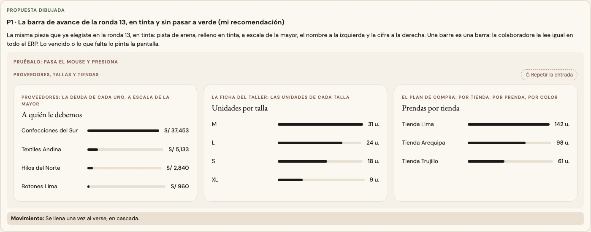

# La barra a escala — una sola pieza (ADR-0358, ronda 14)

**Decidido:** 2026-10-15, Felipe, **tocándola** (página de elegir; fuentes en [rondas/14](rondas/14/README.md)). **Elegida:** P1. **Pieza:** la
barra de avance de la ronda 13 en tinta, `<BarraAvance tono="tinta">` (`components/ui/BarraAvance.tsx`); con dos partes, la barra apilada
medida contra la mayor (`<BarraApilada total>`).

Una fila por cosa (un proveedor, una talla, una tienda, una prenda, un color, un año) con una barra a escala de la mayor.

## Qué se comparó

Cuatro caras: Proveedores (3 px bajo el saldo, lo vencido en rojo y el resto en tinta al 45 %), la ficha del Taller (8 px en verde, ámbar si
quedaban pocas, tinta al 15 % en cero), el plan de compra (8 px en tinta al 60 %, la primera o el año elegido en rojo) y el plan del piso
(6 px, ADR-0352).

## Lo que eligió

**P1 · la barra de avance de la ronda 13, en tinta y sin pasar a verde.** Pista de arena y relleno en tinta, a escala de la mayor, el nombre a
la izquierda y la cifra a la derecha. **La más larga no está «lista»**: por eso `tono="tinta"`, que no se pone verde al llenarse. Lo vencido o
lo que falta lo pinta la pantalla (ámbar si quedan pocas). Una barra es una barra: la colaboradora la lee igual en todo el ERP.

La otra propuesta (sin pista, la mayor en tinta y las demás en arena) no la eligió: era otra pieza más que aprender.

## El movimiento de la pieza

El de la barra de avance: se llena desde cero una vez al verse, en cascada (`indice`).

## Migración (2026-10-15)

**Deuda 0.** La ficha del Taller (las unidades de cada talla: en tinta, ámbar si quedan pocas; se fue el verde), el plan de compra (por
tienda, por prenda, por color: se fue el rojo de la primera), el historial de una campaña (año por año: el año que se mira va en negrita a la
izquierda, no en rojo) y la deuda de cada proveedor, que tiene dos partes y pasó a la **barra apilada** medida contra el mayor saldo (lo
vencido en rojo, lo que falta vencer en tinta; el hueco del final es la pista).

**Se quedan, por su ADR o su función:** las del plan del piso (ADR-0352), los sellos de Movimientos (ADR-0353), la vista rápida de un producto
(ADR-0136), el Observatorio (ADR-0322) y Análisis (ADR-0357); «Cómo te pagaron» de Caja (el color de cada barra es el del medio de pago, un
dato); y la barra que mide cuánto le queda a un aviso destacado (no es un dato que se compare).

## Firmas

Una pista con su relleno dibujada a mano: una fila baja (3 a 8 px) que recorta, redonda, sobre arena, hueso o tinta al 10 %. Con el código de
antes reconoce 4 archivos.
