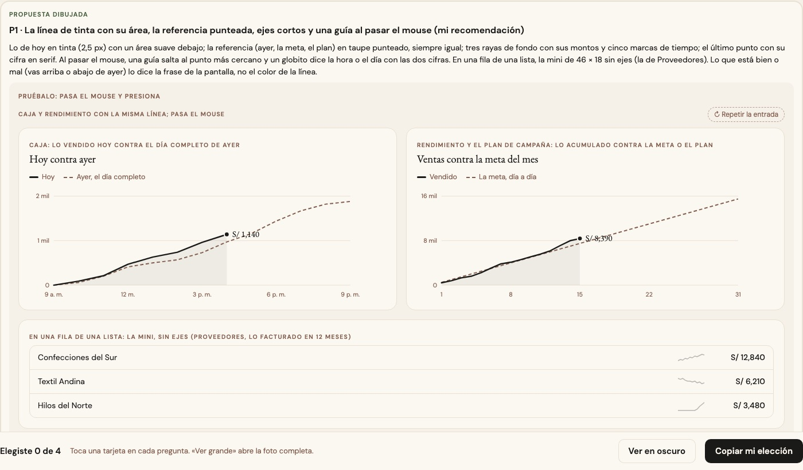
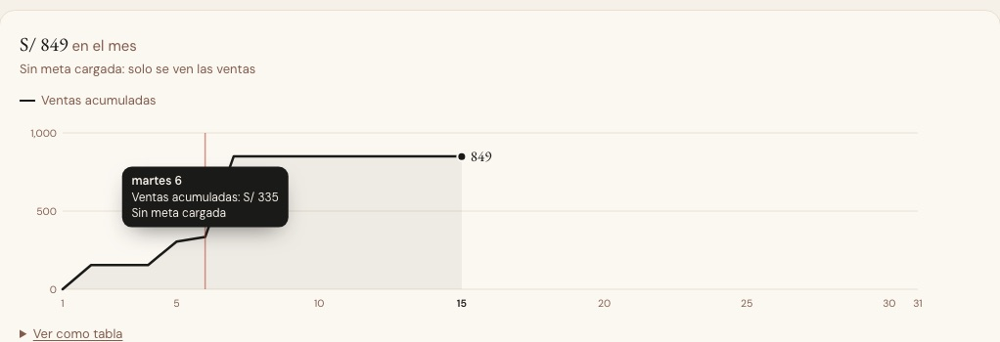

# La línea — una sola pieza (ADR-0358, ronda 14)

**Decidido:** 2026-10-15, Felipe, **tocándola** (página de elegir con demos vivas: pasar el mouse mueve la guía y su globito; fuentes en
[rondas/14](rondas/14/README.md)). **Elegida:** P1. **Pieza:** `<Linea>` (`components/ui/Linea.tsx`; CSS en `app/estilos/graficos-tiempo.css`)
y, en una fila de una lista, `<Sparkline>` (la mini que ya existía).

Cómo va algo en el tiempo, casi siempre contra una referencia: lo vendido hoy contra ayer, el mes contra la meta, lo vendido contra el plan,
el costo de una prenda compra a compra.

## Qué se comparó

Cuatro líneas grandes y una mini, **ninguna compartida**: Caja (hoy 3,2 px en tinta, ayer punteado 6 5, la brecha sombreada en verde o
ámbar, se revelaba en 1,1 s, ejes de cinco rayas y su globito), Rendimiento (2 px con área al 7 %, la meta punteada 5 4, quieta, «Ver como
tabla»), el plan de campaña (rojo 3 px, el plan en pizarra punteada, «si sigue así» en rojo al 40 %, sin ejes, quieta) y la ficha de un
proveedor (2,5 px verde o ámbar según subiera o bajara, cada compra con su punto, una guía roja que saltaba).

## Lo que eligió

**P1 · la línea de tinta con su área, la referencia punteada, ejes cortos y una guía al pasar el mouse.**

- **Lo de hoy en tinta** (2,5 px) con un área suave debajo; **la referencia** (ayer, la meta, el plan) **en taupe punteado**, siempre igual; lo
  que viene («si sigue así») en tinta suave punteada (`proyeccion`).
- **Tres rayas de fondo** con sus montos (`ejes`, `formatoY`) y las marcas de tiempo que pasa la pantalla (`marcasX`, la de hoy en negrita);
  el último punto con su **cifra en serif** (`cifra`) y, si la hay, la cifra al final de la referencia (`cifraReferencia`: «15,500 · meta»).
- **Al pasar el mouse**, una guía salta al punto más cercano (o recorre cualquier minuto, `continuo`, como en Caja hasta «ahora») y un
  **globito** dice lo que pasa la pantalla (`leer`).
- **Lo que está bien o mal** (vas arriba o abajo de ayer) lo dicen el titular y el globito, **no el color de la línea**: se fueron la brecha
  verde o ámbar de Caja, el rojo del plan y el verde o ámbar del costo de un proveedor.
- Para lo que no empieza en cero (el costo de una prenda), `minY`; para un punto por dato, `puntos`; sin ejes donde la fila de abajo ya dice
  cada monto, `ejes={false}`.

La otra propuesta (solo las dos líneas y la cifra final, sin área, ejes ni guía) no la eligió: no se podía leer cuánto se vendió a una hora.

## El movimiento de la pieza

Se dibuja de izquierda a derecha una vez al verse (900 ms), el área aparece detrás y el punto final con su cifra al llegar; con `puntos`,
cada punto aparece uno tras otro. La guía sigue al mouse y el globito entra en 160 ms. La mini se vuelve a dibujar al pasar por su fila
(`trazo-al-pasar`). Sin rebote ni bucle; con «reducir movimiento», quieta.

## Migración (2026-10-15)

**Deuda 0.** Caja (la venta acumulada: conserva el cursor por minuto hasta «ahora», la raya de «ahora» y el globito con la diferencia contra
ayer), Rendimiento (el mes acumulado contra la meta, con su globito de siempre y «Ver como tabla»), el plan de campaña («Ver la curva», con
el plan y «si sigue así») y la ficha de un proveedor (el costo compra a compra, con su punto en cada compra y la fila de montos debajo).

**Se quedan, por su ADR:** las del Observatorio (ADR-0322) y las de Análisis (ADR-0357).

## Escalones y números (2026-10-24)

La pestaña «Costo» del Historial de la prenda necesitaba un costo que se queda quieto hasta que llega mercadería y salta ahí, con un número
que se toca en cada salto. La pieza ganó dos opciones, sin cambiar a nadie que ya la usaba: `escalones` (el trazo va en escalón y la guía
lee el valor del último punto que pasó) y `marcas` (①②③ sobre la línea, con lo que pasó en dos palabras: sube en ámbar, baja en verde, el
resto en taupe; se tocan con el mouse, el dedo o Enter, y el elegido se llena de tinta). Y `arreglos`: un lápiz punteado en pizarra sobre la raya del piso, en la fecha de algo que se corrigió (un costo mal anotado); no
mueve la línea y se toca para ir a su detalle. Maqueta: `docs/maquetas/costo-historial-2026-10/`.

**Números que se pisan (2026-10-26).** Con varias compras casi juntas (6 en 2 días) los números quedaban encimados y no se podía tocar ninguno.
Ahora `marcas` los separa a 26 px como mínimo (`lib/linea-marcas-reglas.ts`: mínimos cuadrados con separación mínima, en el mismo orden y dentro del
gráfico): el escalón de la línea no se mueve, solo el número, unido a su punto por un hilo fino cuando se corrió más de 14 px. Al número apretado
no se le dibuja el texto («↑ subió S/ 1.61»): lo dicen la tabla de abajo, su `<title>` y el lector de pantalla; el elegido lo muestra siempre, y el
blanco de toque se achica a la mitad de la distancia al vecino (mínimo 12 px). Quien tiene sus números separados no ve ningún cambio.

## Firmas

Una `<polyline>` o un `<path>` armado con su propia función de trazo (`d={trazo(…)}`, `camino`, `linea`) fuera de la pieza. Con el código de
antes reconocen 4 archivos.
