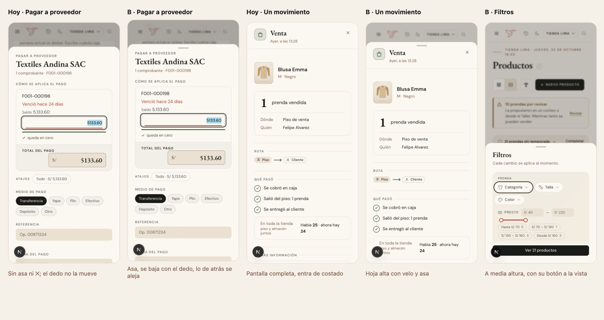

# La hoja del celular — una sola pieza (ADR-0358, ADR-0479)

**Decidido:** 2026-10-22, Felipe, tocando la maqueta con el dedo (`docs/maquetas/hojas-movil-2026-10/`). **Elegida:** «B · Hoja viva con
profundidad». **Pieza:** `<Modal>` y `<Cajon>` bajo 640 px, con `components/ui/useHojaArrastre.ts` (el dedo) y
`components/ui/fondoDeLaHoja.ts` (lo de atrás); las reglas, puras, en `apps/web/lib/hoja-gesto.ts`.

## Qué se comparó

Medido en local a 375 × 812 con pantalla táctil, abriendo las hojas reales de 98 escenarios del auditor de tema (cuenta Admin; 82
abrieron: 61 hojas y 21 listas).

| Forma | Asa | Se baja con el dedo | Entrada | Detalle de un registro | Filtros | Lo de atrás |
|---|---|---|---|---|---|---|
| Hoy | 0 de 61 | 0 de 61 | sube 24 px con un fundido (380 ms) | pantalla completa, entra de costado | a toda altura | velo con desenfoque |
| A · Hoja viva | sí | sí | desde el borde (460 ms) | hoja alta, se desliza de lado | a media altura | velo que se aclara con el dedo |
| **B · con profundidad** | sí | sí | desde el borde (460 ms) | hoja alta, se desliza de lado | a media altura | **se aleja a 0,92 y vuelve con el dedo** |

## Por qué esta

Felipe pidió que la experiencia del teléfono «quede sofisticada y llena de animaciones», y la hoja de hoy no se portaba como una hoja:
nada decía que se podía bajar, y en 29 de 61 la única salida era un «Cancelar» que a veces quedaba bajo el pliegue. B suma a A la
profundidad: se entiende que la pantalla de atrás sigue ahí, debajo. El costo (escalar la cabecera y el contenido) se midió: con el
procesador frenado 4 veces la entrada no pierde cuadros.

## El movimiento de la pieza

- **Al abrir:** la hoja llega desde el borde de abajo (460 ms, `--ease-cayla`, opaca, sin pasarse); su contenido entra en cascada como
  siempre (ADR-0136); lo de atrás se aleja a 0,92, baja 12 px y la cabecera se redondea 18 px, en el mismo tiempo.
- **Con el dedo:** sigue 1 a 1; más arriba de abierta resiste y se frena (`goma`, sin rebote); el velo se aclara y lo de atrás vuelve en
  la misma proporción; el asa se estira y se oscurece mientras la llevan. Al soltar: pasado un tercio o con un tirón se va (180–320 ms,
  según la velocidad del dedo); si no, vuelve a su lugar (hasta 420 ms).
- **Al cerrar** (Escape, el velo, la ✕, «Cancelar»): baja entera en 300 ms (`--ease-salida`) y lo de atrás vuelve. Con algo escrito,
  bajarla pregunta «¿Salir sin guardar?»; mientras guarda, oye el dedo pero no se va.
- **Lo que trajo cada variante:** la cascada del contenido, el velo con desenfoque y la entrada de 18 px con escala del escritorio se
  conservan tal cual; nada se perdió.
- **Con «reducir movimiento»:** la hoja aparece y se va de una, el dedo la sigue igual y lo de atrás no se aleja.

## Lo que queda distinto a propósito

- **La cámara** (`<Modal variante="camara">`): es pantalla completa y negra, con su ✕ y su bandeja; ni asa ni profundidad.
- **Escritorio y tablet** (640 px o más): la hoja sigue arriba y al centro, y el cajón a la derecha, sin ningún cambio.

## Deuda al decidir

3 archivos arman una capa a mano en vez de usar la pieza (firmas en `apps/web/unificar/familias.mjs`): `components/ProveedorModal.tsx`
(su propia hoja con Radix), `components/FiltrosCompras.tsx` y `components/FiltrosRecibidas.tsx` (un globo que en el teléfono flota sobre
la lista). Se migran en la actividad 10 de ADR-0479.
