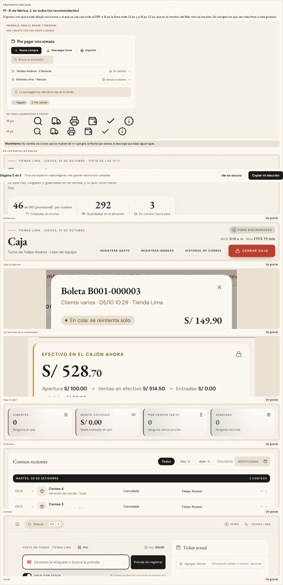
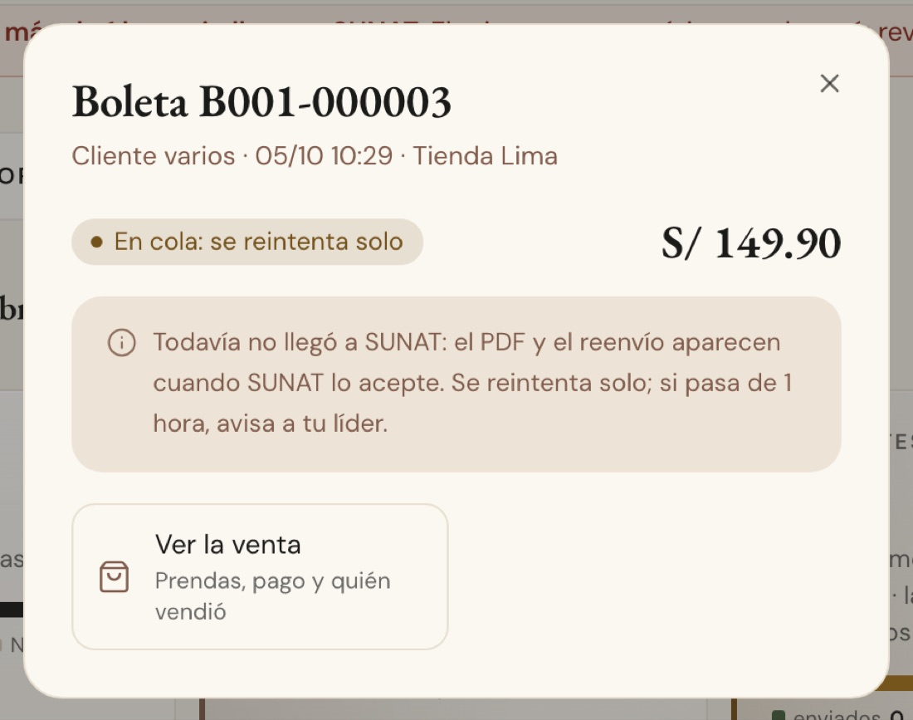
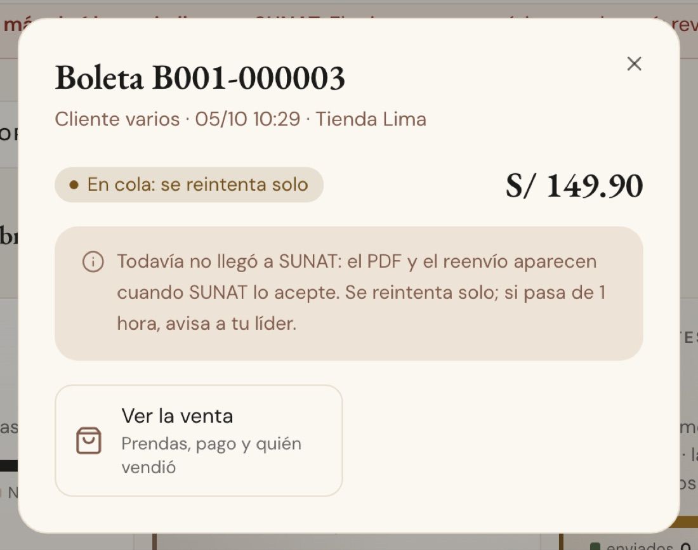
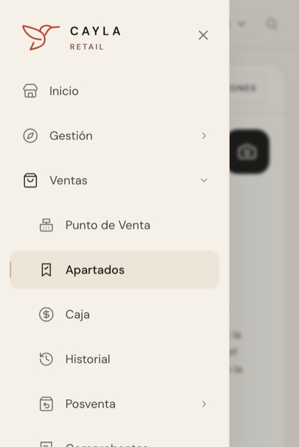

# Los íconos — el grosor y el tamaño (ADR-0358, ronda 15)

**Decidido:** 2026-10-15, Felipe, **mirando** (página de elegir con las mismas siete pantallas reales fotografiadas con cada propuesta
aplicada en vivo, y una fila de íconos aumentados tres veces; fuentes en [rondas/15](rondas/15/README.md)). **Elegida:** P1 en las dos
preguntas. **Pieza:** lucide-react con su grosor de fábrica y la escala de `lib/iconos.ts` (`TAMANOS_ICONO`).

## Qué se comparó

**922 íconos en 320 archivos.** El 84 % ya usaba el grosor de fábrica de lucide (2); el resto iba de 1,4 a 2,8 según quién lo dibujó
(Proformas y las opciones de un comprobante en 1,75, los conteos en 1,5, Existencias en 1,7 y 2,2, los pases de Traslados en 1,8 y 2,6). Y
25 tamaños: casi todos en 12, 14, 16 o 20 px, pero unos 80 archivos en 13, 15, 17, 18 o 19 (el «Cerrar caja», las tarjetas de Proformas, los
filtros, los accesos de Caja). Medido en el código y, en 95 pantallas, en el navegador (lo que se ve: un ícono de 16 px con trazo 2 dibuja una
línea de 1,3 px).

## Lo que eligió

**P1 · el de fábrica, 2, en todos; y cuatro tamaños según el lugar.**

| Lugar | Tamaño | Clase |
|---|---|---|
| Dentro de una insignia o una etiqueta chica | 12 px | `h-3 w-3` |
| Junto a un texto: una fila, una nota, un menú | 14 px | `h-3.5 w-3.5` |
| En un botón, un campo, una pestaña o una tecla de 32 px | 16 px | `h-4 w-4` |
| Junto al título de un bloque, en una tecla grande (40 px o más) o una tarjeta de opción | 20 px | `h-5 w-5` |

No se le pasa `strokeWidth`. Dos casos llevan otro trazo, cada uno con su `unificar-fijo:` en la línea:

- **La marca** (✓ − ‖ ✕ sobre un punto o un cuadrito lleno: el «visto» de un paso, la marca de un cobro, el punto de una diferencia): trazo 3,
  como la de la casilla, que ya era así. Antes iban de 2,2 a 3.
- **El ícono grande** (24 px o más, que es un dibujo: el lugar de un conteo, la nube sin conexión, los medios de la hoja de cobro): trazo
  1,5, como el ícono de un vacío.

Las otras propuestas no las eligió: P2 (1,75, más fino) se ve más gris a 14 px en el monitor del Mac mini; P3 (1,5 px a cualquier tamaño)
deja los íconos grandes livianos y los chicos más gruesos que hoy. Del tamaño, P2 (el ícono crece con la letra) daba medidas como 15,5 px.

## El movimiento

No cambia: el «+» que gira, la flecha que avanza, la descarga que baja y la ✓ que se dibuja (`check-trazo`) siguen igual.

## Migración (2026-10-15)

**Deuda 0.** 89 archivos (con el código de antes las firmas reconocen 89): se quitó el `strokeWidth` de los íconos comunes y se llevaron los
tamaños a la escala según su contenedor. Por ejemplo, los botones de la barra de Caja, de 18 a 16; los accesos de Caja y las tarjetas de opción de
un comprobante, de 17–19 a 20; las tarjetas de Proformas y de Comprobantes, de 15 a 16; las insignias de Existencias, de 15 a 12; los botones
grandes «Escanear prenda» del celular, de 18–19 a 20. También el ícono de las píldoras de filtro y la lupa de los combos (de 15 a 16).

**Se quedan, por su decisión:** el marco (el lateral, la cabecera y su botón «Demo», y el ícono de cada módulo en Roles, que copia al
lateral) dibuja con 1,5 y quedó fuera del censo desde la ronda 1. **Felipe lo decidió en la ronda 16 (P2, mirando las fotos del lateral y la
cabecera con cada opción en vivo): se queda en 1,5**, porque a 20 px su línea (1,25 px) se ve como la de un ícono de 16 px con trazo 2 en un
botón del contenido; con 2 el lateral se veía más marcado. Sus tamaños sueltos pasaron a la escala: el menú del celular y el botón del menú, de
18 y 22 a 20; la lupa de la cabecera y el «Demo», de 18 a 16.

El menú del celular a 375 px, con sus íconos de 20 px y trazo 1,5:  Los pases de Traslados (ADR-0355), el
gasto rápido (ADR-0368), la prenda sin foto (ADR-0333), la vista rápida (ADR-0136), el historial de una prenda (ADR-0354), los sellos de
Movimientos (ADR-0353), el Observatorio (ADR-0322), Análisis (ADR-0357), Ventas sin registrar (ADR-0360), Inicio de Almacén con su propio
juego de íconos (ADR-0292), la página pública del club y la balanza de Recibir. Las piezas con su dibujo —el vacío, el aviso, el
buscador— traen el suyo.

## Firmas

Un ícono (un componente en mayúscula) con un `strokeWidth` que no es 2, o con `size` o una clase de tamaño fuera de la escala (10, 11, 13, 15,
17, 18, 19 o 22 px), mirando hasta 8 líneas; y lo mismo en un CSS (`svg { stroke-width | width }`). Con el código de antes reconocen 89
archivos.
