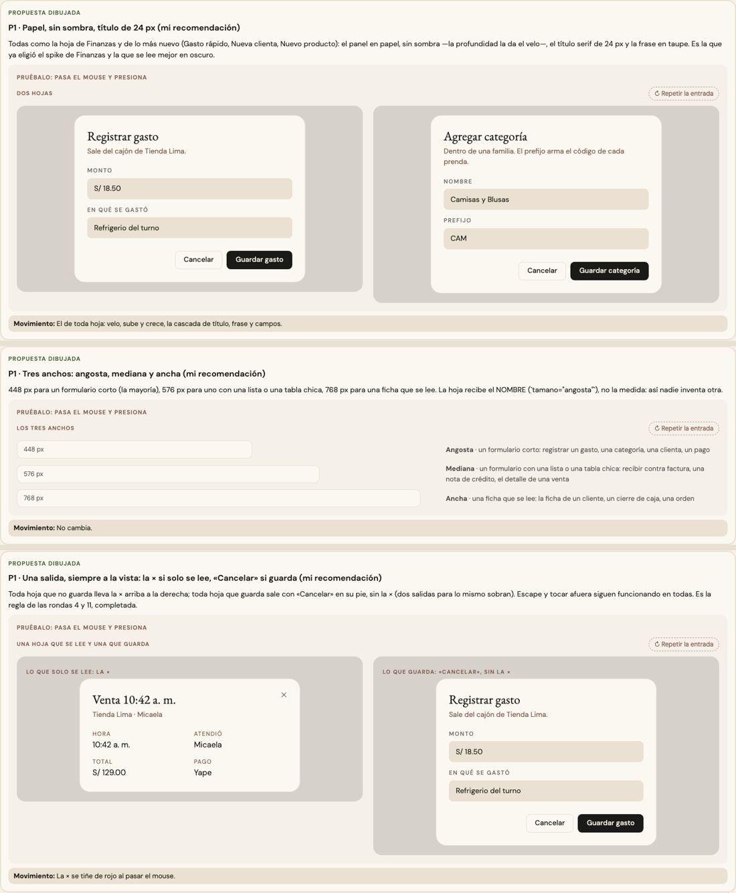
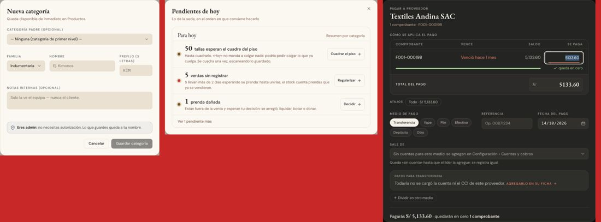
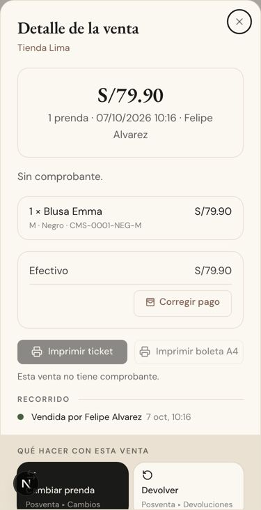

# Las hojas — una sola pieza (ADR-0358, ronda 12)

**Decidido:** 2026-10-14, Felipe, **tocándolas** (página de elegir con demos vivas que entran como una hoja de verdad; fuentes en
[rondas/12](rondas/12/README.md)). **Elegidas:** P1 · P1 · P1. **Pieza:** `<Modal>` y `<ModalRuta>` (`components/ui/Modal.tsx`).

Tres preguntas sobre las ventanas que se abren encima de la pantalla. La entrada ya era una sola desde ADR-0136 (el velo, la hoja que sube y
crece, la cascada); lo que variaba era su cara, su ancho y cómo se sale.

## 1 · La cara

Había tres: crema con sombra y título de 18 px (167 hojas: Categorías, Colores, Roles, Proveedores, Compras, Caja…), papel sin sombra con
título serif de 24 px y la frase en taupe (86: Finanzas, Gasto rápido, Nueva clienta, Nuevo producto, Plan de campaña…) y papel con la ×
(9: Por pagar, la nota de crédito).

**Eligió P1 · papel, sin sombra, título de 24 px** en toda hoja: la del spike de Finanzas y lo más nuevo; la profundidad la da el velo, y
se lee mejor en oscuro. Se va el título de 26 px de las fichas (`tituloGrande`): toda hoja tiene el mismo. La cámara y el ticket de Vender
conservan la suya. `variante="hoja"` y `variante="papel"` quedan como nombres que ya no cambian la cara («papel» todavía pone la ×).

## 2 · El ancho

Había 22 medidas, de 384 px (la de fábrica, 110 hojas) a 1 080.

**Eligió P1 · tres anchos con nombre** (`tamano`): **angosta** 448 px (un formulario corto; la de fábrica), **mediana** 576 px (un formulario
con una lista o una tabla chica) y **ancha** 768 px (una ficha que se lee). La hoja recibe el nombre, no la medida: así nadie inventa otra.
`<ModalRuta>` es ancha por defecto (casi siempre es el detalle de algo).

## 3 · La salida

En la ronda 4 se decidió que una hoja que no guarda nada se cierra con la × de arriba. Pero había hojas que solo se leen sin ninguna salida a
la vista (Movimientos de la caja, Ventas de hoy, Actividad del equipo, Pendientes de hoy, Campañas archivadas…): se salía con Escape o
tocando afuera, que en el celular no siempre se alcanza.

**Eligió P1 · una salida, siempre a la vista:** la × arriba a la derecha si la hoja solo se lee; «Cancelar» en su pie si guarda (ronda 11);
nunca las dos. Escape y tocar afuera siguen funcionando en todas. Una hoja que cambia de modo decide según el modo: la ficha de un cliente
lleva la × mientras se mira y «Cancelar» mientras se edita.

## El movimiento de la pieza

No cambia: el de ADR-0136 (velo con desenfoque, la hoja que sube 18 px y crece, la cascada de título, frase y campos, la salida corta). La ×
se tiñe de rojo al pasar el mouse.

## Migración (2026-10-14)

**Deuda 0.**

- **La cara:** en la pieza; todas las hojas a la vez.
- **El ancho:** 146 hojas a `tamano` con un script (`rondas/12/anchos2.mjs`, que lee las etiquetas JSX respetando llaves y comillas: el
  primero cortaba en el `>` de un título con JSX y dejaba 23 sin migrar); 169 pasan de 384 a la angosta de 448. **Conservan su ancho,
  con su motivo**, las de diseño propio: la vista rápida de un producto, Nueva orden de producción, la mesa de Ventas sin registrar, el
  modal de la prenda de Existencias, la guía de impresión, Revisar fotos y el Historial de una prenda; el Historial de cierres crece de
  mediana a ancha al abrir uno (con los nombres, `ANCHO_HOJA`).
- **La salida:** la × en Movimientos de la caja, Ventas de hoy, Actividad del equipo, Pendientes de hoy, Campañas archivadas, Recepciones
  recientes, los integrantes de un rol, la demo del sistema, «Más de la tienda», las opciones de un comprobante, una factura de insumos,
  «Tus atajos» y Regularizar prenda; sin la × (porque guardan con «Cancelar») Pagar, Pagar juntos, Registrar nota de crédito, el precio
  de una sede y Nueva orden de producción; según su modo, la ficha de un cliente, Liquidar desde, Etiquetar una prenda, una prenda de
  liquidación, Apartados, la propuesta de presupuesto, Identificar con sugerencias y «no se puede eliminar» (los tres últimos decían
  «Cerrar» al pie cuando no había nada que hacer). «Abrir caja» de Vender gana su «Cancelar».

A 375 px (el detalle de una venta desde Historial, con la cuenta del mostrador): 

**Verificado:** `tema:auditar` con las hojas abiertas (Caja, Categorías, Por pagar, Marcas): 0 hallazgos solo en oscuro. `guias:recorrer`
de Vender, Cambios, Devoluciones y Apartados a 375 px, y de Caja, Marcas, Atributos, la ficha de un proveedor, Clientes y Conteo a 1440:
todas en verde.

## Firmas

Un `ancho` a medida (`max-w-…`) y `tituloGrande`. La salida no tiene firma: depende de si la hoja guarda, y eso no se ve en una línea; la
cuida quien construye la hoja (CLAUDE.md, «Piezas únicas»).
