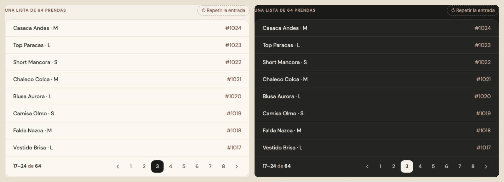

# Paginación — una sola pieza (ADR-0358, ronda 8)

**Decidido:** 2026-10-13, Felipe, **tocándola** (página de elegir con demos vivas; fuentes en [rondas/6-8](rondas/6-8/README.md)).
**Elegida:** P1. **Pieza:** `<Paginas>` (`components/ui/Paginas.tsx`), CSS en `app/estilos/enlaces-paginas-caras.css`. La usan
`PaginacionLocal` (en memoria), `PaginacionPaginas` (por URL) y, sin números, `PaginacionCursor` (`components/Paginacion.tsx`).

## Qué se comparó

| Forma | Dónde | Cómo se veía |
|---|---|---|
| A · `PaginacionLocal` / `PaginacionPaginas` | Existencias, Comprobantes, Marcas (36 px), Conteo, Cuadre; Productos, Historial de cajas, Por revisar | números en VERSALITAS de 11 px, la actual rellena de tinta, «‹ ›» de texto |
| C · `PaginacionCursor` | Movimientos, Historial de ventas, Compras, Órdenes, Recibir | «← VOLVER AL INICIO» y «SIGUIENTE PÁGINA →» en versalitas |

## Lo que eligió

**P1 · las páginas, con la píldora que se desliza.** Números de 13 px en letra normal, en cuadrados de 32 px (36 con `grande`, Marcas), y
la página actual como una píldora de tinta que viaja de un número al otro; las flechas son íconos que se corren 2 px hacia donde llevan.
El rango («1–8 de 64») lo escribe cada lista a su izquierda, como ya hacían todas.

**La paginación por cursor no tiene números a propósito** (`components/Paginacion.tsx`: un cursor resuelve «las 50 después de esta fila»
sin contar ni saltar filas; «página 7 de 2.000» costaría un `count(*)` en cada carga). Toma el aspecto de la pieza: «Volver al inicio» y
«Siguiente página» en 13 px y 32 px, con su flecha que se corre. El texto no cambió.

## El movimiento de la pieza

La píldora se desliza (320 ms, sin rebote) al número nuevo; la primera vez no viaja (se mide y se queda). Antes de medirla —el HTML del
servidor— el número actual se pinta él mismo, así nunca hay un instante sin página marcada. Por URL, la pieza no se desmonta al navegar
(App Router) y la píldora también viaja de la página vieja a la nueva. Un número se tiñe al pasar el mouse; las flechas se corren 2 px.

## Verificación

`lib/paginas.test.ts` dibuja la pieza (página actual, cortes «…», flechas que no se pueden tocar en los extremos, enlaces por URL). La
paginación por cursor se vio en Movimientos. La base local de prueba no tiene ninguna lista de más de una página numerada: el
deslizamiento se vio en la demo, que usa el mismo CSS.

## Deuda al decidir

0 archivos: las tres paginaciones ya eran piezas y cambiaron por dentro.

## Control (2026-10-17)

La paginación de Clientes (`ClientasPanel.tsx`) seguía a mano («‹ Anterior · Página 2 de 5 · Siguiente ›» en versalitas): pasó a
`<Paginas hrefDe>`, por URL como antes. La encontró la firma de `accion.anterior` (ronda 17), que ahora la vigila.
