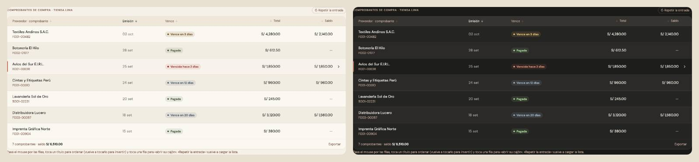

# Tablas — una sola pieza (ADR-0358, ronda 7)

**Decidido:** 2026-10-13, Felipe, **tocándola** (página de elegir con demos vivas; fuentes en [rondas/6-8](rondas/6-8/README.md)).
**Elegida:** P1. **Pieza:** `<Tabla>`, `<Encabezado>`, `fila()` y `celda()` (`components/ui/Tabla.tsx`); el movimiento vive en las reglas de
`.fila-cayla` de `app/globals.css`, así lo tiene toda fila sin cambiar su pantalla.

## Qué se comparó

De 39 formas del censo (sin depurar) quedaron cuatro reales y la de Finanzas: las demás eran la misma `<Tabla>` con otro alto de fila, o
cosas que no son tablas (la matriz de tallas de Existencias, el calendario).

| Forma | Dónde | Cómo se veía |
|---|---|---|
| A · `<Tabla>` | Compras, Clientes, Historial de cajas, Rendimiento, Notas de crédito, Plan de compra, Global | banda arena, títulos taupe, zebra hueso; al pasar el mouse, un tinte crema y nada más |
| B · versalitas sin banda | Por pagar, Proveedores | títulos en VERSALITAS de 11 px, sin banda ni zebra |
| C · Productos (ADR-0254) | Catálogo ▸ Productos | su diseño aprobado |
| D · `<table>` a mano | Comercial, Calidad, Eficiencia, Caja | cabecera en negrita con raya negra, sin hover |
| F · `fin-tabla` (ADR-0195) | Finanzas | la del spike |

## Lo que eligió

**P1 · `<Tabla>` de hoy, con movimiento.** Se ve como hoy (la guía oficial, ADR-0169) y gana lo que le faltaba para decir «esto se abre»,
que Comprobantes de compra (`.cmp-fila`) ya hacía: es el origen del movimiento elegido.

## El movimiento de la pieza

1. **Al llegar** (cargar, filtrar, cambiar de página), las filas entran en cascada: suben 8 px, 28 ms entre cada una, hasta la 12. Las que
   ya estaban no se repiten (React conserva su DOM).
2. **Una fila que lleva a su detalle** (un enlace, un botón, `role="button"` o `cursor-pointer`): al pasar el mouse o con el foco, el hilo
   rojo de canto crece desde el centro en el borde izquierdo (220 ms) y la «›» asoma a la derecha desde 4 px (200 ms), salvo que la fila
   ya traiga su chevron (Existencias).
3. **Abierta** (`aria-current`, su cajón a la vista): el hilo y la flecha se quedan y el fondo es hueso firme.
4. **Recién guardada** (`data-recien`): respira en verde una vez (1,4 s).
5. El título que ordena ya mostraba su flecha y la giraba al invertir (300 ms): se queda.

El hilo es una imagen de fondo (no un `::before`), así no pisa el filete propio de ninguna fila; todo va con especificidad baja, así una fila
con movimiento propio por una decisión (Comprobantes, Frescura, Recepciones) conserva el suyo. Con «reducir movimiento», sin el viaje.

## Lo que queda distinto a propósito

Finanzas (`fin-tabla`, ADR-0195), Catálogo ▸ Productos (ADR-0254), Análisis (ADR-0357), el papel impreso (boleta, proforma, orden de
compra, el plan para imprimir) y las matrices de tallas y colores o de tiendas (otra función: no son listas de registros). Están en las
`excepciones` de la decisión, cada una con su motivo.

## Deuda al decidir

14 archivos (`node apps/web/unificar/deuda.mjs tabla`): 7 `<table>` que son listas (Caja, Comercial, Calidad, Eficiencia del Taller,
Conteo y las «Ver como tabla» de dos gráficos) y 7 encabezados escritos a mano con `role="columnheader"` (Clientes, Por pagar,
Proveedores, Recepciones, Plan de compra, Historia del espacio). Verificado en Clientes: la cascada al entrar y, al pasar el mouse, el hilo
y la «›».

## Migración (2026-10-13)

**Migrada el 2026-10-13: deuda 14 → 1.** Caja (cierres anteriores, «Ver como tabla»), Comercial, Calidad, Clientes, Eficiencia del
taller, Rendimiento y las listas de Compras pasaron a `<Tabla>` + `<Encabezado>` + `fila()`. `<Encabezado>` aprendió `visible` (desde qué
ancho se ve: Clientes decide por su tarjeta con `@container`). Las tablas con columnas que cambian (tienda × mes, campañas) pasan su
plantilla en una variable CSS (`grid-cols-[var(--cols)]`). **Queda:** `ListaConteo` (sus `<tr>` memorizadas de `FilaConteo`).
