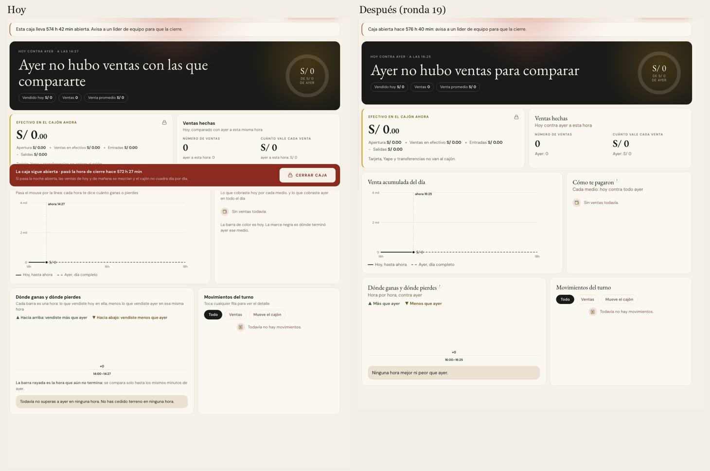
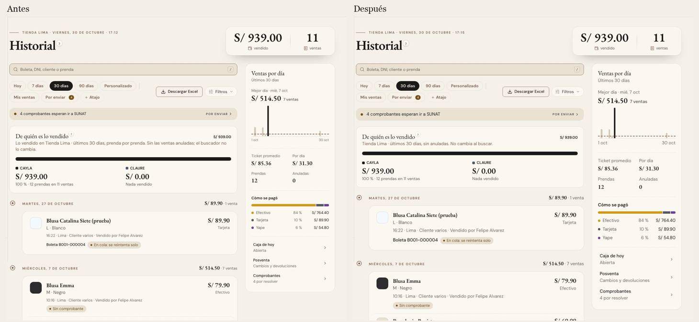
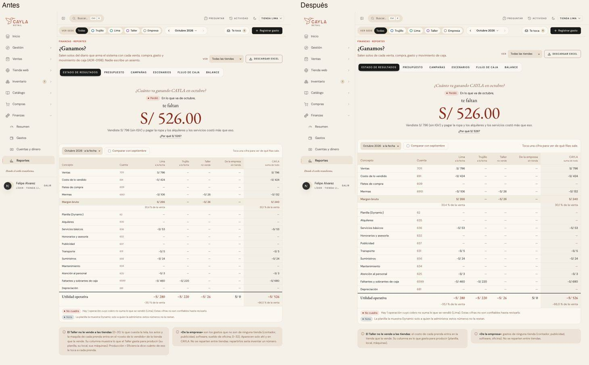
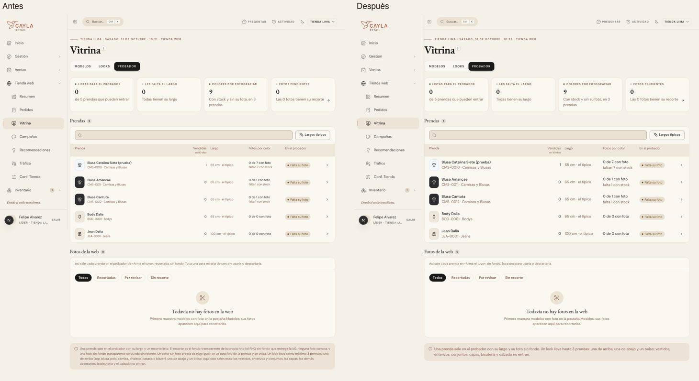

# La letra de lectura y su «?» (`texto`)

Ronda 19 de `/unificar` (2026-10-30 y 2026-10-31). Fuentes, guion y herramientas: [rondas/19](rondas/19/README.md).

**Por qué:** las colaboradoras decían que el texto era chico y que nadie lo leía. La ronda 18 escondió la frase de cada cabecera detrás de un
«?»; esta sigue con todo lo demás que se lee: la frase bajo un título de sección, el detalle de una fila, una nota, un vacío, una ayuda. El
censo midió 107 pantallas: 779 frases de 5 palabras o más, **484 (el 62 %) bajo 14 px**, escritas en 13 tamaños distintos a mano (más de
3.400 usos), y una nota al pie de 33 palabras de mediana en 13 px y gris.

## Lo que eligió Felipe, mirando

| Pregunta | Opciones | Eligió |
|---|---|---|
| ¿De qué tamaño? | E0 hoy (13 tamaños) · E1 y E2, escalas de tres voces con un piso | **Ninguna todavía:** «analiza texto por texto si se puede condensar mucho más, para que haya menos texto y subir la fuente sin preocupación» |
| ¿Qué se queda a la vista? | **F1 una línea, lo demás al «?»** · F2 todo a la vista, más corto | **F1**, con la letra más grande y el «?» más chico, «arriba a la derecha de la última palabra, igual que en las cabeceras» |
| ¿Con qué se abre lo que no se ve? | **A1 el mismo «?» de vidrio de la cabecera** · A2 un enlace «¿Por qué?» | **A1** |

El tamaño se resolvió así: primero se condensó cada frase (de ~7.000 palabras a la vista a ~2.500 en el inventario de 540 frases), y con menos
texto, Felipe pidió subir a 14 px: Caja primero («Movimientos del turno, las cosas dentro se siguen viendo pequeñas»), las píldoras de todo el
ERP («Sí, a 14 px»), y después módulo por módulo, mirando las fotos de antes y después de cada uno.

## Las piezas

- **`<Ayuda>`** (`components/Ayuda.tsx`): con `tono="ayuda"` (el de siempre) ya no es un «!» con un globo de 12 px: es `<AyudaCabecera
  tamano="texto">`, el «?» de vidrio de la cabecera en 14 px, colgado arriba a la derecha de la última palabra, con su globo de vidrio y la letra
  a 16 px. El «!» rojo queda solo para «falta algo» (`tono="falta"`).
- **`<TituloSeccion ayuda>`** (`components/ui/TituloSeccion.tsx`): el mismo «?» en 16 px junto al título de un bloque. Lo que explicaba la
  bajada de una sección (cómo se lee un gráfico, de dónde sale una cifra) va ahí.
- **`<AyudaCabecera tamano="cabecera" | "seccion" | "texto">`** (`components/ui/AyudaCabecera.tsx`): las tres medidas del «?» (20, 16 y
  14 px), y `etiqueta` para su nombre de lector. Lo que se toca es más grande que lo que se ve: 32 px con mouse, 44 con el dedo.
- **`.texto-bajada`** (15 px, taupe) y **`.texto-detalle`** (14 px, tinta al 70 %), en `app/estilos/titulos.css`: la línea bajo un título y
  el detalle de una fila, cuando no hay una pieza que ya los dibuje.

## La regla de tamaño

**Lo que se lee no baja de 14 px.** La bajada de un bloque va a 15 px; el título de una fila de una lista, de 13,5 a 15 px. En CSS propio: lo
de 11,5–13 px pasa a 14, lo de 13,5 a 15 y lo menudo (10–11 px) a 12–13. En todo el ERP: `.pildora-cayla`, `.pildora-filtro-boton`,
`nota-cayla`, el vacío chico, el texto de `<Aviso>`, el detalle de `<TarjetaCifra>` y de `<TarjetaKpiVidrio>`, a 14 px.

**No cambian** (no son texto de lectura o no caben): versalitas y letras espaciadas (`label-cayla`, `uppercase`, `tracking-*`), botones del
sistema, controles de alto fijo, letra monoespaciada, las etiquetas pegadas a un gráfico (ejes, riel, semanas, días, banderas, mapa de calor,
el mapa del Observatorio), teclas, diales y contadores; el **papel impreso** (`.papel-fijo`, `[data-papel]`: boleta, ticket, etiquetas, la hoja
de ingresos, las órdenes impresas); las **matrices de tallas** densas (la del alta, la ficha, el conteo, la recepción); la **planilla de
«Ajustar stock»** (ADR-0494); la **persiana de Caja cerrada** (ADR-0301); el **marco** (lateral y cabecera); y la **vista previa de una campaña
web**, que imita la tienda online.

## Su movimiento

No cambia: el «?» y su globo son los de la ronda 18 (sube 1 px al pasar el mouse, se encoge al presionar; el globo crece desde el pico y la
frase sube un paso después, una vez, sin rebote; nada con `prefers-reduced-motion`). Subir la letra no tocó ninguna animación.

## Migración

Módulo por módulo, un commit cada uno, con fotos de página entera antes y después a 1440 y 375 px y Felipe mirándolas:

| Módulo | Commit | Qué más |
|---|---|---|
| Caja (y las píldoras de todo el ERP) | `1d960c1a8` | títulos de tarjeta a `TituloSeccion`; Movimientos del turno a 15/14/16 px |
| Ventas | `5d16e16a9` | 55 archivos; títulos de grupo de Cambios y Devoluciones a `<TituloGrupo>` |
| Inventario | `78bfbd725` | ~90 archivos; el CSS de Movimientos y de los pases de Traslados |
| Catálogo | `2ff12a7ad` | la vista rápida, Insignias, las parecidas, la ficha del Taller |
| Compras | `80700d7e9` | ~45 frases; el Plan de campaña |
| Clientes | `49dac162b` | la nota de Avisos, de 75 a 35 palabras |
| Gestión | `ebebc0505` | Análisis sin tocar sus gráficos; «Dónde está cada grupo» al «?» |
| Finanzas | `dd0e154b7` | el kit (`finanzas.css`), El telar y Cuentas y dinero; se aparta del spike (ADR-0195) |
| Producción | `8f743e51a` | mirado desde el Taller |
| Tienda web | `055c6409a` | notas del Probador, Looks y Esperan, de 50–100 palabras a menos de 40 |
| Colaboradores | `3f415301b` | sus frases ya eran cortas |
| Configuración | `3afc69ed7` | «Cada casilla se guarda sola…», en seis pestañas, en una línea |
| Inicio | `8211a1a91` | las cuatro caras; el mapa y los gráficos del Observatorio quedan igual |

Caja: 

Historial de ventas: 

¿Ganamos? de Finanzas: 

Vitrina ▸ Probador: 

**No se miró con datos:** las hojas que piden algo guardado (cobrar, cambiar, devolver, pagar, un conteo en curso, una recepción abierta, la
página de una orden de producción o de compra, el editor de una campaña web); sus textos se acortaron igual. **Visto de paso, sin arreglar**
(ya pasaba antes): a 375 px, `/vender/historial` se corre 5 px al costado, `/rendimiento` 21 px y `/finanzas/reportes/campanas` 163 px. Las
frases de «Te toca» del Inicio de almacén salen de `lib/` y siguen largas.

## Firmas

Un párrafo de lectura dibujado a mano bajo 14 px: `
` o `text-[10px]` a `text-[13.5px]`, sin versalitas, letras
espaciadas ni mono (`apps/web/unificar/familias.mjs`, decisión `texto`). La deuda de lo que quedó fuera de los trece módulos (63 archivos:
piezas compartidas, el escáner, las guías, el login, las barreras de error) solo baja; las excepciones, cada una con su motivo, están en la
misma decisión. Una línea legítima se exime con `// unificar-fijo: <por qué>`.
