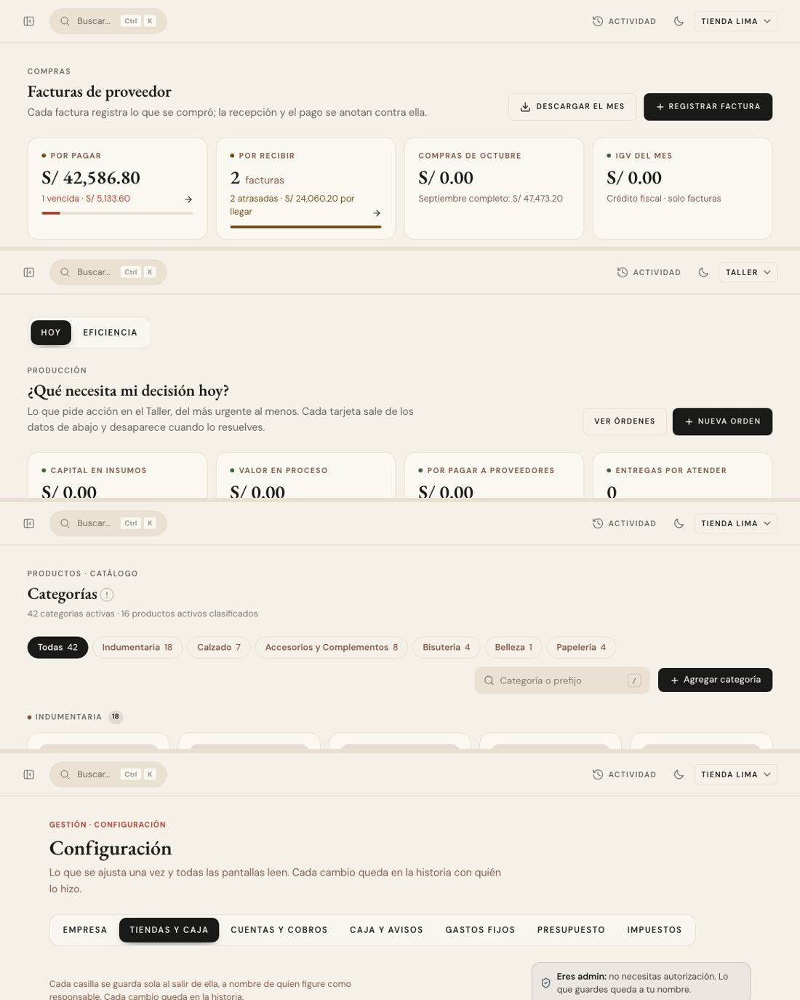
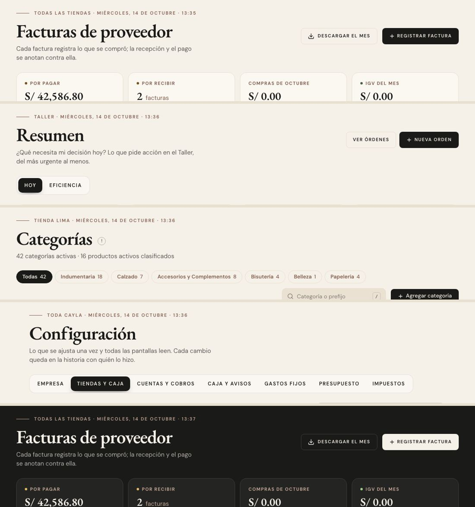
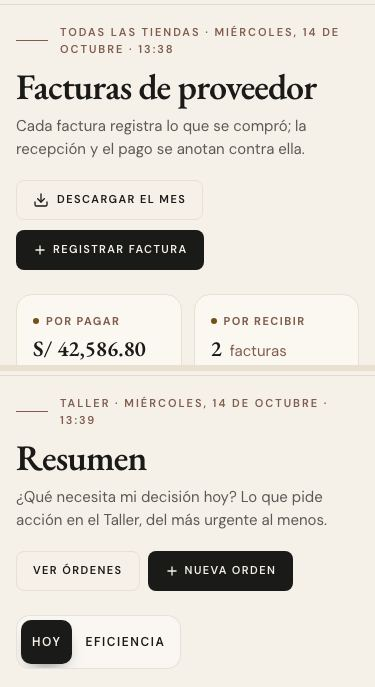

# La cabecera de una pantalla — una sola pieza (ADR-0358, pendientes antes de la ronda 12)

**Decidido:** 2026-10-14, Felipe, **mirando** las fotos de cada pantalla con su cabecera de hoy y la propuesta armada en el navegador
(página de elegir; fuentes en [rondas/pendientes](rondas/pendientes/README.md)).
**Elegida:** P1. **Pieza:** `<EncabezadoPagina>` (`components/ui/EncabezadoPagina.tsx`) en todo el ERP; `<CabeceraPantalla>` queda solo en
Finanzas.

## Qué se comparó

Inventario, Productos, Vender, Caja, Clientes y Colaboradores ya tenían la misma cabecera. El resto tenía tres más:

| Forma | Dónde |
|---|---|
| sede y fecha con el hilo taupe → título de 46 px con el nombre del menú → frase; botones a la derecha (`EncabezadoPagina`) | Ventas, Inventario, Catálogo ▸ Productos y Marcas, Clientes, Colaboradores, Plan de campaña, Órdenes de compra |
| sobretítulo rojo → título de 30 px → bajada en taupe (`CabeceraPantalla`, la del spike de Finanzas) | Finanzas, y también Configuración, Rendimiento, Etiquetas de precio, Actividad, Inicio y la parte de una compra |
| versalitas grises («Compras», «Producción») → título de 24 px → frase gris, a mano | Compras (Facturas, Por pagar, Proveedores, Notas de crédito, Registrar factura), Recibir, las 8 pantallas de Producción, Comercial, Buscar |
| sin sobretítulo, título de 24 px con su «!», a mano | Categorías, Atributos, Familias, Editar producto, la ficha de un proveedor, el detalle de una factura |

Antes: 

## Lo que eligió

**P1 · la de Inventario en todas, menos Finanzas.** Una sola cabecera en todo el ERP: arriba, dónde y cuándo (la sede y la fecha con su
hilo); el nombre de la pantalla tal como lo dice el menú, en 46 px; la frase; a la derecha, los botones (que hablan en versalitas: lo pone
el lugar, ronda 3). Finanzas conserva la de su spike (ADR-0195). La otra propuesta (P2) dejaba Configuración, Rendimiento, Etiquetas y
Actividad con la de Finanzas, «por ser de administrar»; no la eligió.

Cómo se acomoda lo que cada pantalla traía:

- **El sobretítulo desaparece:** el módulo ya lo dice el menú. Lo que decía de dónde se llegó («Productos · Blusa Emma» en Etiquetas, «Tu
  parte» en una compra, el documento de una factura, el código de una prenda) va en la línea de arriba, tras la fecha (`detalle`).
- **La sede** es la que se mira: la de la cuenta (Recibir, Producción —el Taller—, Catálogo, Etiquetas, Inicio); «Todas las tiendas» donde
  la pantalla mira todas (Compras desde ADR-0387, Comercial, Rendimiento con varias); «Todas las sedes» en Actividad del líder y en Buscar;
  «Toda CAYLA» en Configuración, como Colaboradores.
- **La vuelta** es la flecha a la izquierda de la línea de la sede (`volver`), nunca una fila aparte.
- **El «!»** va pegado al título, en la letra de la frase (como Marcas).
- **Lo que es estado, no acción** (las marcas y el crédito de un proveedor, «Pendiente de revisión» de una prenda, las fechas de una
  compra) va bajo la frase (`pie`).
- **En Producción**, el Resumen se titula «Resumen» (el menú) y su pregunta pasa a la frase; las pestañas «Hoy | Eficiencia» bajan bajo la
  cabecera, en el orden de ADR-0220 (cabecera → lo demás).
- La frase pasó a ser opcional en la pieza: una ficha (Editar producto, Atributos, Familias) dice lo suyo con el título.

Después: 

A 375 px: 

## El movimiento de la pieza

El de Inventario: la línea de la sede con el hilo que se dibuja, el título y la frase suben al entrar; los botones, un paso después. Las
cabeceras a mano solo «entraban» (`anim-entra`): no se pierde nada.

## Migración (2026-10-14)

**31 pantallas en 33 archivos, el mismo día; deuda 0.** Compras (Facturas, Por pagar, Proveedores, la ficha de un proveedor, el detalle de
una factura, Registrar factura, Notas de crédito, Tu parte), Recibir mercadería, Producción (Resumen, Eficiencia, Órdenes, Insumos,
Facturas de insumos, Por pagar, Proveedores, Recibir y los estados «No hay un Taller activo»), Catálogo (Categorías, Atributos, Familias,
Editar producto), Configuración, Rendimiento, Actividad, Etiquetas de precio, Inicio, Comercial y su Calidad, y Buscar. En Comercial, el
enlace escrito «Calidad: qué se devuelve y por qué →» pasó a `<BotonVer>` («Ver qué se devuelve», ronda 10).

**No se pudo mirar en local:** Familias y Editar producto, porque a la base local le falta `familias.entra_a_motores` (ADR-0377): la
pantalla se cae antes de la cabecera, con o sin este cambio. Tipos, lint y pruebas en verde.

## Lo que se quedó a propósito

- **Finanzas** (Resumen, Gastos, Cuentas y dinero, Reportes, Impuestos, Cierre): su spike (ADR-0195).
- **La página «Historial» de la vista rápida** (ADR-0354): decidida a propósito, con su movimiento.
- **Los estados** (la pantalla que no existe, sin acceso, «Producción solo en el Taller», elegir sede en CAYLA Global, la pantalla caída)
  y **el papel** (la hoja del plan de campaña) y **las páginas públicas del club**: no son la cabecera de una pantalla del menú.
- **Cotizaciones de maquila** no tiene cabecera de pantalla (es una tarjeta con su título de sección): queda anotado en el backlog.
- **El Inicio del Admin** es el Observatorio (ADR-0322), sin esta cabecera.

## Firmas

Un `<h1>` en la serif de la casa (`font-display`) dibujado a mano fuera de la pieza, y `<CabeceraPantalla>` fuera de Finanzas. Las
excepciones de arriba, cada una con su motivo, en `apps/web/unificar/familias.mjs`.
