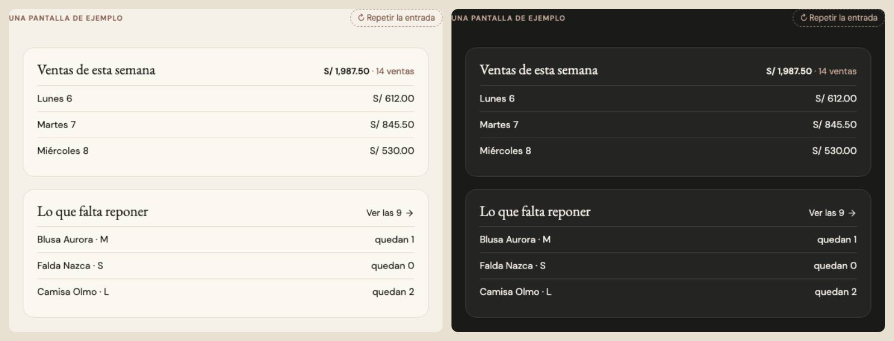
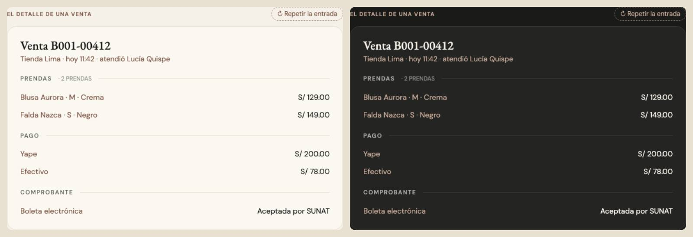
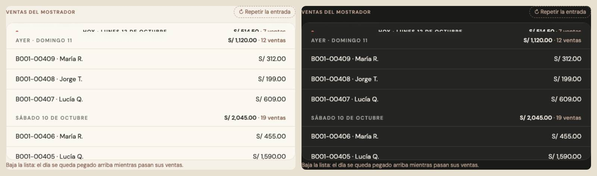

# Títulos de sección — tres piezas (ADR-0358, ronda 7)

**Decidido:** 2026-10-13, Felipe, **tocándolos** (página de elegir con demos vivas; fuentes en [rondas/6-8](rondas/6-8/README.md)).
**Elegidas:** P1 en las tres preguntas. **Piezas:** `<TituloSeccion>`, `<TituloGrupo>` y `<SeparadorDia>` (`components/ui/TituloSeccion.tsx`),
CSS en `app/estilos/titulos.css`.

## Qué se comparó

De 46 formas del censo quedaron tres familias y los separadores de día (las serif de 24 a 32 px eran títulos de hoja, fichas o vacíos:
otras familias): **serif en 8 tamaños** (18 a 24 px, peso 500 o 600: Configuración, Caja, Frescura, Análisis, Colaboradores), **versalitas
en 6 variantes** (10,5 a 12 px, taupe o tinta: Comercial, Rendimiento, Análisis, Historial), **sans seminegrita en 5** (13 a 15 px: Cambios,
Devoluciones, Nuevo producto) y el kit de Finanzas (`fin-etq`, ADR-0195).

  

## Lo que eligió

1. **El título de un bloque · `<TituloSeccion>`.** Un solo tamaño —serif de 21 px, peso normal— sobre la tarjeta o dentro de ella; a su
   derecha, en la misma línea, lo que resume el bloque (`dato`, en taupe de 13 px: «**S/ 1,987.50** · 14 ventas») o su acción (`accion`:
   un `<EnlaceVer>`, «VER LAS 9 →», en versalitas rojas porque así quedó el enlace suelto en la ronda 8).
2. **El título de un grupo dentro de una hoja · `<TituloGrupo>`.** VERSALITAS de 11 px en tinta al 62 % con su cuenta al lado
   («Prendas · 2 prendas») y una raya sand que corre hasta el borde.
3. **El separador de día · `<SeparadorDia>`.** VERSALITAS con el total del día a la derecha («**S/ 514.50** · 7 ventas»); al bajar, el día se
   queda pegado arriba sobre un velo de papel mientras pasan sus filas (`--separador-tope` si lo que se desplaza tiene algo fijo arriba).
   «Hoy» va en tinta con un punto rojo.

La cabecera de una pantalla no es esto: es la de su módulo (ADR-0220).

## El movimiento de las piezas

El título de bloque entra con su tarjeta, sin movimiento propio (un título no se mueve solo). La raya de un grupo se dibuja de izquierda a
derecha una vez (520 ms), escalonada entre grupos con `retraso` (la demo usó 90 ms entre cada uno), siguiendo la cascada del modal. El
separador de día no anima: lo pega el scroll. Sin bucle; con «reducir movimiento», la raya aparece entera.

## Lo que queda distinto a propósito

Las guías interactivas (ADR-0389), la página pública del club y una pantalla de error. El kit de Finanzas usa clases propias (`fin-etq`,
`fin-h-*`) que la firma no toma: queda como está (ADR-0195).

## Deuda al decidir

83 archivos dibujan un título de sección a mano (`node apps/web/unificar/deuda.mjs titulo-seccion`): serif de 18 a 24 px, versalitas o
sans seminegrita en un `h2`/`h3`/`h4`. Se migran módulo por módulo; cada uno se decide por lo que es: título de un bloque (`<TituloSeccion>`),
de un grupo dentro de una hoja (`<TituloGrupo>`) o un día de una lista (`<SeparadorDia>`).

## Migración (2026-10-13)

**Migrada el 2026-10-13: deuda 83 → 0.** Los conteos que iban pegados al título pasaron a `dato` (a la derecha) en los bloques y a
`cuenta` (al lado) en los grupos de una hoja. Actividad usa `<SeparadorDia>`. Eximidos con su `unificar-fijo`: el nombre de una prenda o
de una orden (es un dato), el título del paso que recibe el foco en `FlujoGuiado`, la cabeza numerada de un paso del cobro y los títulos
de hoja (`Dialog.Title`).
